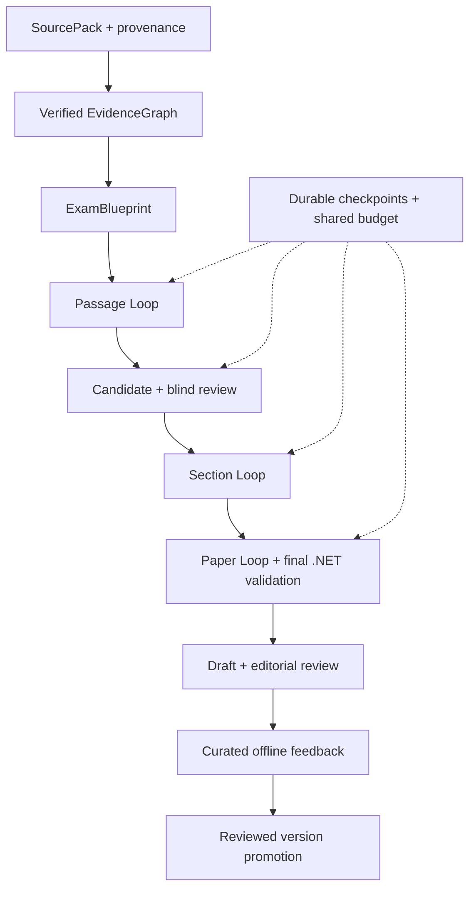

# Langfens — Generation Service Loop Engine V2

## Mục tiêu và trạng thái tài liệu

Bộ kế hoạch refactor đầy đủ từ pipeline 4 phase sang bounded artifact–evaluation–repair runtime. Giữ microservice topology, durable orchestration .NET, public HTTP/NDJSON contracts, source protections và Admin Draft/Publish. Kết quả cuối phải có source provenance, verified evidence, blueprint, versioned artifacts, targeted repair, blind/adversarial review, resume đến artifact, shared budgets và feedback dataset offline.

**Phiên bản plan:** 1.0 — 30/09/2026. **Trạng thái:** PLANNED. Chỉ tài liệu kiến trúc `exam-generation-architecture.md` được cung cấp; chưa có repository, test results hoặc deployment. Các path/model/table mới là thiết kế đề xuất, phải bind với code thực tế ở Phase 00. Không có phase implementation nào được tuyên bố đã đạt.

## Cách đọc và dùng

1. Đọc master plan, [validation matrix](01-validation-matrix.md) và [AI agent runbook](02-agent-runbook.md).
2. Thực hiện từng file dưới `phases/`; mỗi file có work packages, test IDs, gate, evidence và rollback.
3. Mọi gate dùng [JSON template](verification/phase-gate.template.json); báo cáo theo [template](03-final-acceptance-report-template.md).
4. Dùng [source traceability](04-source-traceability.md) để phân biệt behavior tài liệu cũ với đề xuất V2.
5. `LANGFENS-REFACTOR-FULL-PLAN.md` là bản ghép đầy đủ để đọc/tải một file; ZIP chứa bộ phase độc lập. File ghép được sinh từ các file nguồn, không sửa riêng rồi gây lệch phiên bản.

## Những quy tắc phải giữ

| Invariant | Behavior theo kiến trúc đầu vào | Nơi enforce V2 |
|---|---|---|
| Public API | `/sources`, `/source`, `/source/ingest`, `/section` dưới `/v1/autogen/reading-paper/` | API adapter + .NET consumer contract tests |
| Stream | `/section` hỗ trợ `application/x-ndjson` | Typed events + legacy projection |
| Source eligibility | Europe PMC CC-BY/CC0, tối thiểu 600 từ gốc | Ingestion/license policy, repo confirmation G00 |
| Universal ingestion | URL/HTML/Markdown/text, SSRF protection | Fetch security + content caps + provenance |
| Passage | 720–915 từ, 3 section profiles | Python/.NET shared policy fixtures |
| Section 1 | TFNG 7 + sentence completion 6 | Blueprint + section validators |
| Section 2 | MCQ single 6 + summary completion 7 | Blueprint + section validators |
| Section 3 | YNNG 7 + short answer 7 | Blueprint + section validators |
| Full paper | 40 câu liên tục, 2150–2750 từ, chống trùng | PaperLoop + ReadingPaperRules cuối |
| Answer/evidence | Exact passage answer, ≤3 từ/số cho completion/short answer, không leakage | Type-aware deterministic + semantic checks |
| Fidelity | Unsupported/contradicted, cause/certainty overstatement, unmeasured outcome fail-closed | Evidence/passsage evaluators, unresolved blocker prevents accept |
| Durability | Lease 3m, heartbeat 30s, loop claim 10s được mô tả | .NET worker; confirm timings G00, bổ sung fencing |
| Workflow | Checkpoint/resume, Retry, NeedsSources/replace source | Durable artifact store + workflow adapter |
| Publication | AI tạo Draft; Admin quyết định Publish | Final transaction + existing manual flow |

Các con số word counts/type distributions là policy Langfens hiện mô tả, không phải khẳng định toàn bộ quy chuẩn IELTS chính thức. Minimum source length không chứng minh source suitability. EvidenceQuote tồn tại không chứng minh entailment. Đối với NOT GIVEN, phải kiểm tra neither entailment nor contradiction; quote topical chỉ làm context pointer.

## Ranh giới trách nhiệm sau refactor

| Thành phần | Trách nhiệm và boundary |
|---|---|
| `exam-service` | Job/lease/heartbeat, writer fencing, authoritative artifact/run persistence, internal checkpoint API, final validator, Draft graph, manual CRUD |
| `generation-service` | Ingestion/evidence/blueprint, bounded loop execution, AI capabilities, evaluator/repair registry, provider gateway |
| `LoopController` | Typed decisions với scope, reason và budget; không tự sửa prompt/model |
| `ArtifactStoreClient` Python | Gọi authenticated .NET checkpoint API, chờ ack, replay idempotent; không ghi exam-db trực tiếp |
| PostgreSQL exam-db | Immutable payloads/history, CAS accepted heads, operations/budget journal, event outbox; một authoritative store |
| Admin Portal | Progress/workflow, editorial accept/edit/reject, manual publish, feedback reasons |
| Offline benchmark tooling | Curated dataset, frozen comparisons, reviewed promotion qua code/config version |

Internal checkpoint/paper-evaluate/repair/resume capabilities là additions cần thiết. “Giữ contract” nghĩa giữ public callers hoạt động; không nghĩa cấm mọi thay đổi .NET. Worker/DTO/DB cần additive integration để artifact resume thực sự có hiệu lực. Public API layer chỉ gọi facade.

## Flow và dependency graph



Mỗi edge dùng exact artifact ID/version/hash. Đổi source/passage/blueprint làm descendants stale theo closure. Scope repair nhỏ nhất phải đủ để khôi phục correctness; passage change không thể giữ question evaluations cũ chỉ vì numbering chưa đổi.

## Phase index và estimation

| Phase | Nội dung | Gate/phụ thuộc | Ngày công | File |
|---|---|---|---|---|
| 00 | Discovery, contract snapshots, baseline | G00 / none | 2–3 | [Phase 00](phases/phase-00-discovery-baseline.md) |
| 01 | Contracts, policy và ADR | G01 / G00 | 2–3 | [Phase 01](phases/phase-01-contracts-policies.md) |
| 02 | Durable artifacts, fencing, checkpoint | G02 / G01 | 4–6 | [Phase 02](phases/phase-02-durable-artifacts.md) |
| 03 | Provider/parsing/retry/budget | G03 / G01–02 | 2–3 | [Phase 03](phases/phase-03-provider-budget.md) |
| 04 | Ingestion + verified evidence | G04 / G00–03 | 3–5 | [Phase 04](phases/phase-04-ingestion-evidence.md) |
| 05 | Blueprint + suitability | G05 / G01,04 | 2–3 | [Phase 05](phases/phase-05-blueprint.md) |
| 06 | LoopRuntime + ledger | G06 / G02–05 | 3–4 | [Phase 06](phases/phase-06-loop-runtime.md) |
| 07 | Evaluator/repair registries | G07 / G01,04–06 | 3–5 | [Phase 07](phases/phase-07-evaluators-repairs.md) |
| 08 | Passage loop | G08 / G03–07 | 2–3 | [Phase 08](phases/phase-08-passage-loop.md) |
| 09 | Question candidates/groups | G09 / G05–08 | 3–4 | [Phase 09](phases/phase-09-question-candidates.md) |
| 10 | Blind solver/adversary | G10 / G07–09 | 2–3 | [Phase 10](phases/phase-10-blind-solvers.md) |
| 11 | Section loop | G11 / G06–10 | 2–3 | [Phase 11](phases/phase-11-section-loop.md) |
| 12 | Paper loop + worker/final Draft | G12 / G02,06,11 | 3–4 | [Phase 12](phases/phase-12-paper-worker.md) |
| 13 | API/events/observability/UI | G13 / G01–03,11–12 | 2–3 | [Phase 13](phases/phase-13-api-events-observability.md) |
| 14 | Human feedback/offline lifecycle | G14 / G02,07,12–13 | 2–3 | [Phase 14](phases/phase-14-human-feedback.md) |
| 15 | Cutover, chaos, deletion | G15 / G00–14 | 3–5 | [Phase 15](phases/phase-15-cutover-cleanup.md) |

Tổng **40–60 ngày công** theo bảng, chưa tính thời gian quan sát rollout và sự chậm trễ credential/dataset. Một người thực hiện tuần tự khoảng 8–12 tuần làm việc; đây là ước lượng planning cần cập nhật G00, không cam kết giao đúng ngày. “10 ngày” chỉ hợp với vertical slice, không đủ cơ sở hứa toàn bộ persistence/semantic quality/chaos/feedback/rollout.

Có thể quản lý như một chương trình refactor qua 4 sprint/milestones theo năng lực đội:

- **M1 — Foundation:** Phase 00–03, 10–15 ngày công; có contracts, DB checkpoint, provider/budget.
- **M2 — Grounded passage:** Phase 04–08, 13–20 ngày công; accepted evidence→blueprint→passage, bounded repair.
- **M3 — Complete paper:** Phase 09–12, 10–14 ngày công; candidate/blind review→section→paper→Draft.
- **M4 — Production readiness:** Phase 13–15, 7–11 ngày công; compatibility/feedback/rollout/legacy deletion.

Gates quản lý nghiệm thu và promotion. Có thể viết code độc lập cho phase sau khi một external check đang thiếu, nhưng không đánh dấu upstream PASS hay promote dependency chưa kiểm định. Không thực hiện production cutover với required `NOT_RUN_EXTERNAL`.

## Definition of Done chung cho mỗi phase

1. Tất cả work packages có path/symbol thật và commit liên quan; không để placeholder/TODO trong required path.
2. Tất cả deterministic tests và impacted integration/contract/security tests pass với exit code/test counts.
3. Required semantic/live checks có report trên pinned model/prompt/corpus; chưa chạy thì status đúng, không tick hoàn thành.
4. Checkpoint/resume, authority/cancel/budget invariants không regression; behavior changed có ADR và test.
5. Evidence bundle lưu commands, SHA, dependencies/config versions, fixtures hashes, results và limitations.
6. Phase gate tổng hợp đúng trạng thái; không override blocker bằng average score hoặc skip tests.
7. Rollback route/test rõ; docs và deletion inventory cập nhật.

## Folder architecture đề xuất

```text
generation-service/app/
  api/                   # thin HTTP + compatibility adapter
  contracts/             # single domain model definitions
  ingestion/             # security, license, normalize, SourcePack
  evidence/              # claims, verification, graph
  blueprint/             # planner, policies, suitability
  loop/                  # generic runtime/controller/ledger/budget
  loops/                 # domain compositions, no duplicate control loop
  generators/passage/    # capability + versioned prompts
  generators/question/   # candidates, group context, selector, prompts
  evaluators/            # deterministic + semantic + blind solvers
  repair/                # scoped strategies + planner/registry
  providers/             # only place with SDK/vendor logic
  persistence/           # .NET internal API client + resume resolver
  telemetry/             # typed events, tracing, metrics

exam-service/
  [actual paths from G00]/ # job/worker/DTO/internal checkpoints
  [migration path]/       # artifacts, operations, outbox, fencing

tests/
  unit/ contracts/ regression/ integration/ evaluation/ chaos/
docs/refactor/ docs/adr/ artifacts/refactor/
```

Một module có thể ít files hơn nếu code ngắn và cohesive; không tạo class/file rỗng chỉ để giống tree. `contracts/` là canonical; domain modules dùng/re-export, không định nghĩa model thứ hai. Prompt migration làm theo capability ở Phase 08–10; delete monolithic prompts sau parity G15.

## Budget và quality policy khởi điểm

Hard caps chốt trước benchmark: call count, attempts, artifact versions, output tokens, run/section tokens, wall-time, candidate pool/concurrency. Cost cap chỉ dùng khi pricing/usage accounting đủ tin cậy. Budget persisted từ Phase 02, provider gateway enforce Phase 03, runtime consume Phase 06.

Metric quality có hard invariants, annotated-corpus quality và operational performance riêng. Chi tiết ở validation matrix. Không dùng heuristic difficulty hoặc self-reported confidence để hứa band score. Không nói hệ thống hết hallucination chỉ vì audit pass.

## Xóa legacy và phạm vi kết thúc

Chỉ xóa paths thật đã chuyển responsibility: root legacy router/extractor/llm/prompts và obsolete function wrappers; tests chỉ ràng dead implementation; migration flag/branch/deps thừa. Giữ boundary adapter và compatibility reader còn cần cho external callers/old stored artifacts; không gọi chúng là dead code nếu còn behavior sống.

Rollback sau deletion bằng previous compatible release image + additive DB schema. In-flight engine pinned, legacy runs drain/migrate trước removal. Không auto-publish, không drop artifacts/feedback để rollback.

## Chênh lệch có chủ đích với plan trao đổi trước

- Checkpoint/operations/fencing lên Phase 02, trước runtime, thay vì tích hợp durability gần cuối.
- Evidence verification không chỉ kiểm tra span tồn tại; cần entailment, qualifier và coverage.
- Summary completion có group-level dependency; NOT GIVEN có absence semantics riêng.
- PaperLoop có .NET invocation và repair contract rõ; không chỉ tạo Python file rồi coi tích hợp xong.
- Telemetry và budget instrumentation bắt đầu sớm; Phase 13 hoàn thiện, không đợi tới cuối mới thu baseline.
- Human feedback thành phase riêng với export, curation, no-leakage và reviewed promotion.
- Ước lượng thay “10 ngày chắc chắn” bằng ngày công và milestone; gate evidence quyết định hoàn thành.
