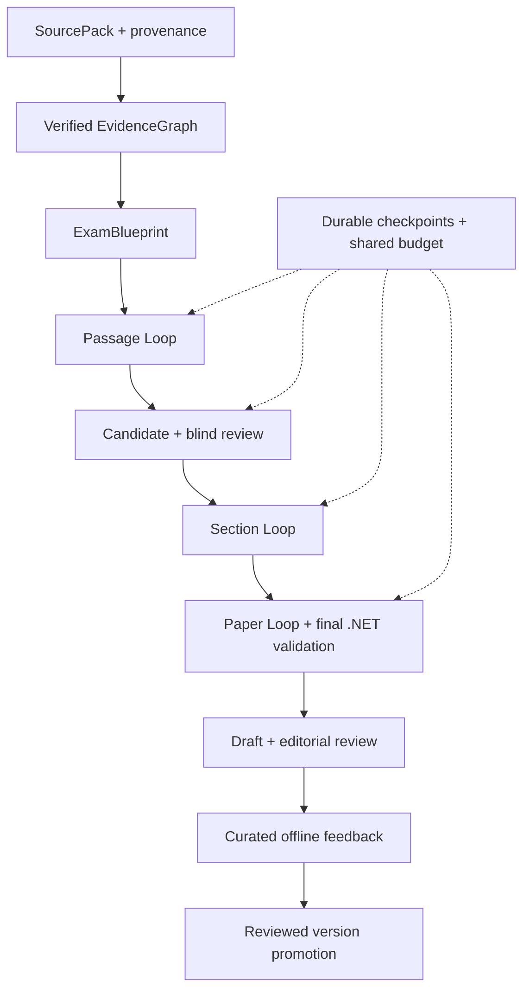

# Bộ plan refactor đầy đủ — Langfens Loop Engine V2

16 phase, work packages, test IDs, acceptance gates và release evidence. Trạng thái implementation: PLANNED, chưa có repository/test execution.


---

# Langfens — Generation Service Loop Engine V2

## Mục tiêu và trạng thái tài liệu

Bộ kế hoạch refactor đầy đủ từ pipeline 4 phase sang bounded artifact–evaluation–repair runtime. Giữ microservice topology, durable orchestration .NET, public HTTP/NDJSON contracts, source protections và Admin Draft/Publish. Kết quả cuối phải có source provenance, verified evidence, blueprint, versioned artifacts, targeted repair, blind/adversarial review, resume đến artifact, shared budgets và feedback dataset offline.

**Phiên bản plan:** 1.0 — 30/09/2026. **Trạng thái:** PLANNED. Chỉ tài liệu kiến trúc `exam-generation-architecture.md` được cung cấp; chưa có repository, test results hoặc deployment. Các path/model/table mới là thiết kế đề xuất, phải bind với code thực tế ở Phase 00. Không có phase implementation nào được tuyên bố đã đạt.

## Cách đọc và dùng

1. Đọc master plan, [validation matrix](01-validation-matrix.md) và [AI agent runbook](02-agent-runbook.md).
2. Thực hiện từng file dưới `phases/`; mỗi file có work packages, test IDs, gate, evidence và rollback.
3. Mọi gate dùng [JSON template](verification/phase-gate.template.json); báo cáo theo [template](03-final-acceptance-report-template.md).
4. Dùng [source traceability](04-source-traceability.md) để phân biệt behavior tài liệu cũ với đề xuất V2.
5. `LANGFENS-REFACTOR-FULL-PLAN.md` là bản ghép đầy đủ để đọc/tải một file; ZIP chứa bộ phase độc lập. File ghép được sinh từ các file nguồn, không sửa riêng rồi gây lệch phiên bản.

## Những quy tắc phải giữ

| Invariant | Behavior theo kiến trúc đầu vào | Nơi enforce V2 |
|---|---|---|
| Public API | `/sources`, `/source`, `/source/ingest`, `/section` dưới `/v1/autogen/reading-paper/` | API adapter + .NET consumer contract tests |
| Stream | `/section` hỗ trợ `application/x-ndjson` | Typed events + legacy projection |
| Source eligibility | Europe PMC CC-BY/CC0, tối thiểu 600 từ gốc | Ingestion/license policy, repo confirmation G00 |
| Universal ingestion | URL/HTML/Markdown/text, SSRF protection | Fetch security + content caps + provenance |
| Passage | 720–915 từ, 3 section profiles | Python/.NET shared policy fixtures |
| Section 1 | TFNG 7 + sentence completion 6 | Blueprint + section validators |
| Section 2 | MCQ single 6 + summary completion 7 | Blueprint + section validators |
| Section 3 | YNNG 7 + short answer 7 | Blueprint + section validators |
| Full paper | 40 câu liên tục, 2150–2750 từ, chống trùng | PaperLoop + ReadingPaperRules cuối |
| Answer/evidence | Exact passage answer, ≤3 từ/số cho completion/short answer, không leakage | Type-aware deterministic + semantic checks |
| Fidelity | Unsupported/contradicted, cause/certainty overstatement, unmeasured outcome fail-closed | Evidence/passsage evaluators, unresolved blocker prevents accept |
| Durability | Lease 3m, heartbeat 30s, loop claim 10s được mô tả | .NET worker; confirm timings G00, bổ sung fencing |
| Workflow | Checkpoint/resume, Retry, NeedsSources/replace source | Durable artifact store + workflow adapter |
| Publication | AI tạo Draft; Admin quyết định Publish | Final transaction + existing manual flow |

Các con số word counts/type distributions là policy Langfens hiện mô tả, không phải khẳng định toàn bộ quy chuẩn IELTS chính thức. Minimum source length không chứng minh source suitability. EvidenceQuote tồn tại không chứng minh entailment. Đối với NOT GIVEN, phải kiểm tra neither entailment nor contradiction; quote topical chỉ làm context pointer.

## Ranh giới trách nhiệm sau refactor

| Thành phần | Trách nhiệm và boundary |
|---|---|
| `exam-service` | Job/lease/heartbeat, writer fencing, authoritative artifact/run persistence, internal checkpoint API, final validator, Draft graph, manual CRUD |
| `generation-service` | Ingestion/evidence/blueprint, bounded loop execution, AI capabilities, evaluator/repair registry, provider gateway |
| `LoopController` | Typed decisions với scope, reason và budget; không tự sửa prompt/model |
| `ArtifactStoreClient` Python | Gọi authenticated .NET checkpoint API, chờ ack, replay idempotent; không ghi exam-db trực tiếp |
| PostgreSQL exam-db | Immutable payloads/history, CAS accepted heads, operations/budget journal, event outbox; một authoritative store |
| Admin Portal | Progress/workflow, editorial accept/edit/reject, manual publish, feedback reasons |
| Offline benchmark tooling | Curated dataset, frozen comparisons, reviewed promotion qua code/config version |

Internal checkpoint/paper-evaluate/repair/resume capabilities là additions cần thiết. “Giữ contract” nghĩa giữ public callers hoạt động; không nghĩa cấm mọi thay đổi .NET. Worker/DTO/DB cần additive integration để artifact resume thực sự có hiệu lực. Public API layer chỉ gọi facade.

## Flow và dependency graph



Mỗi edge dùng exact artifact ID/version/hash. Đổi source/passage/blueprint làm descendants stale theo closure. Scope repair nhỏ nhất phải đủ để khôi phục correctness; passage change không thể giữ question evaluations cũ chỉ vì numbering chưa đổi.

## Phase index và estimation

| Phase | Nội dung | Gate/phụ thuộc | Ngày công | File |
|---|---|---|---|---|
| 00 | Discovery, contract snapshots, baseline | G00 / none | 2–3 | [Phase 00](phases/phase-00-discovery-baseline.md) |
| 01 | Contracts, policy và ADR | G01 / G00 | 2–3 | [Phase 01](phases/phase-01-contracts-policies.md) |
| 02 | Durable artifacts, fencing, checkpoint | G02 / G01 | 4–6 | [Phase 02](phases/phase-02-durable-artifacts.md) |
| 03 | Provider/parsing/retry/budget | G03 / G01–02 | 2–3 | [Phase 03](phases/phase-03-provider-budget.md) |
| 04 | Ingestion + verified evidence | G04 / G00–03 | 3–5 | [Phase 04](phases/phase-04-ingestion-evidence.md) |
| 05 | Blueprint + suitability | G05 / G01,04 | 2–3 | [Phase 05](phases/phase-05-blueprint.md) |
| 06 | LoopRuntime + ledger | G06 / G02–05 | 3–4 | [Phase 06](phases/phase-06-loop-runtime.md) |
| 07 | Evaluator/repair registries | G07 / G01,04–06 | 3–5 | [Phase 07](phases/phase-07-evaluators-repairs.md) |
| 08 | Passage loop | G08 / G03–07 | 2–3 | [Phase 08](phases/phase-08-passage-loop.md) |
| 09 | Question candidates/groups | G09 / G05–08 | 3–4 | [Phase 09](phases/phase-09-question-candidates.md) |
| 10 | Blind solver/adversary | G10 / G07–09 | 2–3 | [Phase 10](phases/phase-10-blind-solvers.md) |
| 11 | Section loop | G11 / G06–10 | 2–3 | [Phase 11](phases/phase-11-section-loop.md) |
| 12 | Paper loop + worker/final Draft | G12 / G02,06,11 | 3–4 | [Phase 12](phases/phase-12-paper-worker.md) |
| 13 | API/events/observability/UI | G13 / G01–03,11–12 | 2–3 | [Phase 13](phases/phase-13-api-events-observability.md) |
| 14 | Human feedback/offline lifecycle | G14 / G02,07,12–13 | 2–3 | [Phase 14](phases/phase-14-human-feedback.md) |
| 15 | Cutover, chaos, deletion | G15 / G00–14 | 3–5 | [Phase 15](phases/phase-15-cutover-cleanup.md) |

Tổng **40–60 ngày công** theo bảng, chưa tính thời gian quan sát rollout và sự chậm trễ credential/dataset. Một người thực hiện tuần tự khoảng 8–12 tuần làm việc; đây là ước lượng planning cần cập nhật G00, không cam kết giao đúng ngày. “10 ngày” chỉ hợp với vertical slice, không đủ cơ sở hứa toàn bộ persistence/semantic quality/chaos/feedback/rollout.

Có thể quản lý như một chương trình refactor qua 4 sprint/milestones theo năng lực đội:

- **M1 — Foundation:** Phase 00–03, 10–15 ngày công; có contracts, DB checkpoint, provider/budget.
- **M2 — Grounded passage:** Phase 04–08, 13–20 ngày công; accepted evidence→blueprint→passage, bounded repair.
- **M3 — Complete paper:** Phase 09–12, 10–14 ngày công; candidate/blind review→section→paper→Draft.
- **M4 — Production readiness:** Phase 13–15, 7–11 ngày công; compatibility/feedback/rollout/legacy deletion.

Gates quản lý nghiệm thu và promotion. Có thể viết code độc lập cho phase sau khi một external check đang thiếu, nhưng không đánh dấu upstream PASS hay promote dependency chưa kiểm định. Không thực hiện production cutover với required `NOT_RUN_EXTERNAL`.

## Definition of Done chung cho mỗi phase

1. Tất cả work packages có path/symbol thật và commit liên quan; không để placeholder/TODO trong required path.
2. Tất cả deterministic tests và impacted integration/contract/security tests pass với exit code/test counts.
3. Required semantic/live checks có report trên pinned model/prompt/corpus; chưa chạy thì status đúng, không tick hoàn thành.
4. Checkpoint/resume, authority/cancel/budget invariants không regression; behavior changed có ADR và test.
5. Evidence bundle lưu commands, SHA, dependencies/config versions, fixtures hashes, results và limitations.
6. Phase gate tổng hợp đúng trạng thái; không override blocker bằng average score hoặc skip tests.
7. Rollback route/test rõ; docs và deletion inventory cập nhật.

## Folder architecture đề xuất

```text
generation-service/app/
  api/                   # thin HTTP + compatibility adapter
  contracts/             # single domain model definitions
  ingestion/             # security, license, normalize, SourcePack
  evidence/              # claims, verification, graph
  blueprint/             # planner, policies, suitability
  loop/                  # generic runtime/controller/ledger/budget
  loops/                 # domain compositions, no duplicate control loop
  generators/passage/    # capability + versioned prompts
  generators/question/   # candidates, group context, selector, prompts
  evaluators/            # deterministic + semantic + blind solvers
  repair/                # scoped strategies + planner/registry
  providers/             # only place with SDK/vendor logic
  persistence/           # .NET internal API client + resume resolver
  telemetry/             # typed events, tracing, metrics

exam-service/
  [actual paths from G00]/ # job/worker/DTO/internal checkpoints
  [migration path]/       # artifacts, operations, outbox, fencing

tests/
  unit/ contracts/ regression/ integration/ evaluation/ chaos/
docs/refactor/ docs/adr/ artifacts/refactor/
```

Một module có thể ít files hơn nếu code ngắn và cohesive; không tạo class/file rỗng chỉ để giống tree. `contracts/` là canonical; domain modules dùng/re-export, không định nghĩa model thứ hai. Prompt migration làm theo capability ở Phase 08–10; delete monolithic prompts sau parity G15.

## Budget và quality policy khởi điểm

Hard caps chốt trước benchmark: call count, attempts, artifact versions, output tokens, run/section tokens, wall-time, candidate pool/concurrency. Cost cap chỉ dùng khi pricing/usage accounting đủ tin cậy. Budget persisted từ Phase 02, provider gateway enforce Phase 03, runtime consume Phase 06.

Metric quality có hard invariants, annotated-corpus quality và operational performance riêng. Chi tiết ở validation matrix. Không dùng heuristic difficulty hoặc self-reported confidence để hứa band score. Không nói hệ thống hết hallucination chỉ vì audit pass.

## Xóa legacy và phạm vi kết thúc

Chỉ xóa paths thật đã chuyển responsibility: root legacy router/extractor/llm/prompts và obsolete function wrappers; tests chỉ ràng dead implementation; migration flag/branch/deps thừa. Giữ boundary adapter và compatibility reader còn cần cho external callers/old stored artifacts; không gọi chúng là dead code nếu còn behavior sống.

Rollback sau deletion bằng previous compatible release image + additive DB schema. In-flight engine pinned, legacy runs drain/migrate trước removal. Không auto-publish, không drop artifacts/feedback để rollback.

## Chênh lệch có chủ đích với plan trao đổi trước

- Checkpoint/operations/fencing lên Phase 02, trước runtime, thay vì tích hợp durability gần cuối.
- Evidence verification không chỉ kiểm tra span tồn tại; cần entailment, qualifier và coverage.
- Summary completion có group-level dependency; NOT GIVEN có absence semantics riêng.
- PaperLoop có .NET invocation và repair contract rõ; không chỉ tạo Python file rồi coi tích hợp xong.
- Telemetry và budget instrumentation bắt đầu sớm; Phase 13 hoàn thiện, không đợi tới cuối mới thu baseline.
- Human feedback thành phase riêng với export, curation, no-leakage và reviewed promotion.
- Ước lượng thay “10 ngày chắc chắn” bằng ngày công và milestone; gate evidence quyết định hoàn thành.


---

# Ma trận kiểm định và nghiệm thu

## 1. Trạng thái và cách ra quyết định

Đây là specification cho tests sẽ triển khai trong repository, không phải test report đã chạy. Trạng thái ban đầu toàn bộ gates là `PLANNED`; không có bằng chứng pass implementation.

| Status | Ý nghĩa | Có được promote release? |
|---|---|---|
| PLANNED | Có plan, chưa bắt đầu | Không |
| IN_PROGRESS | Đang triển khai/kiểm định | Không |
| NOT_RUN | Test chưa chạy | Không cho required checks |
| NOT_RUN_EXTERNAL | Thiếu credential/model/dataset/environment | Không cho required live checks |
| BLOCKED_INPUT | Chưa có repo/schema/input bắt buộc | Không |
| BLOCKED | Có failed test hoặc dependency chưa đạt | Không |
| PASS | Tất cả required tests/checks pass trên commit/config chỉ định | Có, nếu dependencies và rollout authorization cũng đạt |
| FAIL | Đã kiểm định và không đạt | Không |
| NOT_APPLICABLE | Không áp dụng, có rationale theo policy | Chỉ khi check được định nghĩa optional/not applicable |

Gate tổng hợp không lấy majority pass. Một required FAIL/ERROR/NOT_RUN chặn gate. Gate artifact quality khác job Completed: completed job chỉ sau PaperLoop, .NET final validation và final transaction.

## 2. Evidence bundle và runner contract

Mỗi phase dùng `artifacts/refactor/phase-NN/` với:

- `gate.json`: phase/gate ID, git SHA, status, dependencies, required test IDs, results, evidence paths và limitations.
- `commands.jsonl`: exact commands đã chạy, UTC time, working directory, exit code; không lưu secret.
- Test reports JUnit/TRX/JSON theo repo, tổng run/pass/fail/skip và duration; required tests skip phải bị chặn.
- Fixture/corpus/config hashes; schema/policy/prompt/evaluator/model/provider versions.
- Contract snapshot/diff, migration logs, fault/replay traces, metrics report tùy phase.
- Reviewer findings và ticket references cho scope còn thiếu.

G00 implement runner như `scripts/refactor/verify_phase.py --phase NN` hoặc target tương đương theo repository. Đây là command đề xuất cần xây, không tuyên bố đã tồn tại. Runner chọn đúng tests theo manifest, phát hiện zero-tests-collected, unexpected skip, non-zero exit và missing evidence; không tự động stamp PASS từ lệnh build thành công.

Các lệnh test chính xác (pytest/dotnet/frontend/lint/typecheck/migration) lấy từ repo inventory. Dùng existing scripts/lockfiles; không tự thêm Make/Poetry/npm version requirements ngoài task. Live evaluation chạy qua runner riêng với service credentials và capped budget, secret ở env manager.

## 3. Traceability của gate

| Gate | Phải chứng minh | Loại evidence chính |
|---|---|---|
| G00 | Baseline API/policy/workflow thật | Snapshots, recordings, source→symbol inventory |
| G01 | Schema/model/policy cross-language | JSON round-trips, ADR, boundary fixtures |
| G02 | Transaction, ack, fencing, durable resume | PostgreSQL integration fault tests, constraints |
| G03 | Provider parity, bounded retry/shared budget | Fake transport + live configured-model smoke |
| G04 | Source security/provenance/verified claims | Network security cases, offsets/entailment labels |
| G05 | Feasible blueprint và policy counts | Rejected/accepted source plans, Python/.NET parity |
| G06 | Terminating runtime và fresh dependencies | State coverage, kill/resume, no-progress tests |
| G07 | Evaluator quality + scoped repair | Held-out labels, confusion matrix, repair diffs |
| G08 | Approved grounded passage | Fidelity corpus, paired benchmarks, passage resume |
| G09 | Six-type candidates/group selection | Pools, hard filtering, constrained selection |
| G10 | Blind input và uniqueness checks | Serialized requests, disagreement/adversary labels |
| G11 | Section invariants/locality/resume | Snapshot refs, section fault E2E |
| G12 | Full paper và exactly-once DB final graph | Worker integration, .NET final tests, transaction crash |
| G13 | Compatibility/stream/privacy/UI | Consumer tests, backpressure, UI smoke, secret scan |
| G14 | Durable feedback/curation/offline comparison | Edit transaction, export/hash/split, promotion report |
| G15 | Release quality, deletion, canary và rollback | All gates + release manifests + canary + deletion inventory |

Detailed TNN-xx tests nằm trong từng phase. Evidence references không được trỏ file không có hoặc response có signed URLs/secrets.

## 4. Acceptance thresholds đề xuất

Các threshold này là starting release criteria. Chốt/phiên bản hóa ở G00–G01 trước tuning; thay đổi sau benchmark cần ADR với rationale, report cả old/new criteria. Không hạ threshold chỉ để biến lỗi thành pass.

| Nhóm | Tiêu chuẩn | Điều kiện measurement |
|---|---|---|
| Deterministic hard invariants | 100% required fixtures pass; zero accepted invalid graph | Đủ boundaries/types/error paths, không chỉ happy path |
| Public API parity | 100% required contract cases pass | Consumer thực .NET, schema + NDJSON + statuses |
| Security | 100% deny fixtures blocked, zero unauthorized checkpoint writes/secret leaks | SSRF includes real redirect/rebinding transport path |
| Durability | Zero lost committed checkpoints; zero stale-epoch commits; zero duplicate final exams | Kill/fault tại mỗi transaction boundary trên PostgreSQL |
| Budget | Zero admissions vượt reserved parent hard caps; counters survive restart | Parallel requests + unknown provider outcome |
| Fidelity must-reject set | 100% critical known canaries rejected, tối thiểu 10 canary cases | Cases gồm invented quantities, causality, certainty, unmeasured outcomes |
| Semantic blocking recall | ≥95% tổng hợp trên labeled invalid items; từng type không dưới 90% | Held-out corpus, denominators và per-type report |
| Ambiguity detection | ≥90% recall trên ambiguous labeled subset | Labels curated, số cases và confidence intervals ghi rõ |
| False rejection | ≤10% valid labeled items bị blocking reject | Corpus ≥60 valid questions, 6 types |
| Full-paper invariants | 100% final accepted papers đạt counts/types/word ranges/fresh evaluations | Áp dụng bất kể overall success rate |
| Comparative valid-Draft rate | V2 không thấp hơn legacy trong paired sample; mọi failures có reason | ≥18 paired papers/engine, ≥6 source triples, các triples khác nhau |
| Comparative fidelity/ambiguity | V2 không kém legacy theo annotated report; must-reject set vẫn 100% | Blind editorial rubric, labels không dùng cho tuning |
| Latency | V2 P95 ≤1.5× legacy P95 và ≤configured hard run deadline | Cùng env/providers/corpus; initial cap proposed, chốt trước release |
| Cost/tokens | Median V2 billed/estimated token cost ≤2× legacy và mọi run trong cap | Usage unknown báo riêng, không coi estimate là billed actual |
| Manual workflow | 100% required CRUD/Draft/Publish/Retry/NeedsSources cases pass | E2E admin/gateway/backend |

Paired sample ≥18 là regression evidence khởi đầu, không statistical proof of superiority. P95 với sample nhỏ phải ghi sample size và raw distribution; production telemetry cập nhật sau rollout. Confidence intervals/repeated runs cần cho model nondeterminism; chạy critical semantic fixtures ít nhất 3 lần trên pinned configs, báo worst-run cùng aggregate. Các ratio performance/cost áp dụng ở G15; fidelity canaries không được trade off để tiết kiệm tokens.

Nếu legacy success rate 0 ở một fixture set, không dùng ratio để tuyên bố tốt hơn; report counts và evaluator rubric. Benchmark có invalid inputs tách khỏi eligible-source success-rate denominator.

## 5. Dataset yêu cầu

| Dataset | Minimum khởi điểm | Nội dung và split |
|---|---|---|
| Ingestion/security | ≥20 cases | Formats, license, 599/600/601, SSRF, redirects, caps, injection |
| Fidelity | ≥40 cases | Đúng/sai theo 5 issue families; ≥10 critical canaries subset |
| Question | ≥120 items | Mỗi type ≥10 valid +≥10 invalid; ambiguity/leakage/word limits/distractors/NG |
| Section graph | ≥12 cases | Good/bad counts/types/coverage/groups/stale refs |
| Paper graph | ≥12 cases | Good/bad numbering/word count/duplication/leakage |
| Paired end-to-end | ≥18 papers/engine | ≥6 distinct source triples, chia cân bằng topic/profile, seeds/settings frozen |
| Chaos | Toàn matrix bên dưới | Deterministic fake provider + real DB/process failures |

Split theo source family/hash; no overlap giữa dev và final holdout. Đầu vào, output, labels có license/provenance. Annotation lý do cụ thể theo question type, two-reviewer disagreement resolution cho ambiguous/critical labels khi có reviewers; nếu chỉ một reviewer phải nêu limitation, không ghi fabricated independent review.

## 6. Chaos và recovery matrix

| Fault | Checkpoint expectation | Forbidden outcome |
|---|---|---|
| Provider 429/retry-after | Intent/budget đã lưu; bounded delay/defer | Retry forever hoặc reset cap |
| Timeout sau cloud xử lý | UNKNOWN_OUTCOME giữ reservation | Claim chưa tốn tokens hoặc free duplicate call |
| Truncated/invalid JSON | Typed invalid output record | Accept partial/schema-invalid artifact |
| Evaluator exception | ERROR + bounded retry/escalate | Không issue = PASS |
| Crash trước artifact commit | Không advance head | Head trỏ thiếu payload |
| Crash sau commit trước ack | Replay cùng operation result | Duplicate version/reservation |
| Crash sau passage accepted | Resume questions | Re-generate passage không lý do |
| Crash tại Q17 | Reuse valid accepted previous Qs | Restart section/Q1 mặc định |
| Lease takeover | Epoch cũ mất write authority | Late provider result accepted bởi stale writer |
| Cancel giữa repair | Cancelled run vẫn terminal | Late completion ghi Completed |
| Stream drop/duplicate/reorder | Status/replay reconcile | Frontend/client nhầm incomplete thành completed |
| DB unavailable/outbox retry | Authoritative transaction/replay | Final graph half-written hoặc duplicate exam |
| Source replacement | Invalidate exact dependency closure | Reuse stale evidence/questions |
| Deployment version change | In-flight engine/config pinned | Old eval reused với new prompt/model version |

## 7. Repair locality và invalidation rubric

Mọi repair test lưu before/after `{artifactId,version,hash}` và dependency closure. Unrelated accepted artifacts giữ nguyên; impacted children stale tới khi rerun đủ evaluations. Summary text/blank sửa có thể invalidate group; passage sửa có thể invalidate cả section. Locality không có nghĩa giữ nguyên refs đã sai để tiết kiệm chi phí.

Cache key gồm exact payload/dependencies + schema/policy/evaluator/prompt/model config versions. Cache chỉ artifact evaluation, không quyền writer/lease/cancel state. Reuse output không bỏ qua authority check lúc commit.

## 8. Release-blocking conditions

- Accepted unsupported/contradicted/cause-overstated/uncertain-overstated/unmeasured outcome trên must-reject set.
- Schema/API break, invalid final exam, auto-publish hoặc stale dependency accepted.
- Lost checkpoint, duplicate final exam, stale writer commit, budget reset hoặc unauthorized store access.
- Required semantic/live/chaos checks NOT_RUN; missing artifact lineage; secret/thinking exposure.
- Legacy deletion khi callers/in-flight runs chưa migrate/drain; rollback chưa chứng minh tương thích schema.

Known cosmetic warnings có thể vào backlog nếu không tác động invariants; phải ghi owner/ticket và rationale. Không áp dụng ngoại lệ cho required quality/security/durability blockers.


---

# Hướng dẫn thực thi cho AI coding agent

## 1. Operating rules

Làm trong repository thật, đọc AGENTS.md và existing conventions trước. Dùng master plan và file phase làm source of truth. Tài liệu kiến trúc đầu vào mô tả hệ thống; code khảo sát G00 quyết định schema/path thực tế. Không giả định file, endpoint, test script hoặc database column đã tồn tại.

Không bắt đầu bằng xóa legacy. Tạo new capabilities → regression/quality/contract evidence → staged migration → cutover → delete. Không nâng framework/SDK/model ngoài scope nếu chưa có compatibility reason. Tận dụng workers/lease/database có sẵn.

Mỗi phase phải thực hiện code thật, meaningful tests và reports; không kết thúc chỉ ở skeleton/TODO, và không stamp PASS cho lệnh chưa chạy. Missing credential/input được báo cụ thể; tiếp tục independent coding có thể làm, nhưng không promote required dependency chưa đạt.

## 2. Prompt khởi động đầy đủ

> Bạn đang refactor Langfens Generation Service sang Loop Engine V2. Đọc `00-master-plan.md`, `01-validation-matrix.md`, `04-source-traceability.md`, toàn bộ AGENTS.md áp dụng và `phases/phase-00-discovery-baseline.md`. Bắt đầu Phase 00; khảo sát repository, bind paths/schemas/symbols, dựng regression baseline và gate evidence. Giữ public API, NDJSON consumer, section policies, source protections, .NET durable worker, Draft/Publish và manual CRUD. Chưa xóa legacy. Hoàn thành từng work package và T00 tests có thể chạy, ghi command/exit code/SHA/fixtures hashes. Nếu repo khác tài liệu, ghi observed/documented/proposed, giải quyết invariant bằng ADR thay vì bịa. Chỉ G00 PASS khi có test evidence đầy đủ; thiếu repo thì BLOCKED_INPUT. Sau đó tiếp tục phase tiếp theo theo dependencies và scope đã được ủy quyền. Không gọi cloud nếu chưa có configured credential/allowed budget. Không báo pass khi tests bị skip hay evaluator lỗi. Bàn giao phase report có changed files, checks, limitations, rollback và exact next actions.

Đây là prompt thực thi khi người dùng có repo, không phải claim repo đã được khảo sát trong bộ tài liệu này.

## 3. Template prompt cho phase N

> Thực hiện Phase NN theo `phases/phase-NN-...md` tại release branch/worktree đang dùng. Đọc predecessor gate.json, kiểm tra commit/config/corpus version còn hợp lệ. Liệt kê impacted symbols và caller contracts trước chỉnh sửa. Hoàn thành tất cả work packages; dùng canonical contracts, durable artifact client, provider gateway và generic LoopRuntime. Không thêm orchestration/retry loop thứ hai. Viết tests TNN-xx có assertion về outcome/invariants, chạy required checks và impacted regressions. Lưu evidence thật vào `artifacts/refactor/phase-NN/`; cập nhật deletion inventory/ADR. Gate PASS chỉ khi required tests đầy đủ và dependencies đạt. Nếu external checks thiếu, ghi NOT_RUN_EXTERNAL và tiếp tục việc độc lập, không giả kết quả. Không xóa implementation cũ trước G15. Cuối phase báo behavior changed, files, validation, remaining blockers và next phase.

## 4. Chu trình mỗi phase

1. **Preflight:** SHA/worktree sạch hoặc biết rõ changes của user; read instructions; predecessor gates và config/schema compatibility.
2. **Bind plan:** PNN task→actual path/symbol; TNN test→actual test name/command; cập nhật inventory nếu path khác.
3. **Implement:** changes cohesive, exact version refs, scoped repair, authenticated/fenced checkpoints và atomic budget grants.
4. **Verify:** run meaningful unit/contract/integration/quality/fault checks theo manifest; không thêm tests chỉ mirror implementation.
5. **Record:** commands/exit codes/reports/hashes; explain skipped tests; no secrets/raw reasoning.
6. **Gate:** tổng hợp đúng PASS/BLOCKED/NOT_RUN_EXTERNAL; kiểm tra resume/rollback; handoff.

## 5. Kiểm định trước review

- DTO cross-language dùng cùng schema và type semantics; no missing null/Unicode/date handling.
- Every provider call có operation reservation và deadline; mọi accept có exact dependencies/required evaluations.
- Evaluator ERROR và unsupported claim fail-closed; NG absence semantics được xử lý riêng.
- Passage/group sửa làm impacted questions stale; unrelated accepted refs không thay.
- Stream completion dựa durable event/job, không dựa EOF hoặc progress message.
- Cloud call unknown outcome không bị gọi exactly-once; DB final graph idempotency được test thật.
- In-flight run pin versions; cache keys đủ configs; source license/provenance/SSRF không bị mất khi migration.
- Legacy deletion exact paths có caller/behavior/drain evidence; boundary compatibility adapter còn cần thì giữ.

## 6. Khi có vấn đề

Fixture sai → sửa annotation/fixture với rationale, không sửa validator để ăn gian. Code sai → fix rồi rerun impacted tests. Live model quality thấp → giữ gate blocked, benchmark candidate offline, không đổi prompt production tự động. Chưa có permission deployment theo repo → hoàn tất reviewable code/reports rồi làm release approval ở đúng bước. Không cần approval riêng để viết plan hoặc thực hiện read-only/reversible work trong scope đã cho.


---

# Source traceability và assumptions register

## 1. Nguồn đầu vào

`exam-generation-architecture.md`, bản đính kèm ngày 30/09/2026. SHA-256: `f3544ab04c628750edabe38ffccb900d6b4f6156a0c488418b7a9ce731a61297`.

Tài liệu mô tả architecture; chưa kiểm chứng bằng repo. Plan sử dụng các business constraints, services và workflows được mô tả; không coi các câu “100% không hallucination” hay 3–5 phút là số liệu quality/SLA đã xác minh.

## 2. Mapping behavior → phase/test

| Ref | Mục trong nguồn | Behavior dùng làm baseline | Coverage V2 |
|---|---|---|---|
| SRC-01 | 1. Tổng quan | Next.js → YARP → .NET worker/PostgreSQL → Python | G00 inventory, G12 worker, G13 UI/API |
| SRC-02 | 2.1 router.py | 4 public routes, `/section` NDJSON | T00-01/02, T13-01/02 |
| SRC-03 | 2.1 extractor.py | Europe PMC CC-BY/CC0, min 600, universal ingestion/SSRF/excerpt | T04-01/02/06/08 |
| SRC-04 | 2.1 llm.py | MiniMax/Groq, thinking cleanup, JSON parsing, 429 retry | T03-01…08; new policies thay fixed 65s |
| SRC-05 | 2.2 phase 1 | 720–915 words, section styles, bounded extension | T08-01/04, blueprint policies |
| SRC-06 | 2.2 phase 2 | 5 fidelity issue types, revision fail-closed | T04-04/05, T07-07, T08-02/05 |
| SRC-07 | 2.2 phase 3 | 13/13/14, 6 types, exact answer/evidence, ≤3 words/numbers | T01-05/06, T05-01, T09-01/02/04 |
| SRC-08 | 2.2 phase 4 | Blind review + surgical replacement | T10-01…08, T11-02/04 |
| SRC-09 | 3. Flow 1 | Lease/heartbeat, checkpoint SectionsJson, Retry, NeedsSources | T02-03…06, T11-05/06, T12-05 |
| SRC-10 | 3. Flow 1 final | Overall 2150–2750, 40 questions, shingle/graph validation | T12-01…04/06/07 |
| SRC-11 | 3. Flow 1 Draft | Admin final editorial approval | T12-08, T15-04 |
| SRC-12 | 3. Flow 2 | Manual CRUD/media/Draft/Publish | T00-05, T13-08, T14-04, T15-08 |

## 3. Đề xuất mới cần ADR/repo validation

| Assumption/decision | Trạng thái | Chốt ở đâu |
|---|---|---|
| Exact paths/DTO/errors/stream schema | Chưa có repo | G00 |
| Pipeline behavior docs vs actual code | Có thể khác | G00 inventory và approved ADR |
| Canonical domain schema, NG exception, severity | Proposed | G01 |
| .NET owns durable artifacts qua checkpoint API | Proposed architectural default | G01 ADR, G02 DB/auth integration |
| Fencing epoch/CAS/outbox/operation reservation | Proposed reliability requirement | G02 |
| Unknown LLM outcome accounting | Proposed, provider capability dependent | G02–G03 |
| Active provider models/SDK/credential scope | Chưa xác minh; tên model cũ không pin V2 | G03 live smoke |
| Universal-source licensing rights workflow | Baseline chưa mô tả đầy đủ | G00, G04 |
| Stable offset code-point convention | Proposed cross-language contract | G01, G04 |
| Evidence extraction/entailment adequacy | New capability; quality unknown | G04, G07 benchmark |
| Heuristic difficulty/concentration/similarity limits | Chưa calibrated/chốt numeric values | G00–G01 policy, G05/G07 reports |
| Candidate pool/default attempt caps | Proposed, budget dependent | G03, G06, G09 |
| Paper evaluation/repair internal capability | New, cần .NET integration | G12 |
| Feedback tables/curation/export workflow | New | G14 |
| Quality/latency/cost thresholds, canary sample/window | Proposed release criteria | Freeze G00–G01, measure G15 |
| Legacy deletion exact paths/callers/in-flight runs | Chưa biết | G00 inventory, G15 evidence |

## 4. Các điểm không được suy đoán

Không tạo current-version IDs/schema names giả; không báo provider billing/model availability đã xác minh; không tự cho URL/text unknown-license là approved; không nói NG có positive evidence giống TRUE/FALSE; không suy ra same-model review là độc lập thống kê.

Không biến confidence score thành IELTS band/difficulty probability. Không hiểu artifact ack/replay là cloud LLM calls exactly-once. Không coi semantic audit là mathematical guarantee không hallucination. Không report phase PASS hoặc old files đã xóa khi chỉ có plan.

## 5. Scope exclusions

Không rewrite toàn exam-service/gateway/admin portal; không đổi Listening/Writing/Speaking generation; không tự huấn luyện/fine-tune model; không tự deploy candidate prompt từ production feedback. Manual exam flow được giữ và regression test; feedback capture chỉ additive.

Repo discovery có thể phát hiện thiếu protections/bugs so với tài liệu. Các điểm đó cần ticket và scope decision rõ ràng; không bỏ invariant để giữ một bug vì gọi là parity.


---

# Phase 00 — Khảo sát repository và đóng băng baseline

**Phụ thuộc:** Không. **Đầu ra gate:** G00. **Ước lượng:** 2–3 ngày công.

## 1. Mục tiêu và giới hạn

Xác nhận implementation thực tế trước khi thay đổi. Tài liệu kiến trúc là đầu vào thiết kế, chưa phải bằng chứng code hiện tại. Phase này chỉ tạo inventory, fixtures, tests và baseline; chưa xóa legacy hay đổi behavior production.

## 2. Đầu vào bắt buộc

- Repository và commit SHA; đường dẫn thực của Python service, .NET service, frontend, gateway và Compose/CI.
- Dependency manifests/lockfiles, cấu hình không chứa secret, migration history, cách chạy test hiện có.
- Một dataset có quyền sử dụng, kết quả tạo đề trước đây nếu có. Không dùng dữ liệu cá nhân thật trong fixtures.

## 3. Work packages

| ID | Việc cần làm | Deliverable cụ thể |
|---|---|---|
| P00-01 | Đọc AGENTS.md và quy ước repo; ghi SHA, runtime, commands | `docs/refactor/repo-inventory.md` |
| P00-02 | Lần theo bốn route Python, DTO .NET, worker, final validator, admin CRUD | Bản đồ caller → symbol → path thực tế |
| P00-03 | Liệt kê import, entrypoint, startup registration và tests tham chiếu legacy | `legacy-symbol-map.csv`, có replacement dự kiến |
| P00-04 | Chụp request/response, status, lỗi, NDJSON, terminal event, media type | `contracts/legacy/` schemas và recordings |
| P00-05 | Ghi business policies và cách đếm từ/số, answer normalization, duplication | `policy-baseline.json` có nguồn code và phiên bản |
| P00-06 | Ghi lease claim/renew/retry, NeedsSources, cancellation, final persistence | State-transition table và invariant tests |
| P00-07 | Xây fixtures tốt/xấu, provider fake, test replay network stream | Regression suite chạy không cần cloud |
| P00-08 | Benchmark legacy trên corpus cố định; gắn token/latency thật nếu có | `baseline.jsonl`, metrics summary, missing-data notes |

Corpus khởi đầu: ≥6 nguồn phù hợp bao phủ 3 section profiles; ≥6 nguồn không phù hợp; các cặp lỗi nguồn, causality, certainty, unmeasured outcome; 6 loại câu hỏi, mỗi loại ≥5 mẫu đúng và ≥5 mẫu sai. Một fixture có thể phục vụ nhiều test nhưng phải có nhãn riêng. Thêm Unicode, HTML tables, XML, văn bản dài, redirect, source bị thay nội dung, JSON lỗi và stream bị cắt.

Không ghi `0 tokens` khi provider không trả usage: lưu `unknown`. Thời gian 3–5 phút trong tài liệu cũ là mô tả, chưa được coi là SLA đã đo.

## 4. Kiểm định G00

| Test ID | Cách kiểm định | Kết quả bắt buộc |
|---|---|---|
| T00-01 | Replay request mẫu cho 4 endpoint | Tên field, nullability, status và content type được ghi chính xác |
| T00-02 | Parse NDJSON chia chunk ở giữa ký tự UTF-8 và giữa JSON | .NET client dựng được event đúng; EOF thiếu terminal được nhận diện |
| T00-03 | Replay source và policy boundary fixtures | Đạt/sai khớp behavior đã đóng băng; khác biệt tài liệu được ghi |
| T00-04 | Fake worker crash sau section 2 rồi Retry | Section 1–2 giữ nguyên checkpoint, chỉ section 3 chạy tiếp |
| T00-05 | Chạy manual CRUD Draft → sửa → Publish | Tạo/sửa/xuất bản thủ công không bị baseline tooling ảnh hưởng |
| T00-06 | Chạy regression suite hai lần với provider fake | Kết quả xác định; không gọi provider thật |

**Gate PASS:** toàn bộ T00 pass; inventory và schema không còn field quan trọng chưa rõ; các bug sẵn có được ghi thành ticket, không âm thầm coi là behavior đúng. Chưa có repo thì trạng thái `BLOCKED_INPUT`, không bịa schema và không đánh dấu phase hoàn thành.

## 5. Evidence phải lưu

`artifacts/refactor/phase-00/`: SHA, lệnh chạy thật, exit code, test report, recordings đã loại secret, policy snapshot, baseline dataset hash, reviewer notes. Phân biệt `observed`, `documented`, `proposed` trong inventory.

## 6. Rollback và bàn giao

Không có data migration. Baseline không đạt thì sửa harness hoặc phân loại bug trước khi tiếp tục. Phase 01 chỉ bắt đầu khi G00 pass; lỗi bảo mật sẵn có không được sao chép vào V2 chỉ để đạt parity.


---

# Phase 01 — Domain contracts, policies và quyết định kiến trúc

**Phụ thuộc:** G00. **Đầu ra gate:** G01. **Ước lượng:** 2–3 ngày công.

## 1. Mục tiêu

Thiết lập model dùng chung, invariants và ownership. Mọi prompt chỉ hướng dẫn; Python và .NET policies mới là nơi enforce cấu trúc đề. Không xây provider hay generation trong contracts.

## 2. Deliverables

`app/contracts/{artifact,source,evidence,blueprint,evaluation,issue,loop,generation,event}.py`; policy fixtures; JSON Schema versioned; corresponding .NET DTOs hoặc codegen theo convention repo. `docs/adr/` ghi các quyết định dưới đây, có test chứng minh.

## 3. Work packages

1. **P01-01 — Artifact envelope:** `artifactId`, `artifactType`, `version`, `runId`, `sectionId`, `schemaVersion`, `contentHash`, `createdAt`, `producerVersion`, payload và exact parent refs `{id,version,hash}`. Các version bất biến; không dùng parent ID thiếu version.
2. **P01-02 — Run identity:** run/job ID liên kết ổn định; section slot và source revision riêng. SourcePack ID và content hash tách biệt URL. Attempt/operation ID khác artifact version. Không tái sử dụng ID cho nội dung khác.
3. **P01-03 — Evaluation:** evaluator ID/version, exact target ref, `PASS|FAIL|ERROR|NOT_APPLICABLE`, issues, score tùy chọn, input dependency refs, provider/model/prompt version, elapsed/usage. Exception không được biến thành PASS.
4. **P01-04 — Issue ledger:** code, severity, scope, affected refs, evidence, proposed repair capability; trạng thái open/resolved/superseded, fingerprint chống tạo lại cùng lỗi. Giữ lịch sử qua các version.
5. **P01-05 — Issue codes:** gồm unsupported/contradicted claim, causal overstatement, overstated certainty, unmeasured outcome, source insufficient, evidence missing, ambiguous answer, answer leakage, bad distractor, word limit, duplicate, evaluator unavailable, stale dependency, budget exhausted.
6. **P01-06 — Policies:** cấu trúc 13/13/14, numbering 1–40, 6 types, passage 720–915 từ, paper 2150–2750 từ theo tài liệu; cách tính chính xác phải khớp baseline. Đây là policy Langfens, không gọi là mọi quy định chính thức IELTS.
7. **P01-07 — Question-specific schema:** đáp án và options theo type; completion/short answer dùng đáp án xuất hiện trong passage và ≤3 từ/số theo baseline; NOT GIVEN không bắt buộc có câu trích dẫn “chứng minh sự vắng mặt”. Thiết kế absence assessment và topical context span riêng.
8. **P01-08 — Decisions:** PASS/REPAIR/REGENERATE/ESCALATE/FAIL có reason, target scope, budget reservation và expected version. Enum/state machine có transition validation.
9. **P01-09 — Ownership ADR:** .NET giữ job/lease và exam-db; Python không ghi trực tiếp DB do .NET sở hữu. Chọn internal checkpoint API có service auth, fencing và ack. Xem Phase 02; không tồn tại hai authoritative stores.
10. **P01-10 — Dependency invalidation ADR:** source → evidence → blueprint → passage → question/group → section → paper. Chỉ artifact với exact dependencies còn hợp lệ được reuse.
11. **P01-11 — Budget/event ADR:** persisted operation grants trước side effect; event at-least-once, idempotent consumers, không tuyên bố LLM call exactly-once.

## 4. Kiểm định G01

| Test ID | Cách kiểm định | Kết quả bắt buộc |
|---|---|---|
| T01-01 | Round-trip fixtures Python ↔ JSON ↔ .NET | Không mất enum, null, Unicode, UTC timestamp, version hoặc hash |
| T01-02 | Deserialize sai type/count/unknown field theo schema policy | Bị từ chối hoặc xử lý đúng documented compatibility policy |
| T01-03 | Đổi một ký tự payload/parent version | Hash/ref thay đổi; artifact không còn được coi là cùng version |
| T01-04 | Lỗi evaluator và issue critical | Không có đường quyết định PASS |
| T01-05 | Valid NOT GIVEN và completion fixtures | NG không bị reject chỉ vì thiếu positive evidence; completion vẫn cần exact answer span |
| T01-06 | Fixture section và paper boundaries | Cấu trúc/count/range được enforce bằng code, không dựa prompt |

**Gate PASS:** T01 pass; schema và policy có version; ADR store/ack/invalidation/budget có owner và phương án chốt; không còn một model trùng định nghĩa ở `contracts`, `artifacts`, `blueprint/models` mà khác nhau. Nếu cần re-export phải dùng cùng type.

## 5. Evidence, rollback, bàn giao

Lưu schemas, cross-language fixtures, diff contract và ADR vào `artifacts/refactor/phase-01/`. Chưa thay public routing. Rollback bằng revert contracts chưa sử dụng. Phase 02 nhận exact envelope và writer authority model đã chốt.


---

# Phase 02 — Artifact persistence, fencing và checkpoint/resume

**Phụ thuộc:** G01. **Đầu ra gate:** G02. **Ước lượng:** 4–6 ngày công.

## 1. Mục tiêu

Xây nền durable trước Loop Runtime. Giữ ReadingPaperWorker .NET, lease và heartbeat; thêm artifact checkpoints có ack và chống stale writer. Không coi log NDJSON đã gửi là checkpoint đã lưu.

## 2. Data model và ownership

Đề xuất tables dưới exam-service: `GenerationRuns`, `GenerationArtifacts`, `GenerationArtifactDependencies`, `GenerationEvaluations`, `GenerationIssues`, `GenerationDecisions`, `GenerationOperations`, `GenerationEventOutbox`. Tên thực tế theo repo. Artifact payload bất biến; accepted head là con trỏ cập nhật bằng compare-and-swap (CAS).

Unique keys tối thiểu: `(runId,artifactId,version)`, `(runId,operationId)`, `(runId,eventId)`; constraint đánh giá trỏ exact artifact ref. Run mang `leaseEpoch`, `cancelVersion`, engine/schema/policy version và source revisions. Operation chứa request hash, trạng thái, token/cost reservation, result ref và usage reconciliation.

## 3. Work packages

| ID | Việc cần làm | Hành vi bắt buộc |
|---|---|---|
| P02-01 | EF migration theo expand-first; backfill run cho job cũ | Không xóa SectionsJson, không sửa completed exam |
| P02-02 | Claim job tăng lease epoch; renew phải khớp owner/epoch | Worker cũ sau takeover mất quyền ghi |
| P02-03 | Internal checkpoint API với service authentication | Validate run, epoch, expiry, cancelVersion, request hash; không tin header tự khai |
| P02-04 | Durable operation grant trước provider call | Ghi intent + reservation, trả operationId; duplicate request không reserve lần hai |
| P02-05 | Commit payload/evaluation/decision + accepted head + outbox trong transaction | Không có half-accepted artifact hoặc head trỏ payload thiếu |
| P02-06 | Trả checkpoint ack; Python chỉ advance sau ack | ACK lost → resend operationId; lấy committed result, không tạo version mới |
| P02-07 | Resume API và dependency resolver | Reuse accepted exact refs; kiểm tra hash và producer/schema compatibility |
| P02-08 | Source replacement invalidates descendants của section bị ảnh hưởng | Section nguồn khác giữ nguyên; paper aggregate trở thành stale |
| P02-09 | Final BuildExam idempotent theo run/job | Crash sau commit không tạo exam thứ hai |
| P02-10 | Retention, index, payload size, log redaction | Có migration rollback và giới hạn dung lượng định lượng |

Internal routes là capability mới, path/DTO chốt qua ADR ở Phase 01; không bịa là endpoint đang có. Python chỉ dùng persistence client. NDJSON tiếp tục là transport progress/output; checkpoint authoritative được ack qua API. .NET client và worker phải truyền writer grant cho V2. Existing public callers vẫn dùng contract adapter.

Operation `started` chưa có kết quả sau crash không chứng minh provider chưa xử lý. Nếu provider không hỗ trợ idempotency, đánh dấu `UNKNOWN_OUTCOME`, giữ reservation, thực hiện bounded retry dưới operation mới theo policy và hạch toán chi phí có thể trùng. Không mô tả guarantee exactly-once cloud inference.

## 4. Kiểm định G02

| Test ID | Fault injection | Kết quả bắt buộc |
|---|---|---|
| T02-01 | Hai writer gửi cùng operationId đồng thời | Một committed result, một reservation, cùng response replay |
| T02-02 | Cùng ID nhưng request hash khác | Conflict; payload cũ không bị thay |
| T02-03 | Crash trước commit, sau commit, trước ack | Trước commit không advance; sau commit resume đúng result |
| T02-04 | Lease hết hạn rồi worker khác takeover | Mọi write của epoch cũ bị reject, kể cả call đang chạy |
| T02-05 | Cancel lúc provider chưa trả | Result muộn không được accepted/publish; run không sống lại |
| T02-06 | Source section 2 bị thay | Chỉ dependency closure section 2 và paper bị invalidated |
| T02-07 | Crash ngay sau final exam commit | Retry trả cùng ExamId; không duplicate graph |
| T02-08 | Đọc checkpoint hash sai/schema không tương thích | Fail rõ ràng, không silently reuse |
| T02-09 | Auth không có/khác run/stale grant | Checkpoint API từ chối; không sửa DB |

**Gate PASS:** tất cả T02 pass trên PostgreSQL test thật; migration apply và phục hồi app cũ được chứng minh trên DB clone. Không dùng mock repository để kết luận transactional durability đã đạt.

## 5. Evidence, rollback, bàn giao

Lưu migration diff, SQL constraints, transaction diagrams, fault logs và test reports. Rollback app trước, giữ tables additive; không drop dữ liệu V2 để đổi về legacy. Run đang chạy pin engineVersion. Phase 03–06 dùng persistence contract này; không trì hoãn checkpoint tới cuối sprint.


---

# Phase 03 — Provider adapters, parsing, retry và budgets

**Phụ thuộc:** G01–G02. **Đầu ra gate:** G03. **Ước lượng:** 2–3 ngày công.

## 1. Mục tiêu và output

Tách `llm.py` thành `providers/{base,registry,retry,parsing,models}`, adapters MiniMax/Groq; mọi LLM capability dùng một gateway chung. Giữ dependencies đã pin theo repo; không tự nâng SDK/model chỉ vì tài liệu cũ nêu tên model. Tính tương thích API và quyền sử dụng credential phải được kiểm chứng khi triển khai.

## 2. Work packages

1. **P03-01 — Protocol:** request gồm capability, schema, messages, token limit, timeout, model config version, prompt hash, operationId. Response gồm parsed payload, finish reason, usage reported/estimated/unknown, provider request ID, latency; raw response chỉ lưu redacted theo retention.
2. **P03-02 — Config:** tách model routing khỏi business; kiểm tra endpoint/credential scope ở startup. Groq fallback/key rotation có concurrency limit và rate bucket; không lách rate limits bằng retry vô hạn.
3. **P03-03 — Defensive parser:** structured output khi hỗ trợ; fenced JSON parse bounded, reject trailing prose/multiple unrelated objects theo policy. Không regex cắt chuỗi rồi coi là domain-valid. `NaN`, unknown enum, sai types và response quá lớn đều fail schema.
4. **P03-04 — Reasoning cleanup:** chỉ adapter model cần xử lý `<think>`; malformed/unclosed tag không lộ chain-of-thought vào logs hoặc làm JSON bị hiểu sai. Không để contract/generator biết tags.
5. **P03-05 — Retry:** tối đa 3 network attempts/operation khởi điểm; honor Retry-After trong deadline; exponential backoff+jitter; không retry 401/403 hoặc invalid request. Async cancellable waits; delay dài chuyển scheduler/checkpoint nếu hợp lý, không giữ loop ngoài deadline.
6. **P03-06 — Shared budget:** run → section → artifact, parent allocations không vượt cap. Reserve tokens/calls/wall time trước gửi; persist counters với operation. Completion cap tính cả reasoning tokens nếu provider khai báo tính vào giới hạn. Max output được enforce khi gửi.
7. **P03-07 — Cost:** dollar cap chỉ hard-guarantee khi có pricing snapshot và bounded accounting hợp lệ. Nếu usage thiếu, reserve conservative upper bound và báo unknown; không coi 0. Provider-side unknown outcome không hoàn tiền reservation tự động.
8. **P03-08 — Error taxonomy:** RateLimited, Unauthorized, Timeout, Cancelled, InvalidJson, TruncatedOutput, SchemaMismatch, ProviderUnavailable, BudgetExhausted; error retryability được quyết định rõ.
9. **P03-09 — Parity shim:** legacy gọi gateway qua wrapper tạm; không xóa `llm.py` ở phase này. Log wrapper callers vào deletion inventory.

## 3. Kiểm định G03

| Test ID | Input/fault | Kết quả bắt buộc |
|---|---|---|
| T03-01 | 429 + Retry-After dài hơn deadline | Không vượt deadline; bounded failure/defer có checkpoint |
| T03-02 | 401, timeout, 5xx | 401 không retry; transient retry đúng cap và được đếm |
| T03-03 | JSON fenced, malformed, truncated, hai objects, NaN | Chỉ payload hợp schema accepted; không repair JSON vô hạn |
| T03-04 | Cancel trong backoff và đang streaming | Task dừng; writer authority checked khi result muộn |
| T03-05 | Hai candidates đồng thời sát budget limit | Reservation atomic; chỉ requests đủ budget được gửi |
| T03-06 | Provider timeout sau đã xử lý, resume process | UNKNOWN_OUTCOME không gây reset budget hoặc free retry |
| T03-07 | Groq/MiniMax adapter recordings + fake transport | Cùng domain response/error semantics, không lộ API keys/thinking |
| T03-08 | Credentials thật khi được cung cấp | Smoke test tối thiểu cho configured model, usage và schema; không hard-code model name |

**Gate PASS:** deterministic T03-01…07 pass; T03-08 có kết quả hoặc explicit `NOT_RUN_EXTERNAL`. Thiếu external smoke không cản làm phase nội bộ tiếp theo nhưng chặn live cutover G15. Giới hạn cost/token/calls/deadline có config chốt và source version; không lấy con số nháp làm SLA.

## 4. Evidence, rollback, bàn giao

Provider contract report, sanitized recordings, budget race test, usage reconciliation examples tại `artifacts/refactor/phase-03/`. Rollback routing về legacy wrapper; giữ operation accounting. Phase 04 trở đi cấm direct SDK imports ngoài providers.


---

# Phase 04 — Ingestion, SourcePack và EvidenceGraph

**Phụ thuộc:** G00–G03. **Đầu ra gate:** G04. **Ước lượng:** 3–5 ngày công.

## 1. Mục tiêu và output

Tách `extractor.py` thành `ingestion/{fetcher,security,license,cleaner,chunker,source_pack}` và `evidence/{extractor,validators,graph}`. Nguồn có identity, nội dung bất biến, spans có offsets kiểm chứng được. EvidenceGraph phải được đánh giá trước khi passage dùng nó; graph do LLM tạo không tự được xem là chân lý.

## 2. Work packages

| ID | Đầu việc | Deliverable/hành vi |
|---|---|---|
| P04-01 | Migrate Europe PMC/OpenAlex lookup và full-text fetch | Giữ metadata/PMCID/known license behavior theo baseline |
| P04-02 | Bảo vệ fetch | HTTP(S) only, DNS/IP validation, redirect revalidation, connection target pinning hoặc egress proxy có kiểm soát |
| P04-03 | Resource caps | Connect/read deadline, redirect count, compressed/decompressed bytes và extracted-text cap |
| P04-04 | License provenance | CC-BY/CC0 cho flow Europe PMC; universal source lưu quyền sử dụng/license theo policy hiện có, unknown không tự thành approved |
| P04-05 | Clean/normalize | Strip scripts/nav/boilerplate, giữ headings/paragraphs/tables hữu ích; test XML, HTML, Markdown, text |
| P04-06 | SourcePack | Full content hash, normalized-text hash, normalizer version, origin, fetchedAt, license/attribution, original/effective URL |
| P04-07 | Stable spans | Half-open `[start,end)` trên normalized text theo Unicode code point; `text[start:end] == span.text`; hash/text version trong ref |
| P04-08 | Context selection | Chunk boundary có overlap; selectedSpanIds và coverage map rõ ràng, không trình bày excerpt như toàn nguồn |
| P04-09 | Atomic claims | Subject/predicate/object + qualifiers, quantities, units, population, time, modality, source spans và forbidden transforms |
| P04-10 | Evidence verification | Check span tồn tại bằng code, check entailment/qualifier bằng semantic evaluator độc lập với extractor; graph status accepted/rejected |
| P04-11 | Persistence | Checkpoint SourcePack/EvidenceGraph + evaluations qua Phase 02, không giữ graph chỉ trong RAM |

SSRF test bao gồm IPv4/IPv6 loopback, link-local, metadata IP, IPv4-mapped IPv6, IP encoding, userinfo, DNS rebinding và redirect từ public sang private. Không chỉ dùng regex trên hostname. Cùng hostname resolve lại phải có connection-level protection chứng minh được.

Minimum 600 từ gốc phải được kiểm tra trên field/chế độ đúng baseline. Nếu universal ingestion có policy khác, ghi rõ thay vì tự áp rule Europe PMC cho mọi input. Data source/passage chứa chỉ thị giả system được coi là untrusted data, không được mở tools hay đổi policy.

Evidence support `derived/contextual` không mặc nhiên cho phép factual generation. Policy V2 mặc định chỉ cho claim factual từ verified direct support; derived claims cần transformation allowlist và evaluator xác minh. Hai claim mâu thuẫn không được merge thành khẳng định chắc chắn.

## 3. Kiểm định G04

| Test ID | Cách kiểm định | Kết quả bắt buộc |
|---|---|---|
| T04-01 | Replay accepted/rejected license và nguồn 599/600/601 từ | Khớp baseline/policy chốt; license thiếu không bị suy đoán |
| T04-02 | Toàn bộ SSRF/redirect/rebinding fixtures qua transport test | Không kết nối địa chỉ bị cấm; reject có reason |
| T04-03 | Normalize twice, Unicode emoji/combining marks, .NET round-trip | Hash ổn định cùng version; offsets Python/.NET được chuyển đúng |
| T04-04 | Claim có span thật nhưng đổi 14% thành 40%/đổi population | Bị reject dù span ID hợp lệ |
| T04-05 | Claim không support, bỏ “may”, đổi association thành cause | Grounding evaluator trả blocking issue đúng code |
| T04-06 | Source dài: claim nằm ngoài selected coverage | Không được accepted như đã kiểm chứng; fetch chunk hoặc fail insufficient |
| T04-07 | URL như cũ nhưng content mới | Source revision/hash mới; dependencies cũ invalidated |
| T04-08 | Source có prompt injection và oversized/decompression payload | Không đổi policy/tool behavior; caps được enforce |

**Gate PASS:** T04 pass; zero unverified claims trong accepted graph fixtures; không gọi semantic evaluators cho spans/hash invalid. Không tuyên bố “100% không hallucination” từ kết quả corpus hữu hạn.

## 4. Evidence, rollback, bàn giao

Lưu provenance fixtures, offset spec, security tests, claim verification report và graph checkpoint samples. Giữ wrapper `extractor.py` tới G15. Phase 05 chỉ nhận accepted graph; insufficient evidence là outcome có lý do, không trigger generate để lấp kiến thức còn thiếu.


---

# Phase 05 — ExamBlueprint và source suitability

**Phụ thuộc:** G01, G04. **Đầu ra gate:** G05. **Ước lượng:** 2–3 ngày công.

## 1. Mục tiêu

Chốt ý định tạo passage/câu hỏi trước khi gọi generator. Blueprint là artifact versioned gồm exact EvidenceGraph ref, section policies, concept coverage, passage objectives, question slots, target skill/difficulty, group instructions và resource allocations.

## 2. Cấu hình phải giữ

| Section | Numbering | Group 1 | Group 2 | Phong cách |
|---|---|---|---|---|
| 1 | 1–13 | TFNG ×7 | Sentence completion ×6 | Mô tả, factual, trình tự rõ |
| 2 | 14–26 | MCQ single ×6 | Summary completion ×7 | Phân tích, cơ chế/quy trình |
| 3 | 27–40 | YNNG ×7 | Short answer ×7 | Quan điểm, giả thuyết, lập luận |

Range 720–915/section và 2150–2750/paper là policy đang mô tả. Ba section đạt min 720 thì tổng tối thiểu thực tế là 2160; ba section đạt max 915 thì tối đa 2745. Validator enforce cả hai cấp; không tự đổi min/max để làm hai range bằng nhau.

## 3. Work packages

1. **P05-01 — Policy extraction:** chuyển section profiles/counts từ monolithic prompts sang versioned policy; mirror .NET validation qua shared fixtures.
2. **P05-02 — Planner:** map concepts/claims sang passage objectives và slots. Tách factual claims khỏi rhetorical transitions. Không yêu cầu exact answer khi passage chưa tồn tại.
3. **P05-03 — Suitability:** cần enough independent concepts, entities, mechanisms/opinions tùy section. Số tối thiểu concept khởi điểm do benchmark xác định; không quy đổi “nhiều từ” thành “đủ evidence”.
4. **P05-04 — NG planning:** slot kiểm tra information missing trên passage sẽ tạo, không suy ra NG chỉ vì source excerpt không chứa. YNNG dựa writer's view trong passage, TFNG dựa factual proposition.
5. **P05-05 — Difficulty:** lưu categorical/heuristic target và rationale, không gắn score 0.7 với band IELTS đã calibrated. Sau pilot response data mới có thể calibrate.
6. **P05-06 — Coverage constraints:** cap question concentration ở cùng paragraph/claim, target diversity, rule order of evidence theo loại câu nếu baseline yêu cầu. Hard/soft constraints có severity rõ.
7. **P05-07 — Feasibility:** blueprint không hợp schema/count/graph ref fail deterministic trước LLM. Semantic suitability không chắc thì `SOURCE_INSUFFICIENT`/admin escalation, không chèn claim mới.
8. **P05-08 — Budget allocation:** reserve candidate count/cap cho từng group; dành headroom repair; mọi allocation bị parent cap ràng buộc.
9. **P05-09 — Checkpoint:** accepted blueprint bất biến, producer/policy hash pinned. Blueprint sửa làm downstream stale theo exact dependencies.

## 4. Kiểm định G05

| Test ID | Fixture | Kết quả bắt buộc |
|---|---|---|
| T05-01 | Section 1/2/3 blueprint | Chính xác types, groups, counts và slots; 1–40 không thiếu/trùng |
| T05-02 | Source 1000 từ nhưng chỉ một fact lặp | Suitability reject có reason; passage generator call count = 0 |
| T05-03 | Section 3 không có views/arguments đủ rõ | Không tạo opinion claim giả; yêu cầu source phù hợp |
| T05-04 | Blueprint tham chiếu graph rejected/stale | Reject trước generation |
| T05-05 | Planned 3 candidates mỗi slot vượt cap | Planner giảm theo policy hoặc fail; không oversubscribe budget |
| T05-06 | Cùng graph/policy với deterministic planner | Output hash ổn định; nếu LLM planner thì validate/chốt một version trước dùng |
| T05-07 | Policy fixtures chạy Python và .NET | Business decisions tương đương, boundary discrepancies được giải quyết |

**Gate PASS:** T05 pass; không còn counts/ranges chỉ tồn tại trong prompt; source unsuitable được map sang workflow NeedsSources theo adapter, không làm job vô hạn retry.

## 5. Evidence, rollback, bàn giao

Blueprint schema, 3 accepted fixtures, rejected-source report, policy parity report tại `artifacts/refactor/phase-05/`. G05 chưa đổi routing production. Phase 06 nhận blueprint và immutable dependency snapshots đã checkpoint.


---

# Phase 06 — Bounded Loop Runtime và Issue Ledger

**Phụ thuộc:** G02–G05. **Đầu ra gate:** G06. **Ước lượng:** 3–4 ngày công.

## 1. Mục tiêu

Một control flow duy nhất cho generate → evaluate → decide → repair/regenerate. Runtime không biết IELTS prompt; capability được inject qua interfaces. Không dùng nested retries làm tăng attempts vượt cap.

## 2. Work packages

| ID | Đầu việc | Deliverable |
|---|---|---|
| P06-01 | `LoopContext` | Run, exact input refs, scope, authority grant, policy/budget snapshots |
| P06-02 | `LoopRuntime` | Explicit state machine và resume cursor: generate/evaluate/decide/repair/terminal |
| P06-03 | Controller | Decision table theo issue severity, repairability, progress, stale refs và remaining budget |
| P06-04 | Ledger | Persist issue fingerprints, evidence và lifecycle; unresolved blockers không biến mất do evaluator omit |
| P06-05 | Step journal | Mỗi side effect có operation intent/ack, record cursor transactionally |
| P06-06 | Termination | Limits trên calls/versions/attempts/wall time; stagnation và oscillation detector |
| P06-07 | Dependency validator | Re-evaluate sau repair đúng scope và mọi descendants bị invalidated |
| P06-08 | Capability contracts | Generator/Evaluator/Repairer không tự recursive retry hoặc mutate artifact |

Decision policy khởi điểm:

| Điều kiện | Decision | Phạm vi |
|---|---|---|
| Required evaluators PASS, dependencies fresh, không unresolved blocker | PASS | Accept exact artifact version |
| Local fix được allowlist, đủ budget, chưa stagnate | REPAIR | Sentence/item/group nhỏ nhất có thể |
| Artifact không salvageable, source/blueprint vẫn hợp lệ | REGENERATE | Artifact target; không kéo toàn paper theo |
| Source insufficient hoặc quality uncertain hết repair cap | ESCALATE | NeedsSources hoặc editorial review theo job mapping |
| Cancel, stale authority, deadline/cap hết, critical failure không sửa được | FAIL | Persist terminal reason, giữ checkpoints tốt |

`ESCALATE` không đồng nghĩa accepted. Artifact có grounding failure không được lưu như valid exam Draft. Có thể lưu rejected artifacts riêng để admin xem nhưng không đưa vào final exam graph. `PASS` chỉ có khi required evaluations đủ; missing/error/timeout không phải “không có issue”.

Bắt đầu với max 3 generated versions/artifact, max 2 repair attempts giữa các generations, max 2 no-progress decisions. Đây là defaults đề xuất cần benchmark/config chốt, không phải số production đã đo. Provider transport retries vẫn tiêu shared budget nhưng không tạo artifact version nếu chưa có valid payload.

## 3. Kiểm định G06

| Test ID | Scenario | Kết quả bắt buộc |
|---|---|---|
| T06-01 | Generator/evaluator/repairer fake bao phủ 5 decisions | State machine đi đúng path, terminal ghi đúng reason |
| T06-02 | Repair trả artifact hash y hệt | Stagnation counter tăng, loop dừng trong cap |
| T06-03 | A→B→A hoặc luôn sinh issue mới | Oscillation/attempt cap dừng, không infinite loop |
| T06-04 | Một critical issue và nhiều soft score cao | Không aggregate score để che blocker |
| T06-05 | Evaluator thiếu, exception, malformed output | ERROR có record; không PASS, bounded retry/defer |
| T06-06 | Kill ở từng durable state, resume từ journal | Không lặp committed work, không reset budget |
| T06-07 | Passage đổi nhưng questions còn phiên bản cũ | Descendants stale; section không được PASS |
| T06-08 | Cancel/lease takeover giữa evaluate và accept | Fenced commit reject; không advance accepted head |

**Gate PASS:** T06 pass; exhaustive decision cases và property test chứng minh mọi fake sequence trong finite caps đều kết thúc. Pure runtime tests không gọi cloud. G06 chỉ là skeleton runtime, chưa chứng minh chất lượng đề thật.

## 4. Evidence, rollback, bàn giao

Lưu state transition coverage, journal samples, budget snapshots, fault results. Feature flag giữ legacy active. Phase 07 tích hợp capabilities; các loops domain không được copy control flow hoặc thêm retry riêng.


---

# Phase 07 — EvaluatorRegistry, RepairRegistry và evaluation corpus

**Phụ thuộc:** G01, G04–G06. **Đầu ra gate:** G07. **Ước lượng:** 3–5 ngày công.

## 1. Mục tiêu và output

`evaluators/{base,registry,deterministic,semantic}` và `repair/{registry,planner,passage,question}`. EvaluationResult thống nhất, evaluator versioned, cache dựa exact dependency/prompt/model/version; mọi repair tạo artifact mới và bị re-evaluate.

## 2. Work packages

1. **P07-01 — Registry metadata:** supported artifact types, prerequisites, required/optional, hard/soft checks, version, timeout, estimated cost, conflict rules. Thiếu required evaluator là startup/config failure.
2. **P07-02 — Stage ordering:** schema/ref → deterministic → lexical → grounding → semantic → solver/adversary. Structural hard fail chặn expensive evaluation; deterministic pass không thay semantic pass.
3. **P07-03 — Deterministic suite:** word counts, numbering, groups/types, options cardinality, exact answer span, answer length, evidence offsets, blank count, graph refs, exact/shingle duplicates. Full normalization có spec; không dùng substring cho leakage (ví dụ `he` trong `the`).
4. **P07-04 — Semantic suite:** source entailment/qualifiers, ambiguity, directness, distractors, coverage/difficulty heuristics. Score thiếu calibration chỉ dùng ranking/triage; hard blockers tách riêng.
5. **P07-05 — NG semantics:** context quote là pointer, không positive proof của NOT GIVEN. Check no entailment/no contradiction trên toàn approved passage, phân biệt FALSE/NO và NG. Annotation phải biết type.
6. **P07-06 — Ledger merge:** errors có code/scope; fingerprint stable; previous issues chỉ resolved khi evaluator tương ứng trên version mới xác nhận, hoặc superseded kèm lý do và dependency invalidation.
7. **P07-07 — Repair planning:** code→capability allowlist; local sentence/answer/option repair, summary group repair khi blank dependency chung. Không đổi policy/source evidence hoặc answer key đơn thuần để khớp solver.
8. **P07-08 — Safety constraints:** repair không đổi unaffected accepted refs; passage text đổi làm dependent question evaluations stale. Một distractor đổi vẫn phải rerun unique-answer, evidence và solver.
9. **P07-09 — Benchmark:** train/dev/holdout chia theo source family, dedupe near-duplicate; annotation guidelines và disagreement resolution; prompt tuning chỉ dùng dev.

Corpus kiểm định tối thiểu: 120 question items = mỗi loại 10 valid +10 invalid; ≥40 passage/evidence cases có cả đúng/sai, đủ 5 fidelity codes; ≥12 section và ≥12 paper graph cases; ≥20 ingestion/security cases. Đây là smoke benchmark hữu hạn, chưa chứng minh band calibration hay chất lượng production.

## 3. Kiểm định G07

| Test ID | Scenario | Kết quả bắt buộc |
|---|---|---|
| T07-01 | Invalid answer length/schema/evidence offset | Deterministic FAIL; expensive evaluator call count = 0 |
| T07-02 | Semantic annotated corpus trên pinned config | Lưu confusion matrix per issue/type; đạt thresholds master plan |
| T07-03 | Repair một Q trong group độc lập | Unaffected questions hash/ref giữ nguyên |
| T07-04 | Repair summary blank làm coherence đổi | Re-evaluate toàn shared group; không chỉ blank được đổi |
| T07-05 | Repair passage sentence | Relevant dependencies invalidated; chưa revalidate thì không accept section |
| T07-06 | Cached result khác prompt/model/parent hash | Cache miss; không reuse stale evaluation |
| T07-07 | Unsupported claim nhưng lexical/evidence span hợp lệ | Grounding FAIL; score khác không override |
| T07-08 | Repair đổi answer để “agree” với reviewer nhưng passage không support | Reject; answer repair phải có evidence justification |

**Gate PASS:** deterministic T07 pass; semantic evidence đạt acceptance matrix trên held-out labels; ngoại lệ phải có ticket và gate `BLOCKED`, không giảm threshold để cho qua. Nếu live credentials chưa có, semantic gate là `NOT_RUN_EXTERNAL`; được tiếp tục code nhưng chưa nhận G07 semantic PASS.

## 4. Evidence, rollback, bàn giao

Lưu registry manifest, repair scope diffs, evaluator datasets/hashes, labeling rubric và confusion matrices. Models/contracts không duplicate. Phase 08 dùng registry này; mọi evaluator optional skip có reason trong trace.


---

# Phase 08 — Passage Generation Loop và prompt migration cho passage

**Phụ thuộc:** G03–G07. **Đầu ra gate:** G08. **Ước lượng:** 2–3 ngày công.

## 1. Mục tiêu

Thay generate → extend → audit → revise bằng capability chạy trên LoopRuntime. Passage chỉ lấy accepted EvidenceGraph và Blueprint; factual sentences cần source-grounded lineage. Không xóa hàm legacy tới G15.

## 2. Work packages

| ID | Việc cần làm | Đầu ra/hành vi |
|---|---|---|
| P08-01 | PassageGenerator context builder | Pinned blueprint/graph, selected source spans, constraints; source nằm trong data envelope |
| P08-02 | Versioned prompt assets | `generators/passage/prompts/`; ID/version/hash và input variables schema |
| P08-03 | Passage artifact | Paragraph/sentence IDs gắn text version, word count, factual sentence→claim/span alignment |
| P08-04 | Evaluation composition | Word/style + source fidelity + qualifiers/unmeasured outcomes; raw source spans vẫn có để kiểm chứng graph |
| P08-05 | Local fidelity repair | Chỉ câu/đoạn lỗi, vẫn đánh giá lại toàn passage fidelity nếu context semantics thay |
| P08-06 | Structural length repair | Thêm/bớt material từ verified evidence; không invent để đủ từ |
| P08-07 | Oversize passage | Trim theo cấu trúc/câu khi policy cho phép, rồi rerun coherence/grounding; không truncate mù |
| P08-08 | Checkpoint accepted passage | Payload+alignment+eval refs+decision được commit trước khi sinh questions |
| P08-09 | Legacy comparison | Cùng sources/policies, so chất lượng và cost; không yêu cầu text giống hệt |

Sentence alignment do generator khai báo là proposal. Evaluator phải kiểm tra cả factual sentence không có alignment để bắt unsupported statements mới. Rhetorical sentence không cần factual claim nếu thực sự không thêm assertion; không dùng nhãn “transition” để bỏ qua nội dung factual.

Style Section 1/2/3 giữ intent hiện tại. Không kéo dài nguồn ít thông tin bằng paraphrase lặp. Nếu evidence không đủ cho 720 từ có chất lượng, trả `SOURCE_INSUFFICIENT` hoặc escalation; không vòng repair vô hạn. Passage approve không có nghĩa toàn section approve.

## 3. Kiểm định G08

| Test ID | Input/fault | Kết quả bắt buộc |
|---|---|---|
| T08-01 | 3 section profiles và boundary 719/720/915/916 | Counts và repair behavior đúng policy; approved chỉ ở range |
| T08-02 | Thay correlation thành cause, bỏ may, thêm outcome chưa đo | Các fidelity codes blocking được phát hiện; fail-closed sau cap |
| T08-03 | Một câu sai giữa passage tốt | Repair local; version mới; old payload bất biến |
| T08-04 | Thiếu từ nhưng không còn evidence độc lập | Escalate/fail có reason, không tự tạo fact mới |
| T08-05 | Passage chứa factual sentence không alignment | Fidelity evaluation vẫn bắt; không pass nhờ thiếu ref |
| T08-06 | Kill sau passage accepted, trước Q generation | Resume reuse passage hash; passage generator call count thêm = 0 |
| T08-07 | Source injection “ignore all rules” | Không đổi instructions/schema/policy; passage không thực thi instruction |
| T08-08 | Semantic corpus + paired legacy benchmark | Đạt master thresholds, trace usage/latency và quality report |

**Gate PASS:** T08 deterministic và live quality pass; accepted passage có fresh required evaluations, zero unresolved grounding blocker. Một LLM audit không được mô tả là bảo đảm tuyệt đối factual accuracy.

## 4. Evidence, rollback, bàn giao

Lưu prompt inventory/diffs, passage v1→v2 repair diffs, claim alignment, paired benchmarks, crash/resume trace. Giữ legacy flag. Phase 09 chỉ nhận approved exact passage ref và không được tự sửa passage trong question generation.


---

# Phase 09 — Question Candidate Loop, group coherence và selection

**Phụ thuộc:** G05–G08. **Đầu ra gate:** G09. **Ước lượng:** 3–4 ngày công.

## 1. Mục tiêu

Sinh candidate pool có giới hạn, filter bằng hard checks, chọn theo chất lượng/coverage. Cần hỗ trợ shared group content của summary completion; không thiết kế mọi câu hỏi như object độc lập hoàn toàn.

## 2. Work packages

1. **P09-01 — Type generators:** tạo 6 prompt families riêng trong `generators/question/prompts`; mỗi prompt có version/hash, output schema và examples không lấy từ holdout.
2. **P09-02 — Slot/group identity:** candidate có slotId, candidateId, exact passage/group context ref, target type/skill và evidence refs. Numbering final từ blueprint, không để LLM tùy ý đổi.
3. **P09-03 — Pool policy:** completion/short answer 1–2, TFNG/YNNG 2–3, MCQ tối đa 3 khởi điểm; summary tạo coherent group variants hoặc group draft + targeted blanks. Batch requests theo type khi tiết kiệm, không làm candidate count vượt budget.
4. **P09-04 — Hard filtering:** schema, options cardinality/unique labels, answer membership, exact span/word limit, evidence quote, blanks/instructions, leaks. TFNG/YNNG nhận true/false/no/NG đúng schema.
5. **P09-05 — NG review inputs:** topical context và checked passage scope; không bắt fabricate quote chứa đáp án missing. TF/YN evidence và stance phải được phân biệt.
6. **P09-06 — Eligibility:** candidate không blockers và required evaluations fresh mới được chọn. G09 dùng solver interface fake; real solver/adversary tích hợp G10 trước khi cutover.
7. **P09-07 — Ranking:** quality scores đã normalize, confidence indicator không coi là truth probability; tie-break deterministic bằng candidateId/hash. Weights nằm policy có version.
8. **P09-08 — Joint selection:** tránh nhiều slots cùng chọn một fact/answer/đoạn; constrained selector/backtracking có cap. Top score mỗi slot không đủ nếu group/section bị redundancy.
9. **P09-09 — Repair:** local item/distractor khi đủ scope; summary shared text đổi invalidate cả group. Không sửa approved passage để cứu một candidate.
10. **P09-10 — Persistence:** candidate và rejected reason được checkpoint; selected head ghi riêng. Resume giữ selected questions còn hợp lệ, không sinh lại từ Q1.

## 3. Kiểm định G09

| Test ID | Fixture | Kết quả bắt buộc |
|---|---|---|
| T09-01 | 6 types, đúng/sai counts và answer encodings | Valid accepted; invalid deterministic reject có typed reason |
| T09-02 | Completion 4 từ, answer không có, leakage nguyên cụm | Reject; lexical matching có boundary/normalization đúng spec |
| T09-03 | MCQ hai options cùng hợp lý hoặc labels trùng | Không eligible; duplicate labels chặn trước semantic calls |
| T09-04 | Summary 7 blanks và shared sentence liên quan | Group schema/coherence được validate; repair rechecks đúng closure |
| T09-05 | Highest-score candidates cùng dùng một fact | Selector chọn feasible alternative hoặc escalate; không bỏ constraint |
| T09-06 | Mọi candidate fail hoặc budget chỉ còn một request | Bounded regenerate/repair/fail; không tăng pool vô hạn |
| T09-07 | Crash đang Q17 sau Q14–16 accepted | Resume Q17; accepted Q14–16 hashes/counters không đổi |
| T09-08 | Tie scores/reordered candidate input | Deterministic selected result theo tie-break policy |

**Gate PASS:** T09 pass, 6 types có versioned prompts và schema tests; final-quality gate chưa PASS nếu G10 chưa chạy. Không dùng candidate ranking score để vượt hard fail.

## 4. Evidence, rollback, bàn giao

Lưu candidate pool samples, rejected reasons, selection traces và group invalidation report. Legacy question functions vẫn tồn tại tạm. Phase 10 nhận solver input DTO đã loại expected answers để kiểm định blindness.


---

# Phase 10 — Blind Solver, Adversarial Review và answer uniqueness

**Phụ thuộc:** G07–G09. **Đầu ra gate:** G10. **Ước lượng:** 2–3 ngày công.

## 1. Mục tiêu

Kiểm định câu hỏi bằng solver chỉ nhìn approved passage + student-visible question/instructions/options. Adversary tìm đáp án khác có lý. “Blind” là guarantee về data input, không phải guarantee hai lần gọi cùng model thật sự độc lập thống kê.

## 2. Work packages

| ID | Việc cần làm | Đầu ra/hành vi |
|---|---|---|
| P10-01 | Minimal solver DTO | Không answer key, evidence explanation, generation prompt, rejection hints hoặc hidden metadata |
| P10-02 | Prompt versioning | Separate solver và adversarial prompts, input schema và logging rules |
| P10-03 | Solver output | Normalized answer, cited passage spans, short justification, self-reported confidence có label chưa calibrated |
| P10-04 | Adversarial output | Plausible alternative answers, ambiguity type, passage evidence; fail schema nếu output unsupported |
| P10-05 | Comparison by type | Exact/allowed-normalization completion, option-ID MCQ, canonical TFNG/YNNG; không fuzzy match che sai answer |
| P10-06 | Diversity policy | Model/provider khác khi có budget/credential; cùng model ghi correlated-review risk, còn editorial approval |
| P10-07 | Conflict adjudication | Bounded fresh review với verified spans hoặc repair/regenerate; không blind majority vote biến sai thành đúng |
| P10-08 | Cache/checkpoint | Cache keyed passage+question+instructions+model+prompt; answer key chỉ ở comparison service |
| P10-09 | Budget integration | Required solver/adversary hết budget thì non-pass; không skip silent để hoàn thành |

Disagreement với expected answer tạo HIGH blocker, không mặc định sửa key theo solver. Adversarial claim cũng phải có support; “model tìm được alternative” chưa đủ nếu alternative dựa kiến thức ngoài passage. Completion chấp nhận aliases chỉ theo explicit answer policy; không làm rộng normalization sau khi test fail.

NOT GIVEN kiểm tra proposition neither entailed nor contradicted trong toàn passage; false/no cần contradiction/stance evidence. Solver reasoning chỉ lưu justification ngắn theo schema, không thu chain-of-thought ẩn.

## 3. Kiểm định G10

| Test ID | Scenario | Kết quả bắt buộc |
|---|---|---|
| T10-01 | Canary secret trong answer/evidence metadata | Solver/adversary request không chứa canary; test inspect serialized payload |
| T10-02 | Swap expected key giữ passage/question không đổi | Solver request hash giữ nguyên; comparison outcome đổi đúng |
| T10-03 | TF vs NG và YN vs NG annotated pairs | Không gộp missing evidence thành false/no; thresholds đạt matrix |
| T10-04 | MCQ hai plausible answers, completion ambiguous noun phrase | Ambiguity blocker được phát hiện trên held-out corpus |
| T10-05 | Adversary bịa alternative cần outside knowledge | Alternative không đủ evidence bị reject; không auto-fail valid item vì unsupported allegation |
| T10-06 | Solver timeout/malformed output/hết budget | ERROR/non-pass; bounded retry; không mặc định agreement |
| T10-07 | Chỉnh một option hoặc passage sentence | Solver/adversary cache invalidated chính xác |
| T10-08 | Different/same-model configs | Trace diversity thực tế; không ghi “independent model” nếu chỉ khác request |

**Gate PASS:** T10 pass và held-out solver/adversary benchmark đạt thresholds. Confidence tự khai không thay requirement evidence/uniqueness. Không đạt quality → giữ V2 chưa default.

## 4. Evidence, rollback, bàn giao

Lưu serialized blind-input tests, answer comparisons, adjudication examples, per-type metrics và evaluator versions. Phase 11 coi required solver/adversary là mandatory trước section acceptance.


---

# Phase 11 — Section Loop, targeted repairs và resume chính xác

**Phụ thuộc:** G06–G10. **Đầu ra gate:** G11. **Ước lượng:** 2–3 ngày công.

## 1. Mục tiêu

Ghép passage, groups và selected questions thành section đúng blueprint. SectionLoop là domain composition trên generic runtime; không thêm vòng retry riêng. Cần .NET worker hiểu section result V2 và vẫn giữ SectionsJson trong giai đoạn migration.

## 2. Work packages

1. **P11-01 — Section assembly:** build immutable section snapshot với exact passage/group/question refs; derive student-visible payload qua adapter, internal metadata không lộ cho học viên.
2. **P11-02 — Hard validators:** approved dependencies, 2 groups, types/counts 13/13/14, local/global numbering theo contract, instructions, answer graph và 720–915 words.
3. **P11-03 — Coverage:** concept/evidence concentration, duplicate question/answer patterns, paper-question leakage chuẩn bị; thresholds chốt qua Phase 00 corpus và ADR.
4. **P11-04 — Difficulty/style:** heuristic distribution/skill diversity chỉ là editorial quality target, chưa phải band calibration. Distinguish blocking vs warning trong policy.
5. **P11-05 — Repair routing:** duplicate item→item repair; coherence/instructions→group repair; passage flaw→passage loop và invalidate descendants; source flaw→NeedsSources. Scope nhỏ nhất đúng dependencies.
6. **P11-06 — Section checkpoint:** accept transaction ghi snapshot refs + all required evaluations; bridge SectionsJson cùng transaction hoặc idempotent commit path đã chốt.
7. **P11-07 — Resume:** source/blueprint/passsage/question hashes unchanged thì reuse; evaluator/policy version mismatch xử lý theo pinned run compatibility, không tự switch latest giữa job.
8. **P11-08 — Workflow mapping:** source insufficiency NeedsSources; admin quality escalation distinct reason; retryable transient fail khác permanent policy failure; map public statuses theo G00.

## 3. Kiểm định G11

| Test ID | Scenario | Kết quả bắt buộc |
|---|---|---|
| T11-01 | Sections 1/2/3 fully valid | Counts 13/13/14, đúng groups/types, all dependencies accepted |
| T11-02 | Q23 duplicate với Q18, còn các câu khác tốt | Chỉ closure cần repair thay đổi; unaffected hashes nguyên |
| T11-03 | 5 câu bám một span vượt concentration policy | Section không pass chỉ vì từng câu valid; targeted reselection/repair |
| T11-04 | Passage revision sau question acceptance | Section stale; revalidate mọi impacted item/group trước accept |
| T11-05 | Kill tại passage/Q/group/section acceptance | Resume từ exact durable cursor; không mất accepted work |
| T11-06 | Source replacement section 3 | Sections 1–2 giữ nguyên; section 3 closure mới, old history còn |
| T11-07 | Một required evaluation ERROR hoặc stale | Section FAIL/non-pass; không ghi completed checkpoint |
| T11-08 | .NET DTO round-trip section V2 → legacy payload | Client vẫn parse, ordinal/answers/options không mất |

**Gate PASS:** T11 pass, section regression/parity suite xanh, paired quality report đạt matrix. Final exam chưa được tạo ở phase này trước PaperLoop G12.

## 4. Evidence, rollback, bàn giao

Dependency snapshots, scoped repair diffs, workflow/status mapping, crash/resume reports tại `artifacts/refactor/phase-11/`. Legacy-compatible section bridge còn tồn tại tới cutover. Phase 12 dùng only accepted section refs.


---

# Phase 12 — Paper Loop, .NET Worker integration và final Draft persistence

**Phụ thuộc:** G02, G06, G11. **Đầu ra gate:** G12. **Ước lượng:** 3–4 ngày công.

## 1. Mục tiêu

Kiểm định toàn paper 3 section, 40 questions và persist final exam graph exactly once trong DB. .NET giữ durable orchestration/final safety validator; Python giữ AI/domain repair logic. Không chuyển tất cả orchestration sang agent framework.

## 2. Integration design

.NET sau 3 accepted sections gọi capability nội bộ mới `paper/evaluate` của GenerationFacade qua HTTP; nếu cần repair nhận typed repair directives rồi invoke section/item scope V2 dưới cùng run/grant/budget. Path và DTO phải chốt khi triển khai; capability mới không được giả là route đã có. Capability V2 resume/checkpoint/repair nằm internal, service-authenticated; public section route cũ giữ adapter.

Python trả updated exact section refs và paper evaluation artifact. .NET reload authoritative heads, kiểm tra lease epoch/cancelVersion, chạy ReadingPaperRules.Validate cuối, rồi BuildExam transaction. Python không ghi Exams trực tiếp. Final transaction chứa unique run/job→ExamId và job Completed state; outbox event ghi cùng transaction.

## 3. Work packages

| ID | Đầu việc | Acceptance behavior |
|---|---|---|
| P12-01 | Paper snapshot/validator | Đúng 3 sections, 40 câu 1–40, distributions, total 2150–2750 và per-section range |
| P12-02 | Cross-section checks | Exact/shingle/semantic duplicates, concepts và leaked answers; thresholds versioned |
| P12-03 | Similarity policy | Không reject chỉ vì cùng topic; distinguish shared vocabulary vs duplicated content |
| P12-04 | Repair directives | Exact target Q/group/section ref, issue, preconditions và operation grant |
| P12-05 | Re-evaluation closure | Item sửa → section + paper rerun; unrelated sections giữ hash |
| P12-06 | Worker integration | Pinned engine, heartbeat task independent from provider delay, disconnect retry bounded |
| P12-07 | Final .NET validation | Shared fixtures parity; missing/stale/failed paper eval chặn BuildExam |
| P12-08 | Draft-only persistence | Exam/sections/groups/questions/options graph transactionally valid; không auto-publish |
| P12-09 | Idempotent complete | Lost response sau commit → cùng ExamId; polling đọc được trạng thái đúng |

Paper repairs không regenerate toàn paper. Nếu passage quá giống nguồn section khác và item repair không giải quyết, chỉ affected passage/section closure được regenerate với explicit reason, budget và dependency invalidation. Không hứa mọi lỗi paper luôn sửa được bằng đúng một câu hỏi.

## 4. Kiểm định G12

| Test ID | Scenario | Kết quả bắt buộc |
|---|---|---|
| T12-01 | 39/40/41 questions, missing/duplicate ordinal | Chỉ 40 contiguous đạt; invalid graph không persist |
| T12-02 | Tổng range hoặc section range sai | ReadingPaperRules và Python cùng fail theo policy |
| T12-03 | Duplicate Q giữa sections hoặc passage gần sao chép | Blocking issue và repair target đúng; unaffected refs nguyên |
| T12-04 | Answer vô tình lộ trong instruction/question khác | Detected theo type/normalized boundary, tránh substring false positive |
| T12-05 | Lease loss/cancel ngay trước BuildExam | No final commit từ stale writer; không Completed giả |
| T12-06 | DB failure giữa tạo Question/Option và job complete | Rollback cả graph; retry tạo đúng một exam |
| T12-07 | Crash ngay sau commit, trước terminal event | Polling/replay trả cùng ExamId, Draft; không duplicate |
| T12-08 | End-to-end job từ source tới Draft + manual publish | Pipeline đúng, admin quyết định publish, manual CRUD không regression |

**Gate PASS:** T12 pass trên Python+.NET+PostgreSQL integration environment; full graph invariants đạt 100% test corpus. Không đủ 3 sections hoặc paper evaluation chưa đạt thì không nhận completion.

## 5. Evidence, rollback, bàn giao

Lưu additive internal contract, worker sequence, SQL idempotency proof/test, final graph fixtures và E2E artifacts. Rollback engine routing cho new runs; existing pinned V2 runs finish/drain hoặc pause có checkpoint. Phase 13 hoàn thiện transport compatibility và observability.


---

# Phase 13 — API compatibility, structured events và observability

**Phụ thuộc:** G01–G03, G11–G12. **Đầu ra gate:** G13. **Ước lượng:** 2–3 ngày công.

## 1. Mục tiêu

Giữ bốn endpoint public và client behavior đã snapshot; expose V2 progress mà không để frontend/.NET parser bị phá. Observability hooks đã có từ Phase 02/03/06; phase này hoàn thiện adapter, dashboards và test toàn hệ thống.

## 2. Work packages

1. **P13-01 — Thin API:** `app/api/reading.py`→GenerationFacade; không provider call, policy implementation hoặc retry loop trong route handlers. `main.py` registration theo repo.
2. **P13-02 — Public parity:** GET sources, POST source, POST source/ingest, POST section giữ path, media type, field/null/status/error behavior theo G00. New internal routes/versioned fields không phá old clients.
3. **P13-03 — Event envelope:** eventId, sequence, timestamp UTC, runId, operationId, artifact exact ref, schemaVersion, engineVersion, type, sanitized payload. Sequence monotonic per run theo authoritative outbox.
4. **P13-04 — Taxonomy:** run started/completed/failed/cancelled/escalated; artifact generated/repaired/accepted; evaluation completed; issue detected; loop decision; section/paper completed. Completed là durable fact, không progress text.
5. **P13-05 — Legacy adapter:** typed events → legacy events mà G00 parser chấp nhận. Rich stream qua opt-in contract nếu cần; không nhét type mới vào old client trước khi test unknown-event behavior.
6. **P13-06 — Replay:** at-least-once delivery, dedupe theo eventId; reconnect cursor nếu contract hỗ trợ. EOF không terminal→incomplete; querying authoritative job/run status trước quyết định retry.
7. **P13-07 — Backpressure:** bounded log/event buffers, explicit retention và rate caps; slow frontend không chặn heartbeat/DB checkpoint. Không drop terminal events như debug logs.
8. **P13-08 — Metrics/traces:** calls/tokens reported-vs-estimated-vs-unknown, cost snapshot, latency per capability/provider, repairs, rejection codes, budget exhaustion, stale writer, resumed artifacts, quality deltas.
9. **P13-09 — Privacy/cardinality:** không API key/thinking/full source trong metrics; runId chỉ trace/log có retention, không high-cardinality metric labels. Error message frontend ngắn; technical context ở trace.
10. **P13-10 — Frontend regression:** existing generation UI/polling/Retry/Replace Sources, manual CRUD và Draft/Publish; trạng thái rõ, không dùng progress % giả làm completion.

## 3. Kiểm định G13

| Test ID | Scenario | Kết quả bắt buộc |
|---|---|---|
| T13-01 | G00 contract suite chạy V2 adapter | 100% required public compatibility cases pass |
| T13-02 | Stream chunk split UTF-8/JSON, blank lines theo policy | .NET parse đúng hoặc typed protocol error; không crash unhandled |
| T13-03 | Duplicate/out-of-order/replayed events, reconnect | Dedupe; không tăng completed sections hoặc tạo exam lần hai |
| T13-04 | Socket disconnect trước/ sau durable completion | Incomplete không mistaken completed; status/replay khôi phục đúng |
| T13-05 | Slow client và event flood | Memory/buffer cap đạt; heartbeat vẫn renew; terminal fact truy hồi được |
| T13-06 | Canary secrets/raw reasoning trong fake provider errors | Không xuất hiện trong NDJSON/frontend/metrics/logs public |
| T13-07 | Pinned dashboards nhìn budget/error/quality trace | Một run giải thích được các decisions, token accounting và issue lineage |
| T13-08 | UI E2E + manual CRUD + gateway route | Job status, Retry, NeedsSources, Draft/Publish và route đúng baseline |

**Gate PASS:** T13 pass; structured event compatibility không dựa giả định old parser ignore unknown types. Observability latency/cost ghi unknown rõ ràng, không fabricated metrics.

## 4. Evidence, rollback, bàn giao

Lưu contract diff, stream fault recordings, secret scan report, dashboards screenshots/config và UI E2E logs. Retain legacy adapter cho external contract khi cần; đó là boundary adapter sống, không phải legacy generation implementation. Phase 15 phân biệt hai loại này khi cleanup.


---

# Phase 14 — Human-edit feedback và offline evaluation lifecycle

**Phụ thuộc:** G02, G07, G12–G13. **Đầu ra gate:** G14. **Ước lượng:** 2–3 ngày công.

## 1. Mục tiêu

Chỉnh sửa/accept/reject của admin trở thành dữ liệu cải thiện offline. Production không tự viết lại prompt, tự đổi evaluator hoặc tự deploy model. Phase này nằm trong scope refactor để hoàn thiện feedback loop, không để lại như “future work” không có plan.

## 2. Work packages

| ID | Đầu việc | Deliverable |
|---|---|---|
| P14-01 | Link generated → editorial artifact | Stable exam/entity mapping với exact generated artifact refs |
| P14-02 | Immutable edit record | Before/after refs, content diff/hash, editor identity, timestamp, reason codes, comment |
| P14-03 | Reason taxonomy | Unsupported claim, ambiguity, too direct/easy, bad distractor, style, typo, policy issue, source/license |
| P14-04 | Admin UX | Optional reason cho small edit; accept/reject và publish vẫn hoạt động; không làm CRUD phụ thuộc LLM |
| P14-05 | Durable capture | Edit transaction/outbox ghi cùng mutation hoặc idempotent consumer; không duplicate feedback khi retry |
| P14-06 | Curation workflow | Raw edit không mặc định là ground truth; annotation/review/conflict resolution rồi mới benchmark |
| P14-07 | Dataset export | Version/hash, artifact lineage, source rights, labels, partition manifest; loại secret/PII không cần thiết |
| P14-08 | Source-family split | Human edits từ cùng source không nằm cả tuning/dev và holdout; chống near-duplicate leakage |
| P14-09 | Offline comparison | Old/candidate prompt, evaluator/model config chạy cùng frozen corpus và budget; paired report |
| P14-10 | Promotion | Human reviewed report + code/config PR + version pinning + rollback; new run dùng version mới, in-flight pin cũ |

Reason “too_easy” là editorial label, chưa phải psychometric difficulty. Acceptance/publish chỉ cho biết quyết định biên tập, không chứng minh item đúng. Feedback record giữ generated answer và human answer riêng; export có policy visibility để benchmark solver không lộ key.

Capture phải bao phủ generated Draft được sửa qua manual CRUD, không chỉ generation-page special buttons. Các manual exams không có generation lineage vẫn hoạt động; không ép tạo GenerationRun giả.

## 3. Kiểm định G14

| Test ID | Scenario | Kết quả bắt buộc |
|---|---|---|
| T14-01 | Admin sửa Q17/answer/option/passage | Before/after exact refs và diff đúng; downstream impact được ghi |
| T14-02 | Retry cùng edit, optimistic conflict với edit khác | Một feedback cho một committed edit; conflict không ghi dữ liệu giả |
| T14-03 | Edit fail/rollback trong transaction | Không orphan feedback của edit chưa commit |
| T14-04 | Manual exam không có lineage | CRUD/publish bình thường; feedback path xử lý not-applicable |
| T14-05 | Export raw vs curated labels | Raw không tự vào gold set; curation state có audit |
| T14-06 | Dataset split trên cùng source/near-duplicate | Không leakage theo source family/hash similarity |
| T14-07 | Compare prompt A/B và candidate thua hard gate | Report ghi regression; promotion bị chặn |
| T14-08 | Update prompt approved trong staging | New runs pin version mới; old runs/cache giữ version cũ |

**Gate PASS:** T14 pass; dataset export reproducible, reason/curation/versioning hoàn chỉnh; production không có endpoint/job tự deploy prompt từ raw feedback.

## 4. Evidence, rollback, bàn giao

Lưu sanitized feedback examples, edit transaction tests, export manifest, no-leakage report, sample offline comparison và promotion checklist. Không cần tạo dữ liệu admin giả làm “production dataset đã có”. G15 nhận feedback E2E smoke report.


---

# Phase 15 — Release verification, cutover và xóa legacy

**Phụ thuộc:** G00–G14; mọi required external checks phải có kết quả. **Đầu ra gate:** G15. **Ước lượng:** 3–5 ngày công, chưa tính thời gian quan sát rollout.

## 1. Mục tiêu

V2 trở thành control flow mặc định sau khi có evidence đạt. Xóa implementation cũ và các wrappers tạm đúng danh sách đã khảo sát. Chưa có repo/live tests thì phase này chỉ là plan, không gọi hoàn thành.

## 2. Work packages và release sequence

1. **P15-01 — Freeze release candidate:** pin SHA, image digest, schema/policy/prompt/evaluator versions, benchmark corpus/pricing snapshot và test commands. Mọi change sau freeze cần rerun impacted gates.
2. **P15-02 — Complete verification:** run unit/contract/regression/security/DB fault/quality/E2E matrix; không skip required semantic tests vì CI không có key. Live benchmarks chạy riêng nếu cần secrets.
3. **P15-03 — Shadow staging:** replay frozen sources bằng legacy và V2; chỉ một engine persist final exam; shadow budget tách khỏi user budget và có cap. Không chạy shadow cloud âm thầm ở production.
4. **P15-04 — Rollout:** staging full V2 → new-run canary 10% → 50% → 100% theo operational authorization; run pin engine, không đổi giữa chừng. Canary min 20 completed eligible jobs và observation window ≥24h là đề xuất, điều chỉnh theo volume trước rollout.
5. **P15-05 — Abort policy:** bất kỳ stale writer commit, duplicate exam, accepted grounding blocker, unauthorized access hoặc contract break → pause new V2 runs/rollback routing. Quality/latency/cost thresholds dưới master plan.
6. **P15-06 — Drain:** legacy in-flight runs finish hoặc pause với checkpoint; retry old schema đi compatibility reader/migrator được test. Không xóa code còn cần cho run cũ chưa migrate/drain.
7. **P15-07 — Delete exact paths:** `router.py`, `extractor.py`, `llm.py`, `prompts.py` ở scope generation legacy đã xác nhận; không xóa file cùng tên ở module khác. Tên folder/symbol khác repo thì dùng inventory G00.
8. **P15-08 — Remove obsolete functions:** extend/audit/revise/generate_group/replace/reviewer wrappers theo caller map; capabilities mới sống trong modules mới. Xóa test/fixture chỉ test dead implementation, giữ behavior regression corpus.
9. **P15-09 — Remove migration flag/default branches:** config docs, env samples, startup DI, Docker entrypoint, CI, imports, stale prompt assets và deps orphan. Stable public boundary adapter vẫn giữ nếu external contract cần.
10. **P15-10 — Release docs:** folder map, ADRs, runbook resume/cancel/NeedsSources, migrations/retention, telemetry, prompt promotion, rollback artifact/image, final acceptance report.

## 3. Deletion evidence bắt buộc

Mỗi path/symbol: old responsibility, new location, callers/search query, behavior tests, data compatibility, drained-run proof. “Tên file chưa chuẩn” không đủ lý do xóa; chỉ xóa sau responsibility chuyển và tests pass. Search dùng `rg` trong source/config/tests/docs và inspect semantic imports/registrations, không chỉ filename presence.

## 4. Kiểm định G15

| Test ID | Cách kiểm định | Kết quả bắt buộc |
|---|---|---|
| T15-01 | Toàn matrix verification trên release SHA | Không failed/unknown required gates, quality thresholds đạt |
| T15-02 | Import/startup/build Python/.NET/frontend sau deletion | Không missing module/startup registration/dependency |
| T15-03 | Search legacy symbols/files/config flags | Zero executable legacy pipeline refs; historical docs allowlisted |
| T15-04 | E2E source→40 questions→Draft→admin edit→Publish | Draft-only generation, feedback ghi đúng, Publish do admin |
| T15-05 | Full chaos suite trên candidate release | Resume không mất checkpoints, không duplicate graph, không reset budgets |
| T15-06 | Canary measurements + inspection sampled exams | Operational/quality/cost/latency gates đạt; report có sample count |
| T15-07 | Rollback rehearsal trên DB clone/current additive schema | Old compatible image hoặc previous V2 image start, job checkpoints còn đọc được |
| T15-08 | Final manual CRUD và gateway/API contract | Không regression; endpoint/client compatibility giữ |

**Gate PASS:** T15 pass và report review complete. Trước deployment thật, thực hiện approval theo chính sách môi trường/repo nếu có; đây không phải yêu cầu phải xin permission để viết plan hay code reversible. Không đánh dấu release done từ staging tests nếu canary chưa chạy.

## 5. Rollback thực tế

Trước deletion: switch routing cho new runs về legacy, drain/pause pinned V2. Sau deletion: dùng signed/pinned image trước đó hoặc previous V2 release với schema tương thích; không khôi phục source bằng copy tay và không drop V2 tables. Rollback không làm auto-publish, không mất accepted artifacts/feedback. Migrations destructive chỉ xem xét ở release riêng sau retention window.

## 6. Evidence bàn giao

`final-acceptance-report.md`, verified gate JSONs, test outputs, benchmark/run manifest, deletion inventory closed, image rollback rehearsal, canary report và known limitations. Tất cả status chưa chạy phải hiển thị `NOT_RUN`, không dùng ticks sẵn.


---

# Final Acceptance Report — Template

**Trạng thái mẫu:** Chưa có implementation/test execution. Không dùng mẫu này như report PASS.

## 1. Release identity

| Field | Giá trị thực cần điền |
|---|---|
| Release SHA/image digest | Chưa có |
| Test environment / UTC run window | Chưa chạy |
| Engine/schema/policy versions | Chưa chốt |
| Provider/model/config versions | Chưa xác minh |
| Prompt/evaluator version manifest | Chưa có |
| Corpus hash/source-rights manifest | Chưa có |
| Migration set | Chưa triển khai |
| Reviewers / findings | Chưa review |
| Overall result | PLANNED |

## 2. Gate status

| Gate | Status | Required tests pass/total | Evidence | Blockers |
|---|---|---|---|---|
| G00 | PLANNED | — | — | Repository chưa cung cấp |
| G01 | PLANNED | — | — | — |
| G02 | PLANNED | — | — | — |
| G03 | PLANNED | — | — | — |
| G04 | PLANNED | — | — | — |
| G05 | PLANNED | — | — | — |
| G06 | PLANNED | — | — | — |
| G07 | PLANNED | — | — | — |
| G08 | PLANNED | — | — | — |
| G09 | PLANNED | — | — | — |
| G10 | PLANNED | — | — | — |
| G11 | PLANNED | — | — | — |
| G12 | PLANNED | — | — | — |
| G13 | PLANNED | — | — | — |
| G14 | PLANNED | — | — | — |
| G15 | PLANNED | — | — | — |

## 3. Business/contract evidence

- [ ] Four public endpoints và NDJSON .NET consumer parity report.
- [ ] Source license/provenance/SSRF tests.
- [ ] Counts 13/13/14, 6 types, numbering 1–40, word ranges, correct graph.
- [ ] Type-aware answer/evidence/NG checks.
- [ ] Manual CRUD/Draft/Publish/Retry/NeedsSources E2E.
- [ ] AI luôn Draft; no unauthorized auto-publish.

Ghi actual tests/command/result refs cho mỗi mục, không chỉ tick.

## 4. Reliability/security evidence

| Check | Cases executed | Expected/observed | Evidence ref |
|---|---|---|---|
| Artifact commit/ACK crash boundaries | — | — | — |
| Lease takeover/stale writer/cancel | — | — | — |
| Q-level resume/dependency invalidation | — | — | — |
| Atomic shared budgets/unknown cloud outcome | — | — | — |
| Final DB graph rollback/idempotent exam | — | — | — |
| Stream replay/disconnect/backpressure | — | — | — |
| Internal auth/SSRF/secret redaction | — | — | — |

## 5. Semantic quality và paired benchmark

| Metric | N/sample size | Legacy | V2 | Gate criterion | Result |
|---|---|---|---|---|---|
| Fidelity critical canaries | — | — | — | 100% rejected | NOT_RUN |
| Blocking recall/false reject | — | — | — | Matrix thresholds | NOT_RUN |
| Ambiguity per type | — | — | — | ≥90% recall | NOT_RUN |
| Valid Draft completion | — | — | — | V2 no worse in sample | NOT_RUN |
| Accepted graph invariants | — | — | — | 100% | NOT_RUN |
| Latency P50/P95 | — | — | — | P95 ratio + deadline | NOT_RUN |
| Calls/tokens/cost observed-vs-estimated | — | — | — | Ratio + caps | NOT_RUN |

Ghi pinned providers/prompts, annotated labels, per-type confusion matrix, repeated-run worst-case, distributions/intervals và missing usage. Không ghép invalid source failures vào eligible completion denominator.

## 6. Legacy deletion report

| Old exact path/symbol | Responsibility replacement | Callers=0 evidence | Behavior tests | Drain/schema proof | Deleted SHA |
|---|---|---|---|---|---|
| `router.py` scope TBD G00 | `api/reading.py` | — | — | — | — |
| `extractor.py` scope TBD G00 | ingestion/evidence | — | — | — | — |
| `llm.py` scope TBD G00 | providers gateway | — | — | — | — |
| `prompts.py` scope TBD G00 | capability prompt assets + policy | — | — | — | — |
| Legacy generation functions | Capability mapping G00 | — | — | — | — |
| Temporary flags/wrappers/deps | Inventory items | — | — | — | — |

Boundary adapters/compatibility readers còn sống phải ghi rationale, owner và expiry nếu là transition code. Không yêu cầu xóa mọi adapter chỉ để đạt tên checklist.

## 7. Feedback và offline improvement

- [ ] Edit capture có before/after lineage và reason.
- [ ] Transaction retry không duplicate feedback.
- [ ] Raw→curated labels có review, export/version/hash đúng.
- [ ] Source-family split/no benchmark leakage.
- [ ] Candidate promotion có quality report và reviewer.
- [ ] In-flight runs/prompt caches pin versions.

## 8. Rollout/rollback

Ghi actual canary %/run counts/observation window, incidents, abort decisions, previous image compatibility với current DB, resume readiness và rollback rehearsal. Chưa rollout thì G15 không hoàn thành release; staging PASS report riêng.

## 9. Remaining limitations và quyết định

Issue→severity→affected invariant→owner/ticket→resolution. Cosmetic accepted warnings phải có rationale. Required security/durability/grounding blockers không được waiver trong plan này.

**Quyết định cuối:** NOT_RUN / BLOCKED / PASS. Điền bằng evidence, không copy mặc định PASS.
