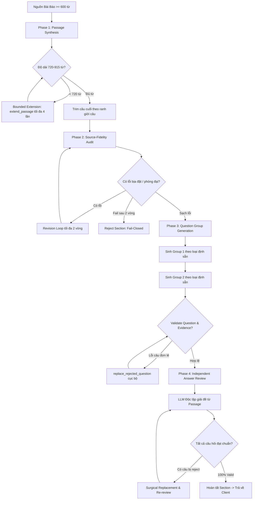
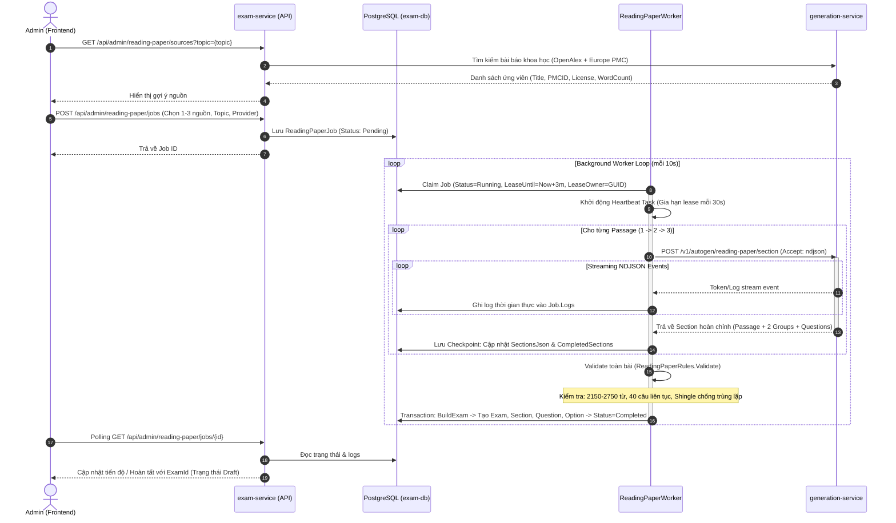
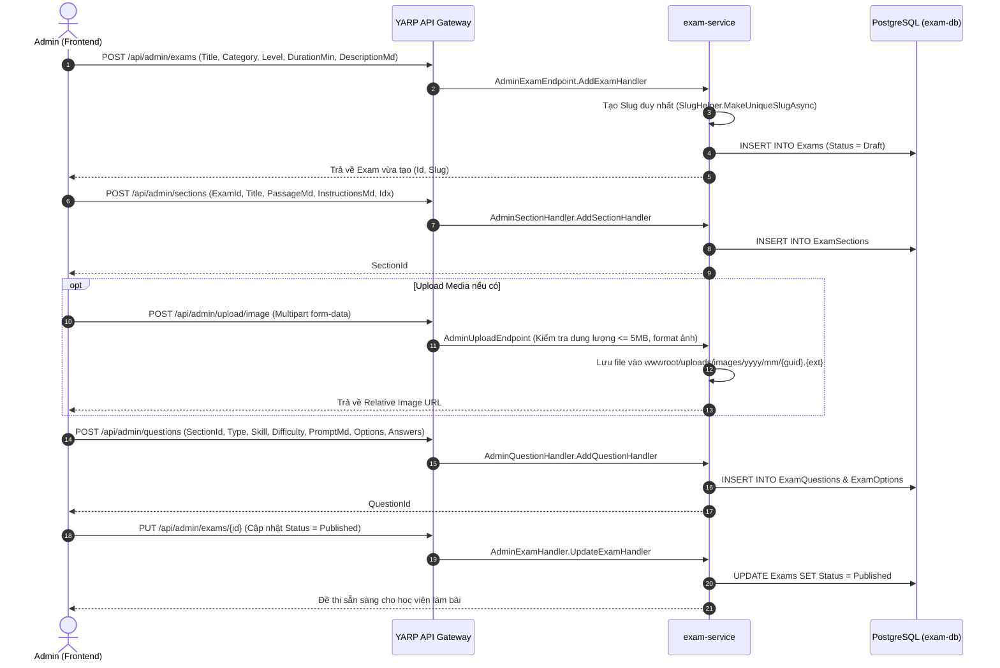

# Kiến Trúc Toàn Bộ Flow Generation-Service & Flow Tạo Đề (IELTS Academic)

Tài liệu này mô tả chi tiết kiến trúc của **`generation-service`** và **toàn bộ flow tạo đề thi hiện tại** trong hệ thống microservice **Langfens**, bao gồm quy trình tự động bằng AI (Autonomous Reading Paper Generation) và quy trình quản trị thủ công (Admin Manual Creation).

---

## 1. Tổng Quan Kiến Trúc Hệ Thống Tạo Đề

Hệ sinh thái tạo đề gồm các thành phần phối hợp chặt chẽ:

```
┌────────────────────────────────────────────────────────────────────────┐
│                   Admin Portal (Next.js Frontend)                      │
│      - Quản lý đề thủ công: /admin/exams                               │
│      - Tạo đề tự động:      /admin/exams/reading-paper                 │
└───────────────────────────────────┬────────────────────────────────────┘
                                    │ HTTP / REST
                                    ▼
┌────────────────────────────────────────────────────────────────────────┐
│                      YARP API Gateway (:5000)                          │
│             /api-exam/ ──► ReverseProxy sang exam-service               │
└───────────────────────────────────┬────────────────────────────────────┘
                                    │
                                    ▼
┌────────────────────────────────────────────────────────────────────────┐
│                       exam-service (.NET 10)                           │
│  ├── ReadingPaperEndpoints: REST API quản lý Job & Ingest nguồn        │
│  ├── ReadingPaperWorker: BackgroundService (Lease + Heartbeat)         │
│  ├── ReadingPaperAiClient: HTTP Client (NDJSON Streaming)              │
│  ├── ReadingPaperRules: Bộ quy chuẩn IELTS Academic & Validate Graph   │
│  └── AdminExam CRUD & QuestionBank: Tạo / duyệt đề thủ công            │
└──────────────┬──────────────────────────────────────────┬──────────────┘
               │ EF Core / PostgreSQL                     │ HTTP (NDJSON)
               ▼                                          ▼
┌──────────────────────────────┐        ┌────────────────────────────────┐
│   PostgreSQL (exam-db)       │        │  generation-service (FastAPI)  │
│  - Exams, Sections, Groups   │        │  ├── Router & Ingestion Engine │
│  - Questions, Options        │        │  ├── 4-Phase Pipeline          │
│  - ReadingPaperJobs          │        │  └── Streaming LLM Orchestrator│
└──────────────────────────────┘        └───────────────┬────────────────┘
                                                        │ OpenAI SDK
                                                        ▼
                                        ┌────────────────────────────────┐
                                        │         LLM Providers          │
                                        │  - MiniMax-Text-01 (Primary)   │
                                        │  - Groq / Llama 3.3 (Fallback) │
                                        └────────────────────────────────┘
```

---

## 2. Kiến Trúc & Pipeline Nội Tại của `generation-service`

`generation-service` là microservice chuyên biệt viết bằng **Python 3.12 / FastAPI** (cổng nội bộ `8080`, Compose port `8095`), có nhiệm vụ tạo bài thi **IELTS Academic Reading** đạt chuẩn quốc tế dựa trên nguồn khoa học có căn cứ thực tế (source-grounded).

### 2.1. Cấu Trúc Module
- **`router.py`**: Cung cấp API với tiền tố `/v1/autogen/reading-paper/`:
  - `GET /sources?topic=...`: Tìm kiếm bài báo khoa học ứng viên qua OpenAlex & Europe PMC.
  - `POST /source`: Tải full-text XML bài báo từ Europe PMC theo PMCID.
  - `POST /source/ingest`: Nạp nguồn tài liệu bất kỳ (URL, HTML, Markdown, Text).
  - `POST /section`: Tạo một section bài đọc (hỗ trợ stream `application/x-ndjson`).
- **`extractor.py`**:
  - Tải & kiểm tra bản quyền bài báo Europe PMC (bắt buộc CC-BY hoặc CC0, tối thiểu 600 từ gốc).
  - **Universal Ingestion**: Xử lý URL (kèm SSRF Protection chặn dải IP nội bộ/loopback), HTML body cleanup, loại bỏ rác/boilerplate.
  - `source_excerpt`: Trích chọn mẫu phân bổ đều toàn bài (tối đa 12.000–14.000 ký tự) để tránh vượt quá TPM của LLM.
- **`llm.py`**:
  - Tầng trừu tượng hóa LLM kết nối với **MiniMax** (chính) và **Groq** (xoay vòng nhiều API key dự phòng).
  - Bóc tách tag `<think>...</think>` đối với mô hình reasoning.
  - Xử lý defensive JSON parsing (loại bỏ markdown blocks, regex tìm cặp ngoặc JSON hợp lệ).
  - Tự động bắt lỗi 429 và retry sau 65 giây.
- **`prompts.py`**: Quản lý Section Profiles và cấu trúc 6 dạng câu hỏi IELTS Academic chuẩn.

### 2.2. Pipeline Tạo Một Passage (4-Phase Autonomous Pipeline)

Mỗi Section được thực thi khép kín qua 4 giai đoạn nghiêm ngặt:



#### Chi tiết 4 Phase:
1. **Phase 1: Passage Synthesis (720–915 từ)**:
   - Viết bài đọc học thuật theo từng Section Profile:
     - **Section 1**: Văn phong mô tả, sự thật khách quan, trình tự rõ ràng.
     - **Section 2**: Phân tích, tập trung vào quy trình/cơ chế.
     - **Section 3**: Lập luận học thuật chuyên sâu, so sánh các quan điểm/giả thuyết.
   - Nếu LLM sinh thiếu độ dài (< 720 từ), hàm `extend_passage` tiếp tục gọi LLM viết tiếp các đoạn tiếp theo từ source gốc (tối đa 4 lần).
2. **Phase 2: Source-Fidelity Audit & Revision Loop (Fail-closed)**:
   - LLM đóng vai trò thẩm định viên đối chiếu từng câu của bài đọc với source gốc.
   - Bắt các lỗi: `unsupported_claim` (không có trong nguồn), `contradicted_claim` (mâu thuẫn), `causal_overstatement` (biến tương quan thành nhân quả), `overstated_certainty` (phóng đại độ chắc chắn), `unmeasured_outcome`.
   - Nếu có lỗi, kích hoạt revision loop (tối đa 2 lượt) để viết lại những chỗ sai. Nếu sau 2 lượt vẫn còn lỗi, từ chối toàn bộ section (fail-closed).
3. **Phase 3: Question Group Generation**:
   - Mỗi section luôn gồm 2 nhóm câu hỏi với cấu hình cố định:
     - **Section 1**: `TRUE_FALSE_NOT_GIVEN` (7 câu) + `SENTENCE_COMPLETION` (6 câu) = 13 câu.
     - **Section 2**: `MULTIPLE_CHOICE_SINGLE` (6 câu) + `SUMMARY_COMPLETION` (7 câu) = 13 câu.
     - **Section 3**: `YES_NO_NOT_GIVEN` (7 câu) + `SHORT_ANSWER` (7 câu) = 14 câu.
   - Bắt buộc kiểm tra `evidenceQuote` phải tồn tại nguyên văn trong bài đọc.
   - Đối với completion/short-answer: đáp án không quá 3 từ/số và phải xuất hiện nguyên văn trong bài đọc, không làm lộ đáp án trong đề (`answer_leakage`).
4. **Phase 4: Independent Answer Review & Surgical Replacement**:
   - Một LLM độc lập giải đề mà **chỉ đọc bài đọc và câu hỏi** (không xem prompt gốc).
   - Kiểm tra tính duy nhất của đáp án, độ phân hóa học thuật (loại bỏ các câu quá hiển nhiên `too_direct`), tính tương thích giữa câu trả lời và trích dẫn bằng chứng.
   - Nếu có câu bị từ chối, hệ thống thực hiện **Surgical Replacement** (chỉ sinh lại đúng câu hỏi bị lỗi kèm prompt cấm lặp lại nội dung cũ) và tái thẩm định.

---

## 3. Toàn Bộ Flow Tạo Đề Hiện Tại

Hệ thống hỗ trợ 2 flow tạo đề chính:

### FLOW 1: Tạo Đề Tự Động (Autonomous AI Reading Paper Flow)

Toàn bộ quy trình diễn ra bất đồng bộ thông qua Job & Worker:



#### Các đặc tính nổi bật của Flow:
- **Distributed Lease & Heartbeat**: Chống tranh chấp nhiều instance worker; tự động khôi phục nếu worker bị crash (lease tự hết hạn sau 3 phút).
- **Checkpoint & Resume**: Nếu tạo 3 passage mà passage 3 gặp sự cố, hệ thống giữ nguyên checkpoint 2 passage đầu; khi bấm **Retry**, worker chạy tiếp từ passage 3 mà không sinh lại từ đầu.
- **Replace Sources**: Nếu nguồn không đủ điều kiện (trạng thái `NeedsSources`), admin có thể thay thế nguồn mới mà không cần tạo lại job.
- **Final Exam Graph**: Đề được khởi tạo với trạng thái **`ExamStatus.Draft`** để Admin biên tập, rà soát lại trước khi phát hành (Publish).

---

### FLOW 2: Tạo Đề Thủ Công (Admin Manual Exam Creation Flow)

Dành cho ban biên tập tạo đề truyền thống hoặc đề Listening / Writing / Speaking:



---

## 4. Bảng So Sánh Hai Flow Tạo Đề

| Tiêu chí | Flow Tạo Đề AI (`generation-service`) | Flow Tạo Đề Thủ Công (`exam-service`) |
| :--- | :--- | :--- |
| **Kỹ năng áp dụng** | IELTS Academic Reading (1–3 Passages) | Đa kỹ năng (Reading, Listening, Writing, Speaking) |
| **Đầu vào** | Topic / PMCID bài báo khoa học / Văn bản raw | Giáo viên nhập liệu từng đoạn văn, câu hỏi |
| **Thời gian tạo** | Tự động hoàn toàn (khoảng 3–5 phút cho bài full 40 câu) | Thủ công (30–60 phút tùy dung lượng đề) |
| **Quy chuẩn đề** | Tự động clamp 720–915 từ/bài, 40 câu, 6 dạng bài IELTS chuẩn | Phụ thuộc vào người biên soạn |
| **Thẩm định chất lượng**| Tự động 2 tầng: Source-Fidelity Audit & Independent Reviewer | Người dùng tự kiểm duyệt |
| **Cơ chế chịu lỗi** | Checkpointing từng Section, Distributed Lease, Retry tự động | Lưu trực tiếp từng thao tác qua REST API |
| **Trạng thái khởi tạo**| Luôn là `Draft` để Admin duyệt cuối trước khi Publish | `Draft` -> Admin chủ động chuyển `Published` |

---

## 5. Tổng Kết

Kiến trúc tạo đề của Langfens kết hợp giữa **mô hình Async Background Job bền bỉ trên .NET 10** và **hệ thống Multi-stage AI Pipeline thông minh trên Python FastAPI**. Thiết kế này đảm bảo:
1. **Tính học thuật & độ tin cậy**: Bài đọc 100% bám sát tài liệu khoa học mở, không bị ảo giác (hallucination).
2. **Khả năng mở rộng & khả năng phục hồi**: Không block HTTP request, lưu checkpoint từng bước, chịu lỗi mạng và rate limit LLM.
3. **Quyền kiểm soát của con người (Human-in-the-loop)**: AI hỗ trợ sinh đề chuẩn, nhưng quyết định xuất bản cuối cùng thuộc về Admin qua hệ thống quản trị Draft/Publish.
