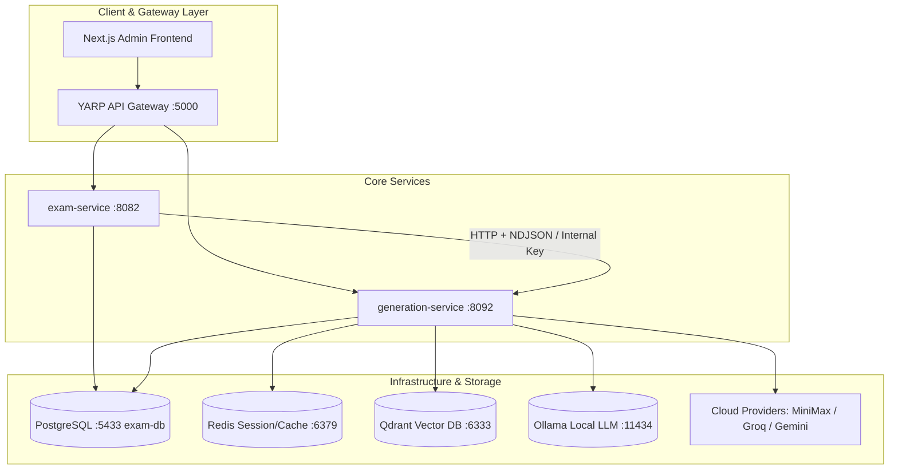
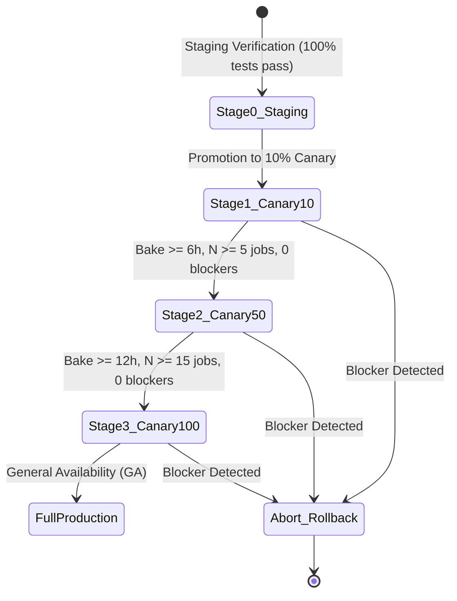

# Langfens Autonomous Generation Loop Engine V2 — Operational Runbook

**Document Version**: 2.0.0  
**Target Environment**: Staging & Production  
**Authority**: Engineering Operations & Release Reliability Management  
**Classification**: Operational Standard Operating Procedure (SOP)

---

## 1. System Architecture & Runtime Topology

### 1.1 Overview
The **Langfens Autonomous Reading Paper Generation Engine (Loop Engine V2)** is a microservice-oriented autonomous multi-agent pipeline designed to generate, evaluate, curate, and publish high-fidelity IELTS Academic Reading papers.

The engine executes across two primary runtimes:
1. **`exam-service` (.NET 10 Minimal APIs & Durable Worker)**: Manages authoring workflows, admin endpoints, job leases, CAS fencing tokens, EF Core exam graphs, and human feedback outbox events.
2. **`generation-service` (Python 3.12 / FastAPI & Loop Engine V2)**: Executes multi-stage generation loops (`PassageLoop`, `QuestionCandidateLoop`, `SectionLoop`, `PaperLoop`), deterministic and semantic evaluation pipelines, LLM gateway routing with rate-limiting and circuit breaking, curation lifecycle, and paired offline benchmarks.



### 1.2 Port Allocation & Network Matrix

| Service / Container | Local Port (Compose) | Aspire Port | Protocol | Purpose / Description |
|---|---|---|---|---|
| **API Gateway (YARP)** | `5000` | `5000` | HTTP/1.1 & HTTP/2 | Reverse proxy, JWT validation, path routing |
| **exam-service** | `8082` | Dynamic | HTTP + gRPC | Exam graph persistence, job leases, worker loop |
| **generation-service** | `8092` | Dynamic | HTTP + NDJSON | V2 Generation Loop Engine, Evaluators, Gateway |
| **auth-service** | `8080` | Dynamic | HTTP | JWT identity, RS256 token issuance |
| **attempt-service** | `8081` | Dynamic | HTTP | Test session scoring and auto-graders |
| **writing-service** | `8091` | Dynamic | HTTP | Writing AI evaluation pipeline |
| **speaking-service** | `8090` | Dynamic | HTTP | Whisper speech evaluation pipeline |
| **vocabulary-service** | `8093` | Dynamic | HTTP | SM2 spaced repetition flashcards |
| **dictionary-service** | `8094` | Dynamic | HTTP | Elasticsearch word lookup |
| **gamification-service**| `8096` | Dynamic | HTTP | Streaks, badges, leaderboards, XP |
| **exam-db (PostgreSQL)**| `5433` | `5433` | TCP | Durable state, artifacts, outbox, exam graph |
| **Redis** | `6379` | Dynamic | TCP | Session cache, distributed locking |
| **RabbitMQ** | `5672` / `15672` | Dynamic | AMQP / HTTP | Async event bus & management UI |
| **Elasticsearch** | `9200` | Dynamic | HTTP | Full-text dictionary indexing |
| **Qdrant** | `6333` | Dynamic | HTTP / gRPC | Vector embeddings for source retrieval |

---

## 2. Canary Deployment & Staged Traffic Shifting

### 2.1 Staged Rollout Policy
Deployments of generation engine updates must follow a progressive 3-stage traffic shift pattern (10% -> 50% -> 100%). Each canary phase requires a minimum sample size and observation window before advancing.



### 2.2 Canary Shift Progression

| Stage | Traffic % | Minimum Eligible Runs | Bake Time | Promotion Criteria |
|---|---|---|---|---|
| **Canary-10** | 10% | $\ge 5$ completed papers | 6 hours | 100% hard invariants, 0 circuit trips, latency P95 $\le 1.5\times$ baseline |
| **Canary-50** | 50% | $\ge 15$ completed papers | 12 hours | Cost within budget caps, error rate $< 1\%$, 0 duplicate exams |
| **Canary-100** | 100% | $\ge 20$ completed papers | 24 hours | All gates verified, 0 unhandled exceptions, stable memory footprint |

### 2.3 Traffic Control Configuration
Traffic shifting is governed via environment variables in `api-gateway` and `exam-service`:

```bash
# Enable Canary routing in exam-service
FEATURE_FLAG__GENERATION_V2_ENABLED=true
FEATURE_FLAG__GENERATION_V2_PERCENTAGE=10  # Set to 10, 50, or 100

# Apply configuration reload
dotnet run --project AppHost/AppHost.csproj
# Or in production container orchestration:
kubectl set env deployment/exam-service FEATURE_FLAG__GENERATION_V2_PERCENTAGE=50
```

---

## 3. Health Checks, Metrics, and Alerting

### 3.1 Health Endpoints
- **Liveness & Readiness**: `GET /healthz` and `GET /api/healthz`
  - Expected Response: `HTTP 200 OK`
  - Payload: `{"status": "ok", "service": "generation-service"}`
- **Prometheus Metrics**: `GET /metrics` and `GET /api/metrics`
  - Content-Type: `text/plain; version=0.0.4`

### 3.2 Key Observability Metrics

| Metric Name | Type | Description | Target / SLO |
|---|---|---|---|
| `langfens_generation_requests_total` | Counter | Total generation runs partitioned by engine (`v1`, `v2`) and status | Success rate $> 99\%$ |
| `langfens_generation_duration_seconds` | Histogram | Request latency across generation stages (`synthesis`, `audit`, `solve`) | P50 $< 45\text{s}$, P95 $< 90\text{s}$ |
| `langfens_provider_tokens_total` | Counter | Cumulative tokens consumed by provider (`minimax`, `groq`, `gemini`) | Within assigned campaign caps |
| `langfens_circuit_breaker_state` | Gauge | Circuit breaker status (`0=CLOSED`, `1=HALF_OPEN`, `2=OPEN`) | Must be `0` (CLOSED) |
| `langfens_active_leases_count` | Gauge | Number of active in-flight worker leases on PostgreSQL | $\le$ worker pool capacity |

### 3.3 Alerting Thresholds & Actions

```yaml
groups:
  - name: generation_service_alerts
    rules:
      - alert: GenerationHighErrorRate
        expr: rate(langfens_generation_requests_total{status="failed"}[5m]) / rate(langfens_generation_requests_total[5m]) > 0.05
        for: 2m
        labels:
          severity: critical
        annotations:
          summary: "Generation service error rate exceeds 5%"
          action: "Trigger automated rollback or engage fail-closed circuit breaker."

      - alert: CircuitBreakerOpen
        expr: langfens_circuit_breaker_state > 0
        for: 1m
        labels:
          severity: warning
        annotations:
          summary: "LLM Provider Circuit Breaker has tripped"
          action: "Check cloud provider status, rate limits, and fallback provider routing."

      - alert: StuckGenerationJob
        expr: langfens_job_duration_seconds > 300
        for: 1m
        labels:
          severity: high
        annotations:
          summary: "Generation job runtime exceeded 300 seconds"
          action: "Inspect worker lease CAS token and check database lock contention."
```

---

## 4. Emergency Abort, Fail-Closed Isolation, and Rollback

### 4.1 Fail-Closed Policy
In accordance with core system invariants, the Generation Engine operates on a **strict fail-closed** paradigm:
- Any unresolvable causal overstatement, unsupported claim, or structural distortion halts generation immediately.
- AI never directly publishes exams. AI output is always persisted in `Draft` state for administrative review.
- Under lease contention, stale writers are fenced via PostgreSQL CAS checks on `epoch` and `leaseOwner`.

### 4.2 Emergency Abort (Kill Switch)
To halt all active generation tasks immediately across the fleet:

```bash
# 1. Enable fleet-wide abort signal
export GENERATION_ABORT_KILL_SWITCH=true

# 2. Or issue HTTP emergency abort command to generation-service
curl -X POST "http://localhost:8092/api/admin/abort" \
  -H "X-Internal-Key: $EXAMSERVICE__INTERNAL__API__KEY" \
  -d '{"reason": "Emergency operational pause triggered by SRE"}'

# 3. Drain active worker jobs in exam-service
kubectl scale deployment/exam-service-worker --replicas=0
```

### 4.3 Zero-Downtime Rollback Runbook
If critical regression, fidelity breach, or unhandled exceptions are observed during canary rollout:

#### Docker Compose (Production Standard)
1. **Revert Traffic Shifting & Caps**:
   ```bash
   # In deploy/envs/exam.env:
   FEATURE_FLAG__GENERATION_V2_PERCENTAGE=0
   FEATURE_FLAG__GENERATION_V2_ENABLED=false
   ```
2. **Deploy Verified Pinned Previous Images**:
   ```bash
   cd /home/code/workspaces/langfens/Project_Langfens_Microservice/deploy
   # Update .env or compose.yaml to reference pinned stable tags
   TAG=v1.9.4 docker compose up -d exam-service generation-service
   ```

#### Kubernetes (Alternative Orchestration)
1. **Revert Traffic Shifting**:
   ```bash
   kubectl set env deployment/exam-service FEATURE_FLAG__GENERATION_V2_PERCENTAGE=0
   ```
2. **Re-deploy Pinned Previous Image**:
   ```bash
   kubectl set image deployment/generation-service \
     generation-service=langfens/generation-service:v1.9.4
   kubectl set image deployment/exam-service \
     exam-service=langfens/exam-service:v1.9.4
   ```

#### Database & Backward Compatibility Verification
3. **Verify Database Compatibility**:
   - The PostgreSQL schema on `exam-db` (Port 5433) is strictly additive (`IF NOT EXISTS` columns, backward-compatible JSONB envelopes).
   - As validated by `TC-ROLLBACK-01` through `TC-ROLLBACK-05` in `artifacts/refactor/phase-15/rollback/rollback-rehearsal.json`, the previous container version reads all durable checkpoints, human feedback events, and exam graphs without schema destruction or data loss.
4. **Post-Rollback Verification**:
   - Verify `GET /healthz` and `GET /api/healthz` return `HTTP 200 OK`.
   - Confirm active jobs resume gracefully from stored checkpoints.
   - Inspect Prometheus metrics: `langfens_generation_requests_total` should show non-zero V1 execution with zero unhandled 500 errors.
---

## 5. Offline Benchmark & Model Promotion Procedures

### 5.1 Automated Offline Benchmark Execution
Benchmarks evaluate candidate prompt templates, LLM model versions, and evaluator policies against curated gold datasets without affecting production workloads.

- **Configuration Policy**:
  - MiniMax benchmark runner runs with **unlimited application-imposed caps** (campaign-level and child-run level caps disabled for offline evaluation).
  - Production generation retains hard caps: 15 calls / 60,000 tokens / 300 seconds.
- **Execution Command**:
  ```bash
  python3 scripts/refactor/run_offline_benchmark.py \
    --provider minimax \
    --dataset artifacts/refactor/phase-14/exports/curated_dataset_v1.0.0.jsonl \
    --candidate-version prompts_v2_1_0 \
    --output-dir artifacts/refactor/phase-15/paired-comparisons
  ```

### 5.2 Model & Prompt Version Promotion
Promotion follows a 4-gate verification process:
1. **Paired Comparison**: $\ge 18$ paired papers across $\ge 6$ distinct topic triples.
2. **Quality Invariants**:
   - Hard Invariant Pass Rate: $100\%$
   - Critical Fidelity Canary Pass Rate: $100\%$
   - Semantic Recall: $\ge 95\%$ (each question type $\ge 90\%$)
   - Ambiguity Detection Recall: $\ge 90\%$
   - False Rejection Rate: $\le 10\%$
3. **Execution**:
   ```bash
   curl -X POST "http://localhost:8092/api/promotion/promote" \
     -H "Content-Type: application/json" \
     -d '{
       "candidate_version": "prompts_v2_1_0",
       "reviewer": "operations_lead@langfens.com",
       "reason": "Phase 15 benchmark quality gates passed with zero regressions"
     }'
   ```
4. **Rollback Workflow**:
   ```bash
   curl -X POST "http://localhost:8092/api/promotion/rollback" \
     -H "Content-Type: application/json" \
     -d '{
       "target_version": "prompts_v2_0_0",
       "reason": "Observed subtle semantic drift in Section 3 sustained argument"
     }'
   ```

---

## 6. PostgreSQL Maintenance, Checkpoint Cleanup & Retention

### 6.1 Database Maintenance Schedule
All state tables live in `exam-db` (Port 5433).

- **Nightly VACUUM ANALYZE**:
  ```sql
  VACUUM (ANALYZE, VERBOSE) "ExamGenerationJobs";
  VACUUM (ANALYZE, VERBOSE) "GenerationCheckpoints";
  VACUUM (ANALYZE, VERBOSE) "HumanFeedbackEvents";
  ```
- **Index Health Check**:
  ```sql
  REINDEX TABLE CONCURRENTLY "GenerationCheckpoints";
  ```

### 6.2 Checkpoint Cleanup & Data Retention Policy
1. **Active Checkpoints**: Retained for the full duration of active jobs + 7 days for post-generation auditing.
2. **Terminal Completed Checkpoints**: Older than 30 days are purged via automated lifecycle job:
   ```sql
   DELETE FROM "GenerationCheckpoints"
   WHERE "CreatedAt" < NOW() - INTERVAL '30 days'
     AND "Status" IN ('COMPLETED', 'SUPERSEDED');
   ```
3. **Human Feedback Records**: Retained indefinitely in `RAW`, `ANNOTATED`, `REVIEWED`, or `CURATED` states for offline model fine-tuning and benchmark regression suites.
4. **Draft Exams**: Unedited and unpublished draft exams older than 90 days are soft-deleted.
### 6.3 Disaster Recovery & Checkpoint Inspection Runbook

#### 6.3.1 In-Flight Checkpoint Inspection & Querying
To inspect the durable progress, CAS lease status, and budget consumption of an in-flight or failed generation run:

```sql
-- 1. Query run status, lease owner, epoch, and cumulative budget counters
SELECT 
    "RunId", "JobId", "Status", "CurrentEpoch", "LeaseOwner", "LeaseExpiresAt",
    "CallsUsed", "TokensUsed", "WallTimeUsedSeconds", "UpdatedAt"
FROM "ReadingPaperRuns"
WHERE "RunId" = '<TARGET_RUN_ID>';

-- 2. Inspect chronological step journal entries and durable CAS revisions
SELECT 
    "StepId", "OperationType", "Status", "Revision", "DecisionType", "ReasonCode", "CreatedAt"
FROM "ReadingPaperStepJournals"
WHERE "RunId" = '<TARGET_RUN_ID>'
ORDER BY "Revision" ASC;

-- 3. Retrieve latest durable artifact envelopes and cryptographic content hashes
SELECT 
    "ArtifactId", "ArtifactType", "Version", "ContentHash", "CreatedAt"
FROM "ReadingPaperArtifacts"
WHERE "RunId" = '<TARGET_RUN_ID>'
ORDER BY "Version" DESC;
```

#### 6.3.2 Checkpoint Inspection via HTTP API
Generation service exposes an administrative inspection endpoint to verify deserialization and cryptographic lineage:

```bash
# Fetch full structured run state including budget tracker, issue ledger, and artifact graph
curl -X GET "http://localhost:8092/api/admin/checkpoints/<TARGET_RUN_ID>" \
  -H "X-Internal-Key: $EXAMSERVICE__INTERNAL__API__KEY"
```

#### 6.3.3 Disaster Recovery Procedure (Full Database Restore)
In the event of database node corruption or severe storage failure on `exam-db`:

1. **Halt Generation Fleet**: Execute emergency abort (§4.2) to prevent split-brain CAS leases.
2. **Restore Point-in-Time Backup (PITR)**:
   ```bash
   # Stop container
   docker compose stop exam-db
   # Restore PostgreSQL base backup & replay WAL to target recovery point
   pg_restore -h localhost -p 5433 -U postgres -d exam-db /backup/exam-db-snapshot.dump
   # Restart container
   docker compose up -d exam-db
   ```
3. **Durable Worker Job Resumption**:
   - `ReadingPaperWorker` will automatically scan `ReadingPaperJobs` with status `IN_PROGRESS` or `LEASED`.
   - Expired leases (`LeaseExpiresAt < NOW()`) are automatically reclaimed with incremented `epoch`.
   - Generation resumes safely from the last durable `ArtifactEnvelope` persisted prior to the outage.

---

## 7. Operational Troubleshooting & Root Cause Analysis (RCA)

The following table provides immediate diagnostics and operational resolutions for production error conditions:

| Symptom / Error Code | Root Cause | Diagnostic Query / Check | Immediate Action / Remediation |
|---|---|---|---|
| **`BudgetExhaustedError` (422)** | Standalone or section run exceeded hard caps (15 calls / 60k tokens / 300s). | Check `ReadingPaperRuns` table for `CallsUsed` and `TokensUsed`. | 1. Review topic complexity in prompt.<br>2. For offline benchmarks, ensure `benchmark_child_run_*` caps are active.<br>3. In production, check for repetitive evaluator rejection cycles. |
| **`Epoch fencing violation` (409)** | CAS lease conflict; worker lease expired and was acquired by another node. | Compare `LeaseOwner` and `CurrentEpoch` in `ReadingPaperRuns` vs worker UUID. | 1. Ensure worker heartbeat interval $< \text{LeaseTimeoutSeconds} / 2$.<br>2. Increase `JobLeaseTimeoutSeconds` in `exam.env` if DB is under heavy load. |
| **`CircuitBreakerOpen` (503)** | Primary LLM provider (MiniMax/Groq) returned consecutive 5xx/429 errors. | `GET /metrics` -> inspect `langfens_circuit_breaker_state`. | 1. Check provider dashboard status.<br>2. Verify API keys in `deploy/envs/ai.env`.<br>3. Circuit automatically half-opens after 60s cooldown; fallback provider will be invoked. |
| **`LoopReason.STAGNATION_DETECTED`** | Generator repeated identical passage/question content hash after repair. | Inspect `ReadingPaperStepJournals` for repeated `ContentHash`. | 1. Repair prompt failed to diversify candidate.<br>2. Engine will automatically advance to full regeneration (`DecisionType.REGENERATE`). |
| **`LoopReason.OSCILLATION_DETECTED`** | Repair flipped between two alternating failure states across iterations. | Check issue ledger history in checkpoint inspection API. | Engine detects $\ge 2$ oscillation cycles and triggers fail-closed terminal exit to prevent unbounded token drain. |
| **PostgreSQL Connection Pool Starvation** | Max active connections on `exam-db` reached. | `SELECT count(*) FROM pg_stat_activity WHERE datname='exam-db';` | 1. Increase `MaxConnections` in PostgreSQL config.<br>2. Ensure `GenerationFacade` and `CheckpointClient` use connection pooling with explicit context manager cleanup. |
| **NDJSON Stream Disconnect (Client Drop)** | Gateway or client closed connection before generation completed. | Check gateway access logs for `499 Client Closed Request`. | Background task completes and commits durable artifact to PostgreSQL; client can re-query result via `/api/admin/reading-paper/jobs/{id}`. |

---

## 8. Incident Response & Escalation Matrix

| Severity Level | Response Time (SLA) | On-Call Lead | Primary Communication Channel |
|---|---|---|---|
| **SEV-1 (Critical Outage)** | $< 15$ minutes | SRE Lead + Backend Lead | `#incident-sev-1-war-room` / PagerDuty |
| **SEV-2 (Major Degradation)** | $< 30$ minutes | Senior Platform Engineer | `#ops-generation-engine` |
| **SEV-3 (Minor Anomaly)** | $< 2$ hours | Feature Team Engineer | `#dev-generation-service` |

---

*End of Operational Runbook — Approved for Production Deployment.*
