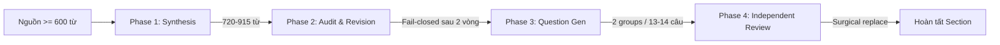
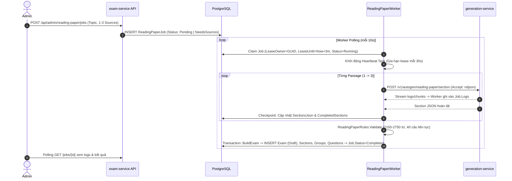

# Kiến Trúc Generation-Service & Flow Tạo Đề (IELTS Academic)

Tài liệu tóm tắt kiến trúc của `generation-service` và toàn bộ quy trình tạo đề thi hiện tại trong Langfens.

---

## 1. Sơ Đồ Kiến Trúc Tổng Thể

```
┌─────────────────────────────────┐
│     Admin Frontend (Next.js)    │
│  /admin/exams/reading-paper     │
└───────────────┬─────────────────┘
                │ HTTP (YARP Gateway :5000 -> /api-exam/)
                ▼
┌────────────────────────────────────────────────────────────────────────┐
│                         exam-service (.NET 10)                         │
│  - ReadingPaperEndpoints: Quản lý Job, Ingest, Replace Sources, Retry  │
│  - ReadingPaperWorker: BackgroundService (Distributed Lease 3m + 30s)  │
│  - ReadingPaperRules: Kiểm duyệt IELTS (2150–2750 từ, 40 câu continuous)│
│  - Admin CRUD: Tạo vỏ đề thi (Draft shell) & quản lý thủ công          │
└───────────────┬────────────────────────────────────────┬───────────────┘
                │ GENERATION_SERVICE_URL (NDJSON Stream) │ EF Core
                ▼                                        ▼
┌──────────────────────────────────────┐       ┌────────────────────────┐
│      generation-service (FastAPI)    │       │  PostgreSQL (exam-db)  │
│  - extractor: Europe PMC, Ingestion  │       │  - reading_paper_jobs  │
│  - 4-phase pipeline (720–915 words)  │       │  - exams, sections,   │
│  - llm: MiniMax (main), Groq (backup)│       │    groups, questions   │
└──────────────────────────────────────┘       └────────────────────────┘
```

**Cấu hình kết nối**: `exam-service` ưu tiên biến môi trường `GENERATION_SERVICE_URL` (fallback `AI_SERVICE_URL` / `http://generation-service:8080`). `generation-service` chạy trên cổng 8080 (Compose: `8095:8080`), LLM mặc định gồm MiniMax (`MiniMax-Text-01`) và Groq fallback (`openai/gpt-oss-20b`).

---

## 2. Pipeline Nội Tại của `generation-service`

Tạo từng Section (bài đọc kèm câu hỏi) qua 4 giai đoạn khép kín (`pipeline.py`):



1. **Phase 1: Passage Synthesis (720–915 từ)**: Sinh bài đọc học thuật theo Section Profile (Sec 1: Miêu tả; Sec 2: Phân tích quy trình; Sec 3: Lập luận phản biện). Nếu thiếu từ, `extend_passage` mở rộng dựa trên nguồn gốc (tối đa 4 lần), sau đó trim theo ranh giới câu.
2. **Phase 2: Source-Fidelity Audit & Revision**: LLM audit đối chiếu bài đọc với nguồn gốc để phát hiện bịa đặt (`unsupported_claim`, `contradicted_claim`, `causal_overstatement`). Revision loop tối đa 2 vòng; nếu vẫn còn lỗi sẽ từ chối section (fail-closed).
3. **Phase 3: Question Group Generation**: Sinh 2 nhóm câu hỏi cố định theo Section:
   - *Sec 1*: `TRUE_FALSE_NOT_GIVEN` (7) + `SENTENCE_COMPLETION` (6).
   - *Sec 2*: `MULTIPLE_CHOICE_SINGLE` (6) + `SUMMARY_COMPLETION` (7).
   - *Sec 3*: `YES_NO_NOT_GIVEN` (7) + `SHORT_ANSWER` (7).
   - Kiểm tra `evidenceQuote` phải nằm nguyên văn trong bài; đáp án completion $\le 3$ từ và không lộ đề (`answer_leakage`).
4. **Phase 4: Independent Answer Review**: LLM độc lập giải đề từ bài đọc. Nếu phát hiện câu lỗi/mơ hồ, hệ thống thực hiện **Surgical Replacement** sinh lại câu đó và tái thẩm định.

---

## 3. Toàn Bộ Flow Tạo Đề Hiện Tại

### Flow 1: Tạo Đề Tự Động (Autonomous AI Reading Paper Flow)

Toàn bộ vòng đời xử lý qua `ReadingPaperJob` và `ReadingPaperWorker`:



#### Quản lý trạng thái & Phục hồi lỗi của Job:
- **`Pending` $\rightarrow$ `Running`**: Worker nhận lease và gia hạn liên tục qua heartbeat. Nếu worker bị tắt đột ngột, sau 3 phút worker khác có thể claim lại.
- **Checkpointing**: Mỗi passage hoàn thành được commit ngay vào DB. Nếu gặp lỗi ở passage sau, trạng thái chuyển thành `Failed`.
- **`POST /jobs/{id}/retry`**: Chỉ áp dụng cho job `Failed` chưa có `ExamId`. Worker chạy tiếp từ passage tiếp theo mà không sinh lại từ đầu.
- **`PUT /jobs/{id}/sources`**: Khi nguồn bị lỗi (`NeedsSources`), Admin có thể đổi nguồn mới và reset checkpoint.
- **Kết quả**: Đề thi được sinh ra ở trạng thái **`ExamStatus.Draft`** để Admin duyệt, chỉnh sửa trước khi Publish.

---

### Flow 2: Tạo Đề Thủ Công (Admin Manual Exam CRUD)

Dành cho ban biên tập tạo đề truyền thống hoặc các kỹ năng khác (Listening, Writing, Speaking):

1. **Tạo vỏ đề thi (`Draft` Shell)**: `POST /api/admin/exams` $\rightarrow$ `AdminExamService.AddAsync` sinh slug duy nhất và tạo bản ghi `Exam` (Status: `Draft`). Vỏ đề chưa có nội dung câu hỏi.
2. **Thêm phần thi (Sections)**: `POST /api/admin/sections` $\rightarrow$ tạo `ExamSection` gắn với `ExamId` (lưu bài đọc hoặc audio script).
3. **Upload tài nguyên (nếu có)**: `POST /api/admin/upload/image` $\rightarrow$ kiểm tra file $\le 5\text{MB}$, lưu local `wwwroot/uploads/images/` và trả relative URL.
4. **Thêm nhóm & câu hỏi**: `POST /api/admin/questions` $\rightarrow$ tạo `ExamQuestion` và các `ExamOption`.
5. **Xuất bản**: `PUT /api/admin/exams/{id}` $\rightarrow$ cập nhật `Status = ExamStatus.Published`.

---

## 4. Tóm Tắt Khác Biệt

| Đặc điểm | Flow Tạo Đề AI (Autonomous) | Flow Tạo Đề Thủ Công (Admin CRUD) |
| :--- | :--- | :--- |
| **Kỹ năng** | IELTS Academic Reading (1–3 Passages) | Đa kỹ năng (Reading, Listening, Writing, Speaking) |
| **Cách tạo đồ thị** | Worker tự động build toàn bộ đồ thị (`Exam` $\rightarrow$ `Option`) trong 1 transaction | Admin tạo từng phần rời rạc qua nhiều endpoint REST |
| **Cơ chế chịu lỗi** | Checkpoint từng section, Distributed Lease 3 phút, Retry tiếp nối | Thao tác CRUD trực tiếp trên từng bản ghi |
| **Kiểm duyệt** | 2 tầng LLM (Audit + Independent Review) + C# Rule Validation | Người biên tập tự kiểm tra thủ công |
| **Trạng thái ban đầu** | `ExamStatus.Draft` | `ExamStatus.Draft` |
