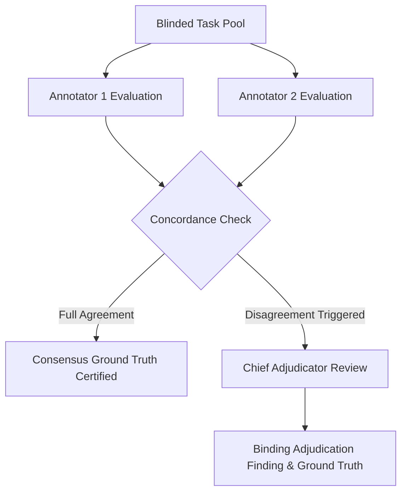

# Answer-Key Disagreement & Expert Adjudication Workflow

**Phase:** RG10 Confirmatory Research Freeze  
**Document:** Human Expert Adjudication and Consensus Protocol  
**Target:** Senior Chief Adjudicator, Review Panel, and Research Auditor  
**Governing Standard:** `generation_baseline/research/HUMAN_REVIEW_PROTOCOL_AND_RUBRIC.md`  

---

## 1. Dual-Blind Evaluation Architecture

All human evaluation for the confirmatory research freeze follows a dual-blind consensus protocol:
- Two certified independent human experts (Annotator 1 and Annotator 2) score each anonymized task independently without communication or access to the other's ratings.
- A Senior Chief Adjudicator resolves discrepancies and certifies the final human ground truth.



---

## 2. Automatic Disagreement Triggers

An item is automatically flagged for Senior Adjudication if ANY of the following three conditions occurs:

1. **Answer-Key Divergence:**
   $$\text{Key}_{\text{Annotator 1}} \neq \text{Key}_{\text{Annotator 2}}$$
   *Example:* Annotator 1 selects `TRUE`, while Annotator 2 selects `NOT GIVEN`; or Annotator 1 selects `B`, while Annotator 2 selects `C`.
2. **Binary Acceptability Divergence:**
   $$\text{Verdict}_{\text{Annotator 1}} \neq \text{Verdict}_{\text{Annotator 2}}$$
   *Example:* Annotator 1 rates `PASS`, while Annotator 2 rates `FAIL`.
3. **Rubric Dimension Divergence:**
   $$\max_{d \in \{1, 2, 3, 4\}} |\text{Score}_{1, d} - \text{Score}_{2, d}| \ge 2$$
   *Example:* Annotator 1 gives Dimension 2 (Key Uniqueness) a score of 5, while Annotator 2 gives it a score of 3.

---

## 3. Senior Adjudication Procedure

When an item triggers adjudication, the Chief Adjudicator follows this strict protocol:

1. **Independent Blind Inspection:** The Chief Adjudicator inspects the item text, passage, and options without viewing system prompts or model identifications.
2. **Review of Annotator Evidence:** The Adjudicator reviews both annotators' selected keys, dimension scores, evidence spans, and qualitative notes.
3. **Linguistic & Factual Analysis:**
   - For Reading items: The Adjudicator cross-references the source publication to verify whether the proposition is strictly entailed, contradicted, or unmentioned.
   - For Grammar items: The Adjudicator consults standard reference grammars (e.g. *The Cambridge Grammar of the English Language*) to determine whether options are standard academic English or dialectal/ungrammatical variants.
4. **Binding Finding:** The Adjudicator issues a binding ruling containing:
   - Final Certified Answer Key (or `NONE_VALID` / `AMBIGUOUS_MULTI_KEY`).
   - Final Binary Verdict (`PASS` or `FAIL`).
   - Final Consolidated Dimension Scores (1–5 scale).
   - Documented Adjudication Rationale explaining why one annotator was upheld or an alternative finding reached.

---

## 4. Inter-Annotator Agreement Statistics

To validate panel reliability, the pipeline computes two complementary statistical metrics across the full evaluation batch:

### 4.1 Cohen's Quadratic-Weighted Kappa ($\kappa$)
Measures categorical agreement corrected for chance agreement:
$$\kappa = \frac{P_o - P_e}{1 - P_e}$$
- Target Acceptance Threshold: $\kappa \ge 0.80$ (strong agreement).
- Threshold for Panel Retraining: $\kappa < 0.70$.

### 4.2 Gwet's $AC_1$ Statistic
Used alongside Cohen's $\kappa$ to prevent the "Kappa Paradox" (where high raw agreement yields low Kappa under severe class imbalance, e.g. predominately high PASS rates):
$$AC_1 = \frac{P_o - P_e^{\gamma}}{1 - P_e^{\gamma}}$$
- Target Acceptance Threshold: $AC_1 \ge 0.85$.

---

## 5. Adjudication Record Template (`adjudication_ledger.json`)

```json
{
  "task_id": "[ADJUDICATOR: SUPPLY BLINDED TASK ID, e.g. task_hrev_000000000000]",
  "disagreement_types": [
    "[ADJUDICATOR: ONE OR MORE OF 'ANSWER_KEY_DIVERGENCE', 'VERDICT_DIVERGENCE', 'RUBRIC_DIMENSION_DIVERGENCE']"
  ],
  "annotator_1": {
    "key": "[ANNOTATOR 1 SELECTED KEY]",
    "verdict": "[ANNOTATOR 1 VERDICT: 'PASS' | 'FAIL']",
    "scores": {
      "grounding_or_rule": "[INTEGER 1-5]",
      "uniqueness": "[INTEGER 1-5]",
      "distractors": "[INTEGER 1-5]",
      "register": "[INTEGER 1-5]"
    }
  },
  "annotator_2": {
    "key": "[ANNOTATOR 2 SELECTED KEY]",
    "verdict": "[ANNOTATOR 2 VERDICT: 'PASS' | 'FAIL']",
    "scores": {
      "grounding_or_rule": "[INTEGER 1-5]",
      "uniqueness": "[INTEGER 1-5]",
      "distractors": "[INTEGER 1-5]",
      "register": "[INTEGER 1-5]"
    }
  },
  "adjudication": {
    "adjudicator_id": "[CHIEF ADJUDICATOR IDENTIFIER]",
    "final_key": "[ADJUDICATED BINDING KEY]",
    "final_verdict": "[ADJUDICATED BINDING VERDICT: 'PASS' | 'FAIL']",
    "final_scores": {
      "grounding_or_rule": "[INTEGER 1-5]",
      "uniqueness": "[INTEGER 1-5]",
      "distractors": "[INTEGER 1-5]",
      "register": "[INTEGER 1-5]"
    },
    "binding_rationale": "[ADJUDICATOR: SUPPLY DOCUMENTED RATIONALE AND CITATION EVIDENCE FOR BINDING RESOLUTION]",
    "adjudicated_at": "[ISO-8601 TIMESTAMP, e.g. YYYY-MM-DDTHH:MM:SSZ]"
  }
}
```
