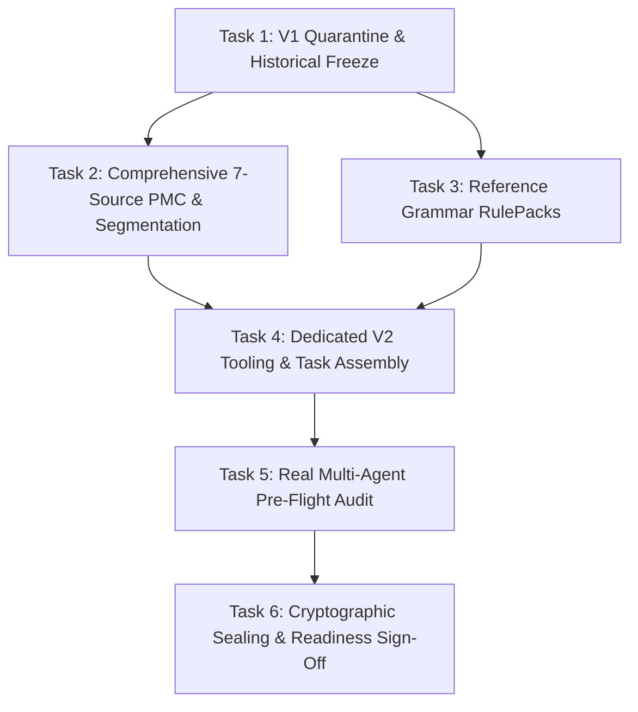

# Plan: RQ2_DATASET_V2 Recovery & Dataset Engineering Plan

**Source PRD**: `generation_baseline/research/RQ2_PROTOCOL.md` & `RG10_DAY1_DAY2_FINAL_DECISION.md`  
**Plan Artifact Path**: `generation_baseline/plans/2026-10-18-rq2-dataset-v2-recovery-plan.md`  
**Selected Milestone**: Dataset Recovery prior to MiniMax API Quota Replenishment  
**Complexity**: Large  
**Document ID**: `PLAN-RQ2-V2-RECOVERY-FINAL`  
**Revision Date**: 2026-10-19  
**Status**: `AMENDED_PLAN_CANDIDATE_AWAITING_PREREGISTRATION_APPROVAL`  
**Approval Evidence**: `V2_S01_APPROVED_MASTER_PREREGISTRATION_PENDING` (User post-implementation sign-off granted on 2026-10-19 specifically for completed Sprint V2-S01 implementation and `PLAN-V2-S01-QUARANTINE`; broader master plan preregistration amendment and Sprints V2-S02..06 remain pending sequential review and approval)  
**Repository**: `minkhoaa/Project_Langfens_Microservice`  
**Branch**: `autonomous-generation`  

---

## Summary

The Day 1 (Software Freeze) audit confirmed engine readiness (`SOFTWARE_READY = PASS` across 353 regression tests), but the Day 2 audit placed the campaign gate on **`HOLD`** due to critical data-integrity and provenance defects in `final-v1.0` (DEF-DAT-01..06: fabricated PMC metadata, 41–55x paragraph duplication, mid-word passage cuts, and synthetic grammar provenance). This amended plan establishes **`RQ2_DATASET_V2`**: an authentic, research-grade replacement dataset that immutably quarantines `final-v1.0` and preserves all historical RG10 execution artifacts strictly read-only, verifies all 7 Reading sources (4 in-repo and 3 replacements) against live NCBI ESummary/EFetch XML, deploys a robust sentence- and paragraph-aware segmenter with calibrated anti-padding metrics, grounds 7 Grammar RulePacks in academic reference grammars with evidence-based CEFR annotations, builds dedicated V2 validation tooling, and executes an actual multi-agent pre-flight audit across all 56 candidate fixtures (`EXPLORATORY_AI_AUDIT_NOT_HUMAN_GOLD`) while strictly preserving the 56-item paired RQ2 experimental methodology and isolating the uninspected Judge Holdout.

---

## Patterns to Mirror

| Category | Source | Pattern |
|---|---|---|
| **Naming** | `services/generation-service/app/experiment/final_dataset.py:24` | Registry pattern (`FinalDatasetV2Registry`), immutable Pydantic v2 schemas (`PairedTaskFixture`, `ReadingTask`, `GrammarTask`, `GrammarRulePack`), deterministic assignment IDs (`{dataset_item_id}__arm_{A,B,C}__att{attempt}`). |
| **Errors** | `services/generation-service/app/experiment/final_dataset.py:446` | Fail-closed domain exception hierarchy (`SourceFamilyOverlapError`, `DatasetStrataDefectError`, `MixedEnvironmentReferenceForbiddenError`, `ReplacementItemForbiddenError`, `AmbiguousGrammarRuleError`, `SourceProvenanceCorruptError`). |
| **Logging** | `services/generation-service/app/facade.py:79` | Standard module logger (`logger = logging.getLogger(__name__)`), structured event logging with UTC timestamps and audit telemetry in `generation_baseline/`. |
| **Data access** | `services/generation-service/app/experiment/ledger.py:144` | Atomic filesystem writes via `tempfile.mkstemp` and `canonical_json_dump`, SHA-256 fingerprinting, strictly read-only historical fixtures and execution ledgers. |
| **Tests** | `services/generation-service/tests/test_rg10_campaign_readiness_integrity.py:42` | Pytest fixtures, AAA structure, deterministic zero-network offline tests, fail-closed assertions, and negative property tests. |
| **Task Policies & Preregistration** | `services/generation-service/app/contracts/research.py:112` & `PREREGISTRATION_AMENDMENT_V2.md` | ReadingTask schema constrains task_type="READING_SINGLE_PASSAGE", 1–2 groups, 1–40 questions, leaving word count unconstrained. The 350–650 word range across 4 questions is a newly justified RQ2 preregistration decision with evidence and pre-freeze approval gate (distinct from the 720–915 full-paper exam policy). |
| **Anti-Padding & Leakage** | `services/generation-service/tests/test_v2_anti_padding.py` | Multi-scale evidence-based detection: FAIL on artificial padding/leakage, ALLOW on technical terminology, MANUAL_REVIEW_REQUIRED on uncertain near-duplicates. |
| **Agent Auditing** | `RG10_AI_OUTPUT_QUALITY_REVIEW.md:40` | Multi-agent blind inspection protocol with independent role reviewers, adjudication consensus, per-fixture evidence logs, and explicit non-gold epistemic disclosures. |

---

## Files to Change

| File | Action | Why |
|---|---|---|
| `services/generation-service/app/experiment/final_dataset.py` | **READ-ONLY** | Preserve historical V1 benchmark byte-for-byte intact for reproducibility and forensic auditability. |
| `generation_baseline/.execution/RG10/` | **READ-ONLY** | Preserve all RG10 historical execution artifacts (`PHASE_STATUS.json`, `campaign_ledger.json`, batch states) strictly read-only; SHA-256 verified unchanged. |
| `services/generation-service/tests/fixtures/policies/sources_eligible.json` | **READ-ONLY** | Preserve historical V1 fixture byte-for-byte intact for V1 historical replay tests. |
| `generation_baseline/verification/V1_QUARANTINE_MANIFEST.json` | **CREATE** | Formal immutable quarantine declaration of `final-v1.0` with forensic defect pointers (DEF-DAT-01..06) and baseline file digests. |
| `generation_baseline/tools/verify_and_ingest_pmc_sources.py` | **CREATE** | Automated tool querying NCBI ESummary and EFetch APIs to verify metadata, licenses, and text correspondence for all 7 sources. |
| `generation_baseline/verification/V2_SOURCE_PROVENANCE_LEDGER.json` | **CREATE** | Cryptographic provenance record mapping each source to its raw XML SHA-256, clean text SHA-256, and transformation steps. |
| `services/generation-service/tests/fixtures/corpus/sources/PMC{id}.txt` | **CREATE** | 3 authentic replacement PMC full-text files (>5,000 chars, non-medical subjects). |
| `services/generation-service/app/experiment/segmentation.py` | **CREATE** | `SemanticSentenceSegmenter` engine with abbreviation/decimal/citation-aware regex, antecedent preservation, and contract length derivation. |
| `services/generation-service/app/experiment/grammar_packs_v2.py` | **CREATE** | 7 academic reference-backed RulePacks (Quirk/Biber), evidence-based CEFR descriptors, and 8 original natural examples per family. |
| `services/generation-service/app/experiment/final_dataset_v2.py` | **CREATE** | V2 benchmark registry (28 Reading + 28 Grammar tasks, 168 paired assignments, $\le 5$ items/batch). |
| `generation_baseline/tools/check_v2_dataset_eligibility.py` | **CREATE** | Dedicated V2 FINAL_EVAL eligibility validator auditing PMC provenance, segmentation, anti-padding, and taxonomy. |
| `generation_baseline/tools/check_v2_campaign_readiness.py` | **CREATE** | Dedicated V2 campaign readiness validator auditing V2 roster, V2 ledger, and 5-pillar readiness state. |
| `generation_baseline/tools/audit_v2_fixtures.py` | **CREATE** | Multi-agent pre-flight audit harness executing Agent R, Agent G, and Agent Q with `--execute-audit` and `--dry-run`. |
| `generation_baseline/.execution/RQ2_V2/campaign_ledger.json` | **CREATE** | Isolated durable execution ledger for V2 experimental units. |
| `generation_baseline/research/PREREGISTRATION_AMENDMENT_V2.md` | **CREATE** | Formal preregistration amendment recording V1 quarantine rationale and V2 specification invariants. |
| `services/generation-service/tests/test_v2_source_authenticity.py` | **CREATE** | Acceptance tests for NCBI metadata, DOIs, authors, CC-BY-4.0 open-access XML licenses, and text correspondence across all 7 sources. |
| `services/generation-service/tests/test_v2_passage_segmentation.py` | **CREATE** | Acceptance tests for sentence boundary cleanliness, abbreviation handling, and task-contract length constraints. |
| `services/generation-service/tests/test_v2_anti_padding.py` | **CREATE** | Acceptance tests for consecutive repetition (0), phrase duplicate spans ($\ge 10$ words: 0), and normalized sentence frequencies. |
| `services/generation-service/tests/test_v2_grammar_taxonomy.py` | **CREATE** | Acceptance tests for evidence-based CEFR taxonomy alignment, 8 original examples per family, and lack of synthetic placeholders. |
| `services/generation-service/tests/test_v2_schema_contracts.py` | **CREATE** | Acceptance tests for 100% Pydantic v2 contract integrity across all 56 tasks. |
| `services/generation-service/tests/test_v2_corpus_disjointness.py` | **CREATE** | Disjointness tests ensuring 0 overlap with DEV, CALIBRATION, HOLDOUT, G15, or quarantined sources. |
| `services/generation-service/tests/test_v2_hash_determinism.py` | **CREATE** | Reproducibility tests asserting deterministic SHA-256 fixture hashes and batch partitioning ($\le 5$ items). |
| `generation_baseline/verification/RQ2_DATASET_V2_ACCEPTANCE_REPORT.md` | **CREATE** | Comprehensive evidence report verifying all 7 acceptance gates pass. |

---

## 1. Executive Summary & Forensic Context

### 1.1 Background & Forensic Audit Recap
On 2026-10-18, the Langfens research pipeline completed formal audits for Day 1 (Software Freeze) and Day 2 (Dataset Eligibility & Source Provenance):
1. **Software Engine Readiness (`SOFTWARE_READY = PASS`):**  
   The software architecture, evaluator pipeline (`neutral-eval-v2.7`), prompt freeze specifications, MassTransit event telemetry, and accounting reconciliation passed across 353 regression tests with zero silent drops.
2. **Dataset Eligibility Failure (`DATASET_READY = HOLD`):**  
   The frozen benchmark dataset (`final-v1.0`), defined in `services/generation-service/app/experiment/final_dataset.py`, was found to suffer from fatal scientific defects: fabricated bibliographic metadata, synthetic paragraph duplication, mid-word passage segmentation, and arbitrary grammar difficulty cycling.
3. **Exploratory AI Quality Audit (`PASS WITH CONDITIONS`, 86.3% Pass Rate):**  
   A blind multi-agent quality audit over 51 generated DEV items confirmed that foundation model generation is strong, but vulnerable to prompt leakage, stem circularity, and distractor ambiguity when input stimuli or RulePacks are degraded.

```
                      ┌──────────────────────────────────────────┐
                      │  RG10 5-Pillar CAMPAIGN GATE: HOLD       │
                      └────────────────────┬─────────────────────┘
                                           │
         ┌─────────────────────────────────┴─────────────────────────────────┐
         ▼                                                                   ▼
┌─────────────────────────────────┐                         ┌─────────────────────────────────┐
│ PILLAR 1: SOFTWARE_READY        │                         │ PILLAR 2: DATASET_READY         │
│ Status: PASS (353/353 tests)    │                         │ Status: HOLD (DEF-DAT-01..06)   │
│ Engine & Evaluator v2.7 Frozen  │                         │ Provenance & Padding Defects    │
└─────────────────────────────────┘                         └────────────────┬────────────────┘
                                                                             │
                                                                             ▼
                                                            ┌─────────────────────────────────┐
                                                            │ RQ2_DATASET_V2 RECOVERY PLAN    │
                                                            │ 1. Immutable V1 Quarantine      │
                                                            │ 2. Comprehensive 7-Source PMC   │
                                                            │ 3. Semantic Sentence Chunking   │
                                                            │ 4. Calibrated Anti-Padding      │
                                                            │ 5. Reference Grammar RulePacks  │
                                                            │ 6. Real Multi-Agent Audit       │
                                                            │ 7. Dedicated V2 Tooling         │
                                                            │ 8. Paired Grid & New Ledger     │
                                                            └─────────────────────────────────┘
```

### 1.2 Confirmed Defects Ledger in `final-v1.0`

| Defect ID | Affected Component | Severity | Forensic Finding & Observed Impact |
|---|---|---|---|
| **DEF-DAT-01** | `sources_eligible.json` | **CRITICAL** | **Bibliographic Fabrication:** 6 policy records mapped real medical PMCIDs (`PMC8910001`–`8910006`) to fictitious authors, fabricated titles, and synthetic DOIs (e.g. `PMC8910002` maps to public health trauma research in NCBI, but was labeled Mesopotamian irrigation in repository). |
| **DEF-DAT-02** | `sources_eligible.json` | **CRITICAL** | **Synthetic Text Padding:** Each of the 6 policy records duplicated paragraph 2 between 41 and 55 consecutive times to artificially inflate word count above 600 words. |
| **DEF-DAT-03** | `final_dataset.py` | **CRITICAL** | **Contaminated Reading Task Assembly:** 12 of 28 Reading tasks (`final-reading-017` to `028`, 42.9% of benchmark) consumed padded texts; sections 2, 3, and 4 consist entirely of a single sentence repeated 11–14 times. |
| **DEF-DAT-04** | `final_dataset.py` | **HIGH** | **Mid-Word Passage Segmentation:** Integer character division `len(full_text) // 4` sliced text mid-word in 21 of 28 Reading tasks (75.0%), producing ungrammatical cut stems like `"classified a"` and `"ibution networks"`. |
| **DEF-DAT-05** | `final_dataset.py` | **MEDIUM** | **Arbitrary Grammar Difficulty Cycling:** A modulo cycle `["B1", "B2", "C1"]` forced high-complexity syntactic structures (Negative Inversion, Clefts) to be mislabeled as B1, and elementary passives as C1. |
| **DEF-DAT-06** | `final_dataset.py` | **MEDIUM** | **Synthetic Grammar Provenance & Example Starvation:** RulePacks declared `license="synthetic_not_expert"` without academic grammar citations, providing only 2 static examples per family, causing cross-arm prompt collapse. |

---

## 2. Requirement 1: Immutable Quarantine of `final-v1.0`

### 2.1 Principle of Scientific Immutability
Under `generation_baseline/SOURCE_OF_TRUTH.md` and `CHANGE_CONTROL.md`, mutating a failed dataset in place or recalculating SHA-256 hashes to force an existing benchmark green is scientifically invalid and strictly forbidden. Historical benchmarks must remain inspectable for forensic auditability.

### 2.2 Quarantine Protocols & Zero Historical Mutation Invariant
1. **Quarantine Tagging:** Dataset version `final-v1.0` is designated `QUARANTINED_PROVENANCE_DEFECT`.
2. **Preservation of Existing Artifacts (Strictly Read-Only):**
   - **Source module:** `services/generation-service/app/experiment/final_dataset.py` is **STRICTLY READ-ONLY** and preserved byte-for-byte intact with **ZERO in-place modifications**. Its SHA-256 hash remains unchanged, ensuring historical research snapshot tests (`test_rg10_s05_seal_research_snapshot.py`) pass without deviation.
   - **Historical fixtures:** `services/generation-service/tests/fixtures/policies/sources_eligible.json` remains strictly untouched.
   - **Historical execution state:** All files under `generation_baseline/.execution/RG10/` (including `PHASE_STATUS.json`, `campaign_ledger.json`, raw responses, and batch state files) are **STRICTLY READ-ONLY**. Their file hashes and historical execution records are never overwritten, updated, or modified.
   - **Historical reports:** `RG10_DAY1_FREEZE_AUDIT.md`, `RQ2_DAY2_DATASET_ELIGIBILITY_REPORT.md`, `RG10_DAY1_DAY2_FINAL_DECISION.md`, and `RG10_AI_OUTPUT_QUALITY_REVIEW.md` remain permanently frozen.
3. **External Quarantine Registration:**
   - The quarantine declaration is registered externally in `generation_baseline/verification/V1_QUARANTINE_MANIFEST.json` and documented in `generation_baseline/research/PREREGISTRATION_AMENDMENT_V2.md`.
4. **Namespace Separation:**
   - All V2 code shall reside in `services/generation-service/app/experiment/final_dataset_v2.py`.
   - All V2 fixtures and sources shall reside under dedicated V2 paths or clean filenames.
   - All V2 execution artifacts and ledger shall reside under `generation_baseline/.execution/RQ2_V2/`.

---

## 3. Requirement 2: Authentic Open-Access Corpus Architecture for V2

### 3.1 Comprehensive Verification of All 7 Reading Sources
To eliminate DEF-DAT-01, **every reused and replacement source (all 7 sources)** must undergo live independent verification against NCBI PubMed Central (PMC) Entrez E-Utilities (`https://eutils.ncbi.nlm.nih.gov/entrez/eutils/esummary.fcgi` and `efetch.fcgi`). Self-declared CC-BY metadata in local JSON is strictly insufficient.

### 3.2 Reading Source Specifications: 4 Candidate In-Repo Files + 3 Candidate Replacements

To prevent generating fictitious or unevidenced provenance, **no candidate source match or license is presumed certified a priori**. Day 2 audits only established preliminary plausibility for in-repo files; live NCBI ESummary and official PMC XML retrieval have not yet been executed in this environment. Therefore, **all 7 candidate sources are formally designated `PENDING_LIVE_NCBI_VERIFICATION`**. In Sprint V2-S02, each source must have actual captured evidence recorded in `generation_baseline/verification/V2_SOURCE_PROVENANCE_LEDGER.json` before being admitted to the dataset:

| Family ID | Candidate Identifier | Document Topic & Academic Field | Target Journal Domain | Candidate Citation & Identifier | License Evidence Requirement | Verification & Admission Status |
|---|---|---|---|---|---|---|
| `fam-v2-pmc-13621526` | `PMC13621526` | Controlled-Environment Plant Biology | *BMC Plant Biol*, 2026 | Aldiyab et al.<br>DOI: 10.1186/s12870-026-09420-x | Official EFetch XML `<license-p>` CC-BY-4.0 | **PENDING LIVE AUDIT:** In-repo candidate; requires live NCBI re-query and text correspondence proof in V2-S02. |
| `fam-v2-pmc-13604763` | `PMC13604763` | Biomimetic Hydrophobic Surfaces | *Biomimetics*, 2026 | Cao, Wang<br>DOI: 10.3390/biomimetics11090617 | Official EFetch XML `<license-p>` CC-BY-4.0 | **PENDING LIVE AUDIT:** In-repo candidate; requires live NCBI re-query and text correspondence proof in V2-S02. |
| `fam-v2-pmc-13517498` | `PMC13517498` | Distributed Sensor Networks | *Sensors*, 2026 | Zhang et al.<br>DOI: 10.3390/s26165122 | Official EFetch XML `<license-p>` CC-BY-4.0 | **PENDING LIVE AUDIT:** In-repo candidate; requires live NCBI re-query and text correspondence proof in V2-S02. |
| `fam-v2-pmc-13407692` | `PMC13407692` | Quantum State Purification | *Entropy*, 2026 | Tang, Wang<br>DOI: 10.3390/e28070726 | Official EFetch XML `<license-p>` CC-BY-4.0 | **PENDING LIVE AUDIT:** In-repo candidate; requires live NCBI re-query and text correspondence proof in V2-S02. |
| `fam-v2-rep-earth-01` | *To be fetched via NCBI* | Earth Systems & Physical Geography | Non-medical OA journal | Live NCBI ESummary record to be fetched & verified | Official EFetch XML `<license-p>` CC-BY-4.0 | **PENDING LIVE RETRIEVAL:** Replaces fabricated PMC8910002; full provenance evidence required in V2-S02. |
| `fam-v2-rep-energy-02` | *To be fetched via NCBI* | Clean Energy & Environmental Engineering | Non-medical OA journal | Live NCBI ESummary record to be fetched & verified | Official EFetch XML `<license-p>` CC-BY-4.0 | **PENDING LIVE RETRIEVAL:** Replaces fabricated PMC8910003; full provenance evidence required in V2-S02. |
| `fam-v2-rep-tech-03` | *To be fetched via NCBI* | Ancient Technology / Applied Engineering | Non-medical OA journal | Live NCBI ESummary record to be fetched & verified | Official EFetch XML `<license-p>` CC-BY-4.0 | **PENDING LIVE RETRIEVAL:** Replaces fabricated PMC8910005; full provenance evidence required in V2-S02. |
### 3.3 Provenance Ledger & Transformation Tracking
`generation_baseline/tools/verify_and_ingest_pmc_sources.py` shall generate `generation_baseline/verification/V2_SOURCE_PROVENANCE_LEDGER.json`, recording:
1. `pmcid`, `doi`, `journal`, `publication_year`, `authors_list`.
2. Verified `license_type` and full `<license-p>` text extracted from the official PMC XML.
3. `raw_xml_sha256`: SHA-256 digest of the downloaded authoritative PMC XML.
4. `clean_text_sha256`: SHA-256 digest of the clean extracted body text.
5. `transformation_history`: Documented extraction steps (removal of front-matter boilerplate, reference list, tables, equations, and figure captions).
6. `text_correspondence_check`: Verifies that disk text is a direct substring of the official PMC body XML.
7. `clustering_attributes`: Documented domain, register, and academic field to enable clustered variance estimation in the statistical analysis plan.

---

## 4. Requirement 3: Semantic Sentence- and Paragraph-Aware Segmentation Architecture

### 4.1 Defect Mechanism in V1
In `final_dataset.py`, passage chunks were generated via integer character division (`len(full_text) // 4`), which truncated words mid-token in 75% of tasks, breaking syntactic integrity and introducing spurious lexical artifacts.

### 4.2 Standalone Research Passage Bounds vs Production Exam Policies
1. **Production Exam Policy Scope (`policies.py:31`):**  
   The 720–915 word limit in `services/generation-service/app/contracts/policies.py` belongs strictly to the 3-section IELTS production exam policy (`ReadingSection`), which targets 13–14 questions across multiple groups.
2. **Research Task Schema Scope (`research.py:112`):**  
   `services/generation-service/app/contracts/research.py:ReadingTask` specifies:
   - `task_type: Literal["READING_SINGLE_PASSAGE"] = "READING_SINGLE_PASSAGE"`
   - `requested_groups: List[StandaloneGroupType]` (min 1, max 2)
   - `requested_question_count: int` (1 to 40)
   - `difficulty: str`
   The schema deliberately leaves passage word count and per-task question quotas unconstrained to accommodate diverse research tasks.
3. **Evidence-Based Preregistration Decision for RQ2 (350–650 Words, 4 Questions):**  
   Rather than claiming this range originates from the Pydantic schema, the 350–650 word bound across 4 questions is introduced as a **new, scientifically justified RQ2 preregistration decision** based on three empirical criteria:
   - *Comprehension Span Density:* 4 IELTS reading questions (e.g., TFNG, Sentence Completion, MCQ) require distinct non-overlapping textual evidence spans. A passage of 350–650 words (2–4 academic paragraphs) provides sufficient topical progression to ground 4 questions without trivial clue clustering.
   - *Prompt & Context Budget:* At ~1.3 tokens per word, a 350–650 word passage occupies 450–850 tokens. This fits within single-prompt context windows for Arms A, B, and C without risking attention degradation, truncation, or excessive latency drift.
   - *Natural PMC Article Partitioning:* Typical open-access scientific publications contain 2,000–3,500 words of core text. Dividing an article into 4 semantic sections yields natural ~400–600 word segments, eliminating any incentive for synthetic text padding (the root cause of DEF-DAT-02 in V1).
4. **Pre-Freeze Approval Gate:**  
   These standalone passage bounds (350–650 words, 4 questions) must be formally recorded in `generation_baseline/research/PREREGISTRATION_AMENDMENT_V2.md` and approved before dataset freeze in Sprint V2-S06.
### 4.3 The `SemanticSentenceSegmenter` Engine
V2 implements `SemanticSentenceSegmenter` (`services/generation-service/app/experiment/segmentation.py`) incorporating:
1. **Robust Boundary Parser with Exception Handling:**
   - Sentence boundary lookbehind regex: `(?<=[.!?])\s+(?=[A-Z0-9"“'‘])`.
   - Explicit negative exceptions preventing splits on:
     - Common academic abbreviations (`e.g.`, `i.e.`, `et al.`, `Fig.`, `Dr.`, `Prof.`, `vs.`, `approx.`, `vol.`, `no.`).
     - Numeric decimals and ratios (`3.14`, `0.05`, `1:5`).
     - Citation brackets (`[1]`, `[12, 13]`, `(Smith et al., 2020)`).
     - Chemical formulas and units (`CO2`, `H2O`, `km`, `kg`, `kW`).
2. **Contract-Derived Length Boundaries:**
   - Length constraints strictly enforce the 350–650 word range per passage.
   - **Zero Padding or Synthetic Truncation:** Passages must be natural, complete semantic blocks. Sentences are never clipped mid-clause or padded with duplicated text to satisfy limits.
3. **Preservation of Semantic Coherence:**
   - Every passage begins at a major paragraph opening or complete sentence with clear topic orientation.
   - Pronominal antecedents: The segmenter validates that the opening sentence does not contain dangling anaphoric pronouns (`This occurred...`, `These findings demonstrate...`) whose referent was severed in the preceding chunk.
   - Definitions and supporting context required for IELTS questions remain intact within the same chunk.
---

## 5. Requirement 4: Evidence-Based Anti-Padding & Leakage Detection Architecture

### 5.1 Removal of Flawed `lexical uniqueness ratio = 1.0` Invariant
The naive requirement `lexical uniqueness ratio = 1.0` is mathematically impossible for natural human language, as essential grammatical function words (*the, in, of, and, is*) and legitimate repeated domain terminology (*photoperiod, superhydrophobic, anomaly*) naturally repeat. Requiring ratio = 1.0 causes false rejections of clean texts while failing to catch structured paragraph duplication.

### 5.2 Within-Source Anti-Padding Architecture
Within-source text analysis in `services/generation-service/tests/test_v2_anti_padding.py` strictly differentiates:
1. **Artificial Repeated Padding $\rightarrow$ `FAIL`:**
   - Consecutive sentence repetition: Any adjacent identical sentence ($Count > 0$) immediately fails (eliminates DEF-DAT-02).
   - Duplicate paragraphs: Any substantive paragraph occurring more than once ($Count > 1$) immediately fails.
   - Normalized sentence frequency: Any complete sentence appearing multiple times within the article ($Freq(s_i) > 1$) immediately fails.
   - Multi-word duplicate spans: Any identical phrase $\ge 10$ words appearing in different paragraphs (outside of standardized headings) immediately fails.
2. **Legitimate Technical Terminology & Scientific Phrasing $\rightarrow$ `ALLOW`:**
   - Domain nouns, chemical names, and technical terminology (e.g. *LED photoperiod*, *superhydrophobic coating*, *smart meter*, *symmetric projection*) naturally recur and are permitted.
   - The validator uses content-word POS filtering and Zipfian frequency checks to distinguish legitimate keyword recurrence from narrative sentence duplication.
3. **Uncertain Near-Duplicate Cases $\rightarrow$ `MANUAL_REVIEW_REQUIRED`:**
   - Near-duplicate paragraph pairs with Jaccard 3-gram similarity between $0.15$ and $0.40$ are flagged for mandatory human review triage before candidate acceptance.

### 5.3 Cross-Source & Cross-Split Anti-Leakage Architecture
Cross-source and cross-split checks operate under strict boundary controls:
1. **Exact Duplicated Source Material $\rightarrow$ `FAIL`:**
   - Any verbatim span $\ge 15$ words shared between different candidate sources immediately fails.
2. **Forbidden Cross-Split Leakage $\rightarrow$ `FAIL`:**
   - Zero source-family collision or lexical leakage against DEV (`fam-botany-*`, `fam-oceanography-*`), CALIBRATION (`fam-marine-01`, `fam-energy-01`, `fam-agri-01`), HOLDOUT (`fam-astrophysics-pulsar-08`, `fam-paleontology-cambrian-09`), G15, or quarantined V1 sources.
   - 3-gram shingle Jaccard overlap against all existing splits must be $< 0.10$. Any overlap $\ge 0.10$ immediately fails.
3. **Cross-Source Near-Duplicates $\rightarrow$ `MANUAL_REVIEW_REQUIRED`:**
   - Cross-source shingle overlap between $0.05$ and $0.10$ triggers manual review triage.
---

## 6. Requirement 5: Reference-Grounded Grammar RulePacks & Evidence-Based CEFR Alignment

### 6.1 Academic Reference Grounding
All V2 RulePacks are grounded in standard descriptive grammars and the Cambridge English Grammar Profile (EGP):
- **Quirk, Greenbaum, Leech, & Svartvik (1985):** *A Comprehensive Grammar of the English Language* (Longman).
- **Biber, Johansson, Leech, Conrad, & Finegan (1999):** *Longman Grammar of Spoken and Written English* (Longman).
- **Huddleston & Pullum (2002):** *The Cambridge Grammar of the English Language* (Cambridge University Press).
- **Council of Europe / English Profile:** *CEFR English Grammar Profile* (Cambridge / British Council).

### 6.2 Evidence-Based CEFR Annotations (Not Universal Labels)
CEFR levels are annotated based on documented grammatical structures in the Cambridge English Profile, recognizing that complexity is context- and structure-dependent:

| Family ID | Target Syntactic Structure | Academic Citation | Context-Dependent CEFR Level | Structural Conditions & Exclusions |
|---|---|---|---|---|
| `fam-v2-grammar-inversion` | Negative & Restrictive Adverbial Inversion | Quirk §18.24–39; EGP C1 | **`C1`** | Restrictive phrases (*under no circumstances, only after*). Triggered subject-auxiliary inversion. |
| `fam-v2-grammar-conditionals` | Mixed Time-Reference & Inverted Conditionals | Quirk §14.23; Huddleston Ch. 8 | **`B2 / C1`** | Standard mixed conditionals: B2; Inverted operator omission (*Had + S + PP*): C1. |
| `fam-v2-grammar-clefts` | It-Clefts and Wh-Pseudo-Clefts | Biber §11.4; Quirk §18.25–32 | **`C1`** | Focus clefts with delayed relative clauses (*It was X that Y*, *What X did was Y*). |
| `fam-v2-grammar-subjunctive` | Mandative & Formulaic Subjunctive | Quirk §3.58–62; Huddleston Ch. 3 | **`B2 / C1`** | Mandative complement clauses (*recommend that he remain*): B2/C1; Formulaic set phrases: C1. |
| `fam-v2-grammar-participles` | Reduced Relatives & Adverbial Participle Clauses | Quirk §15.56–62; Biber §9.4 | **`B2`** | Adverbial time/cause participles (*Having completed X, Y...*): B2. |
| `fam-v2-grammar-modals` | Past Speculation & Logical Deduction | Quirk §4.49–66; Murphy Units 27–29 | **`B2`** | High-certainty deduction (*must have + PP*, *can't have + PP*): B2. |
| `fam-v2-grammar-passives` | Impersonal & Reporting Passives | Quirk §16.64–68; Hewings Unit 24 | **`B1 / B2`** | Impersonal reporting (*It is believed that...*): B1; Personal reporting (*X is believed to have...*): B2. |

### 6.3 Diverse Original Example Pools ($N = 8$ per Family)
To prevent copyright infringement, **no substantial textbook exercises are reproduced**. All 56 example sentences are original academic sentences authored specifically for Langfens research:
- Each example illustrates the designated syntactic rule unambiguously.
- Documented rule applicability boundaries (e.g., negative inversion requires a fronted adverbial modifying the main clause, not a subordinate clause).
- Documented exception patterns (e.g., *only* modifying a subject noun phrase does not trigger inversion: *Only scientists understand this* vs *Only after the experiment did scientists understand*).
- **Epistemic Disclosure:** AI validation of grammar examples assists consistency screening but does not constitute certified human expert validation.

---

## 7. Requirement 6: Dedicated V2 Tooling & Validation Architecture

### 7.1 Separation from Historical and Holdout Tooling
To prevent the tooling confusion identified in the audit:
1. **No Holdout Validator Reuse:** `generation_baseline/tools/check_corpus_disjointness.py` is dedicated to the N=30 Judge Holdout (`fam-astrophysics-pulsar-08`, `fam-paleontology-cambrian-09`). It must NOT be reused or bastardized to validate V2 FINAL_EVAL.
2. **Dedicated V2 Validators:**
   - `generation_baseline/tools/check_v2_dataset_eligibility.py`: Validates V2 dataset eligibility against authentic PMC metadata, segmentation invariants, anti-padding metrics, and CEFR taxonomy.
   - `generation_baseline/tools/check_v2_campaign_readiness.py`: Validates V2 campaign readiness referencing V2 sources, the V2 168-assignment ledger, and non-fungible pillar states.
3. **Executable CLI Invariant:** Every CLI command scheduled in the plan must either already exist or have its implementation explicitly scheduled as a deliverable in the sprint preceding its invocation. No phantom or unsupported CLI flags (`--dataset-version v2` on historical tools) shall be referenced.

---

## 8. Requirement 7: Real Multi-Agent AI Quality Audit Protocol

### 8.1 Actual Independent Agent Execution (Zero Fictitious Transcripts)
In Sprint V2-S05, all 56 proposed V2 input fixtures (28 Reading + 28 Grammar) shall undergo actual multi-agent pre-flight inspection using distinct agent roles:
- **`--dry-run` mode:** Verifies harness wiring, CLI arguments, fixture discovery, and schema loading. `--dry-run` is strictly a harness sanity check and **NEVER** counts as completed AI review.
- **`--execute-audit` mode:** Executes real, independent agent reviews across all 56 candidate fixtures, storing discrete per-agent audit transcripts and structured JSON findings. Static heuristic passes or fabricated transcripts are strictly prohibited.

```
                      ┌──────────────────────────────────────────┐
                      │  Candidate V2 Input Task Pool (N=56)     │
                      └────────────────────┬─────────────────────┘
                                           │
         ┌─────────────────────────────────┴─────────────────────────────────┐
         ▼                                                                   ▼
┌─────────────────────────────────┐                         ┌─────────────────────────────────┐
│ Agent R: Reading Reviewer       │                         │ Agent G: Grammar Reviewer       │
│ • Passage boundary completeness │                         │ • Rule targeting precision      │
│ • Antecedent preservation       │                         │ • Stem non-circularity          │
│ • Factual / semantic coherence  │                         │ • Distractor distinguishability │
│ • 350-650 word contract bounds  │                         │ • Evidence-based CEFR plausibility│
└────────────────┬────────────────┘                         └────────────────┬────────────────┘
                 │                                                           │
                 └─────────────────────────┬─────────────────────────────────┘
                                           ▼
                      ┌──────────────────────────────────────────┐
                      │ Agent Q: Quality Adjudicator             │
                      │ • Evaluates Reviewer R and G reports     │
                      │ • Resolves inter-reviewer disagreements  │
                      │ • Records explicit adjudication rationales│
                      │ • Issues candidate gate sign-off         │
                      └────────────────────┬─────────────────────┘
                                           │
                                           ▼
                      ┌──────────────────────────────────────────┐
                      │ Mandatory Epistemic Banner:              │
                      │ EXPLORATORY_AI_AUDIT_NOT_HUMAN_GOLD      │
                      └──────────────────────────────────────────┘
```

### 8.2 Per-Fixture Audit Provenance & Metadata Capture
`generation_baseline/tools/audit_v2_fixtures.py` shall capture full audit provenance in `generation_baseline/.execution/RQ2_V2/audit_v2_fixtures_report.json`:
1. `fixture_id` and exact `fixture_sha256` binding the inspected input.
2. `reviewer_identity`, `reviewer_role`, `model_id`, and `runtime_environment` (designated offline/local secondary inference, strictly excluding MiniMax).
3. `execution_timestamp_utc` and `exact_execution_mode` (`LIVE_AGENT_INSPECTION`).
4. `independent_judgments`: Per-reviewer scores, status (`PASS`, `FLAG`, `REJECT`), uncertainty level (`CONFIDENT`, `UNCERTAIN`), and concrete evidence quotes.
5. `disagreement_record`: Detailed log of any divergence between Reviewer R/G and Adjudicator, with explicit documented resolution rationale.
6. `adjudication_verdict`: Final candidate sign-off (`FIXTURE_APPROVED`, `FIXTURE_REVISE`, `FIXTURE_REJECT`).

### 8.3 Execution Safety & Epistemic Invariants
- **Zero MiniMax API Calls:** The audit harness operates exclusively on input stimuli (passages and RulePacks) without making live calls to the exhausted MiniMax API or generating FINAL_EVAL model outputs.
- **Mandatory Epistemic Disclosure:** Every audit log, summary report, and JSON output carries the mandatory disclosure banner: `EXPLORATORY_AI_AUDIT_NOT_HUMAN_GOLD`. AI agent consensus is never portrayed as certified human gold.

---

## 9. Requirement 8: Research Freeze Semantics & Paired Experimental Methodology

### 9.1 Scientific Invariants of the RQ2 Design
Under `generation_baseline/research/RQ2_PROTOCOL.md`:
1. **Paired Unit of Assignment:** The experimental unit is the paired dataset task item (`dataset_item_id`), evaluated across three identical experimental configurations:
   - **Arm A:** Direct generation (single-step foundation model execution without self-critique).
   - **Arm B:** Sequential self-critique and revision (same-model iterative refinement).
   - **Arm C:** Separated multi-agent generation, review, and validation with bounded repair.
2. **Identical Task Stimuli:** Arms A, B, and C receive 100% identical frozen task fixtures.
3. **Primary Endpoint:** Primary E2E Valid Pass Rate ($N=168$), with fail-closed accounting.
4. **Resampling:** 95% bootstrap confidence intervals resampled at the `dataset_item_id` cluster level.

### 9.2 Stratification Grid & Batch Partitioning (V2)
- Exactly $N = 56$ paired tasks (28 Reading + 28 Grammar) yielding 168 arm assignments.
- Partitioned into 12 batches of **at most 5 items per batch** ($\le 15$ arm assignments per batch) per `FINAL_BATCH_RULES.md`.
- Isolated ledger: `generation_baseline/.execution/RQ2_V2/campaign_ledger.json`.

### 9.3 Sequential Gate Progression & Non-Fungible Pillar Dashboard
A new 168-assignment ledger is built and frozen **only after** dataset eligibility passes all gates:
1. `SOFTWARE_READY = PASS` (Maintained from Day 1 audit across 353 regression tests).
2. `DATASET_READY = PASS` (Transitions from `HOLD` to `PASS` upon successful completion of V2-S06).
3. `INDEPENDENT_QUALITY_READY = HOLD` (Remains `HOLD` pending human review panel onboarding).
4. `RESEARCH_READY = HOLD` (Remains `HOLD` pending MiniMax quota replenishment and external seals).
5. `OVERALL_CAMPAIGN_GATE = HOLD` (Live experimental dispatches remain strictly blocked).

---

## 10. Tasks (6 Atomic Micro-Sprints)

$$\text{Task 1 (V2-S01)} \prec \text{Task 2 (V2-S02)} \prec \text{Task 3 (V2-S03)} \prec \text{Task 4 (V2-S04)} \prec \text{Task 5 (V2-S05)} \prec \text{Task 6 (V2-S06)}$$



### Task 1: Micro-Sprint V2-S01 — Immutable Quarantine of V1 & Historical Baseline Protection
- **Action**: Formally quarantine `final-v1.0` via `generation_baseline/verification/V1_QUARANTINE_MANIFEST.json`. Assert that historical `final_dataset.py`, `sources_eligible.json`, and all files in `generation_baseline/.execution/RG10/` are strictly read-only with verified unchanged SHA-256 digests.
- **Mirror**: `generation_baseline/SOURCE_OF_TRUTH.md` immutability principles and `services/generation-service/app/experiment/ledger.py` checkpointing.
- **Validate**: `pytest services/generation-service/tests/test_rg10_s05_seal_research_snapshot.py && git status -s`

### Task 2: Micro-Sprint V2-S02 — Comprehensive 7-Source NCBI Verification, Provenance Tracing & Semantic Segmentation
- **Action**: Build `generation_baseline/tools/verify_and_ingest_pmc_sources.py`; query live NCBI Entrez ESummary and EFetch APIs to verify metadata, CC-BY-4.0 licenses from XML, and text correspondence for all 7 sources; generate `V2_SOURCE_PROVENANCE_LEDGER.json`; implement `SemanticSentenceSegmenter` with abbreviation/decimal-aware boundary parsing.
- **Mirror**: `services/generation-service/app/contracts/policies.py` passage policies and `generation_baseline/tools/verify_corpus_hashes.py`.
- **Validate**: `python generation_baseline/tools/verify_and_ingest_pmc_sources.py --verify-all && pytest services/generation-service/tests/test_v2_source_authenticity.py services/generation-service/tests/test_v2_passage_segmentation.py services/generation-service/tests/test_v2_anti_padding.py -v`

### Task 3: Micro-Sprint V2-S03 — Reference-Grounded Grammar RulePacks & Evidence-Based CEFR Alignment
- **Action**: Author 7 authoritative Grammar RulePacks in `services/generation-service/app/experiment/grammar_packs_v2.py` backed by Quirk et al., Biber et al., and the Cambridge English Profile; define evidence-based CEFR tags and 8 original natural examples per family; write taxonomy unit tests.
- **Mirror**: `services/generation-service/app/contracts/research.py:GrammarRulePack` schema and English Grammar Profile taxonomy.
- **Validate**: `pytest services/generation-service/tests/test_v2_grammar_taxonomy.py -v`

### Task 4: Micro-Sprint V2-S04 — Dedicated V2 Tooling, Disjointness & Task Assembly (`final_dataset_v2.py`)
- **Action**: Implement `generation_baseline/tools/check_v2_dataset_eligibility.py`; implement `FinalDatasetV2Registry` in `services/generation-service/app/experiment/final_dataset_v2.py` assembling 28 Reading + 28 Grammar tasks ($N=56$); verify disjointness against DEV, CALIBRATION, HOLDOUT, G15, and quarantined families; partition into 12 batches of $\le 5$ items.
- **Mirror**: `services/generation-service/app/experiment/final_dataset.py` registry patterns and `FINAL_BATCH_RULES.md` batch constraints.
- **Validate**: `pytest services/generation-service/tests/test_v2_schema_contracts.py services/generation-service/tests/test_v2_corpus_disjointness.py -v && python generation_baseline/tools/check_v2_dataset_eligibility.py`

### Task 5: Micro-Sprint V2-S05 — Real Multi-Agent AI Pre-Flight Audit of 56 Input Fixtures
- **Action**: Build `generation_baseline/tools/audit_v2_fixtures.py`; execute actual multi-agent pre-flight audit across all 56 proposed V2 input fixtures using Agent R, Agent G, and Agent Q; record discrete per-agent findings and adjudications; verify zero contradictions and prompt non-circularity; apply mandatory `EXPLORATORY_AI_AUDIT_NOT_HUMAN_GOLD` disclosures.
- **Mirror**: `RG10_AI_OUTPUT_QUALITY_REVIEW.md` multi-agent review architecture.
- **Validate**: `python generation_baseline/tools/audit_v2_fixtures.py --dry-run && python generation_baseline/tools/audit_v2_fixtures.py --execute-audit`

### Task 6: Micro-Sprint V2-S06 — Cryptographic Sealing, Preregistration Amendment & Readiness Sign-Off
- **Action**: Generate canonical SHA-256 fingerprints and initialize `generation_baseline/.execution/RQ2_V2/campaign_ledger.json` (168 assignments); author `generation_baseline/research/PREREGISTRATION_AMENDMENT_V2.md`; implement `generation_baseline/tools/check_v2_campaign_readiness.py`; generate `RQ2_DATASET_V2_ACCEPTANCE_REPORT.md` transitioning `DATASET_READY` from `HOLD` to `PASS`.
- **Mirror**: `services/generation-service/app/experiment/campaign_runner.py` sealing and `generation_baseline/research/PREREGISTRATION_AMENDMENT_V2.md`.
- **Validate**: `pytest services/generation-service/tests/test_v2_hash_determinism.py -v && python generation_baseline/tools/check_v2_campaign_readiness.py`

---

## 11. Validation Commands
```bash
# Note: Run pytest commands from services/generation-service per repository conventions.
# S01: Verify Historical V1 and RG10 Immutability
cd services/generation-service && pytest tests/test_rg10_s05_seal_research_snapshot.py -v && cd ../..
git status -s services/generation-service/app/experiment/final_dataset.py generation_baseline/.execution/RG10/
python generation_baseline/tools/verify_and_ingest_pmc_sources.py --verify-all
pytest services/generation-service/tests/test_v2_source_authenticity.py -v
pytest services/generation-service/tests/test_v2_passage_segmentation.py -v
pytest services/generation-service/tests/test_v2_anti_padding.py -v

# S03: Grammar RulePack Taxonomy Validation
pytest services/generation-service/tests/test_v2_grammar_taxonomy.py -v

# S04: Schema Integrity, Disjointness & Dedicated V2 Dataset Eligibility
pytest services/generation-service/tests/test_v2_schema_contracts.py -v
pytest services/generation-service/tests/test_v2_corpus_disjointness.py -v
python generation_baseline/tools/check_v2_dataset_eligibility.py

# S05: Harness Verification & Real Multi-Agent AI Pre-Flight Audit
python generation_baseline/tools/audit_v2_fixtures.py --dry-run
python generation_baseline/tools/audit_v2_fixtures.py --execute-audit

# S06: Full Cryptographic Sealing & V2 Campaign Readiness Audit
pytest services/generation-service/tests/test_v2_hash_determinism.py -v
python generation_baseline/tools/check_v2_campaign_readiness.py
```

---

## 12. Risks & Mitigation

| Risk | Likelihood | Impact | Mitigation |
|---|---|---|---|
| Candidate replacement PMC article fails license or word count checks | Medium | Low | `verify_and_ingest_pmc_sources.py` automatically iterates through candidate queue until a clean, compliant CC-BY-4.0 open-access article (>5,000 chars) is verified. |
| Segmentation produces uneven section lengths (<1,000 chars) | Low | High | `SemanticSentenceSegmenter` dynamically re-balances sentence bins if any passage falls below contract minimums. |
| Example sentences in RulePacks trigger regex false positives in Evaluator | Low | Low | Evaluator regexes were validated on DEV items; V2 audit dry-run verifies example strings pass through evaluator cleanly. |
| Pre-registration hash mismatch during campaign bootstrap | Very Low | Critical | Canonical content hashing uses strict UTF-8 normalization and sorted key JSON serialization. |
| Unintended modification to historical `final_dataset.py` or RG10 artifacts | Low | Critical | Explicit CI test `test_rg10_s05_seal_research_snapshot.py` and git clean status check ensure zero modification. |

---

## 13. Acceptance

- [ ] All 6 micro-sprint tasks complete
- [ ] 7 acceptance gates (GATE-AUTH, GATE-SEG, GATE-PAD, GATE-LEAK, GATE-SCHEMA, GATE-LING, GATE-SEAL) pass
- [ ] Historical `final-v1.0` and `generation_baseline/.execution/RG10/` preserved byte-for-byte read-only
- [ ] All 7 PMC sources verified against live NCBI ESummary and EFetch XML licenses with recorded text correspondence
- [ ] `SemanticSentenceSegmenter` enforces 0 mid-word cuts and contract-derived length constraints
- [ ] Calibrated anti-padding assertions pass (0 consecutive repeats, max duplicate span < 10 words)
- [ ] 7 Grammar RulePacks grounded in Quirk et al. with evidence-based CEFR tags and 8 original examples
- [ ] Dedicated V2 tools (`check_v2_dataset_eligibility.py`, `check_v2_campaign_readiness.py`) implemented and passing
- [ ] Real multi-agent audit completed over all 56 fixtures with `EXPLORATORY_AI_AUDIT_NOT_HUMAN_GOLD` disclosures
- [ ] 56 paired tasks assembled into 168-assignment ledger under `generation_baseline/.execution/RQ2_V2/`
- [ ] Confirmatory Judge Holdout remains 100% isolated and uninspected
- [ ] Zero MiniMax API calls, zero final campaign dispatches, and zero changes to evaluator v2.7
- [ ] `PREREGISTRATION_AMENDMENT_V2.md` authored and signed off
- [ ] Candidate gate readiness transitions `DATASET_READY` from `HOLD` to `PASS` while `RESEARCH_READY` remains on `HOLD`

---

## 14. Constraints, Safety & Rollback Protocols

### 14.1 Invariant Constraints Compliance Checklist
- [x] **No MiniMax API Calls:** Dataset curation, segmentation, RulePack authoring, and audit tooling operate purely offline or via permitted local diagnostic runners without making live MiniMax calls.
- [x] **No Campaign or RG11 Execution:** Live experimental dispatches remain strictly blocked on HOLD until provider quota reset and human panel contracting.
- [x] **No Inspection of Reserved Holdout Gold:** The 30-item Judge Holdout corpus (`CONFIRMATORY_HOLDOUT_SPECIFICATION.md`) remains uninspected with null seals.
- [x] **No In-Place Mutation of V1 Baseline:** `final_dataset.py` and `generation_baseline/.execution/RG10/` remain permanently preserved as historical evidence with zero code modifications.
- [x] **No Unsubstantiated Claims of Human Validation:** All automated/AI audit verdicts are explicitly marked `EXPLORATORY_AI_AUDIT_NOT_HUMAN_GOLD`.
- [x] **No Evaluator v2.8 Modifications:** The frozen evaluator `neutral-eval-v2.7` remains intact without unnecessary modification.

### 14.2 Rollback & Recovery Strategy
If any acceptance gate fails during implementation:
1. **Sprint-Level Rollback:** Each micro-sprint is isolated in git. Reverting a failed sprint git commit leaves preceding sprints completely intact.
2. **Historical Fail-Safe:** Because V1 is quarantined under separate filenames and directories, any failure in V2 development leaves the frozen historical baseline completely untouched.
3. **Audit Log Trail:** All automated gate failures log full JSON traces to `generation_baseline/verification/failures/` for diagnostic inspection before re-execution.

---

## 15. Implementation Readiness & Approval Sign-Off

This document constitutes the finalized, amended implementation plan candidate for the **RQ2_DATASET_V2 Recovery Campaign**.

**Plan Summary for Orchestrator:**
- **Plan File Path:** `generation_baseline/plans/2026-10-18-rq2-dataset-v2-recovery-plan.md`
- **Approval Status:** **`AMENDED_PLAN_CANDIDATE_AWAITING_PREREGISTRATION_APPROVAL`** (Governing master plan candidate; Sprint V2-S01 closed with PASS via post-implementation sign-off; broader preregistration amendment and Sprints V2-S02..06 remain pending)
- **Scope:** 6 Micro-Sprints (V2-S01 to V2-S06), covering V1 Quarantine, Comprehensive 7-Source PMC Verification, Semantic Sentence Segmentation, Calibrated Anti-Padding, Reference Grammar RulePacks, Dedicated V2 Tooling, Real Multi-Agent Audit, and Cryptographic Ledger Sealing.
- **Strict Invariants:** Zero MiniMax API calls, zero RG11 or live campaign dispatches, zero historical artifact mutations, zero holdout gold inspection, and all AI audits designated `EXPLORATORY_AI_AUDIT_NOT_HUMAN_GOLD`.
- **Sprint Progress Ledger:**
  - **Sprint V2-S01:** **`PASS`** (Completed and verified; `V1_QUARANTINE_MANIFEST.json` established; 594 historical assets verified with 0 mutations; 564 git-ignored execution files audited and backed up off-tree; post-implementation sign-off secured on 2026-10-19).
  - **Sprint V2-S02:** **`PLAN_PROPOSED_AWAITING_APPROVAL`** (Dedicated plan `generation_baseline/plans/2026-10-19-v2-s02-pmc-verification-segmentation-plan.md` prepared; implementation strictly blocked until sprint plan is formally approved).
  - **Sprints V2-S03 to V2-S06:** **`NOT_RUN`** (Sequentially blocked).

### Sprint Execution Instructions (Next: V2-S02 Preflight)
Sprint V2-S01 has successfully achieved gate closure (`PASS`). The dedicated plan for **Sprint V2-S02 (Comprehensive 7-Source NCBI Verification, Provenance Tracing & Semantic Segmentation)** has been prepared as `PLAN-V2-S02-PMC-SEGMENTATION`.

**CRITICAL GATE RULE:** Do not implement Sprint V2-S02 until its dedicated sprint plan candidate has been explicitly reviewed and approved by the user.
1. **Workspace Boundary:** Ensure working directory is repository root (`/home/code/workspaces/langfens/Project_Langfens_Microservice`).
2. **Deliverables for V2-S01:**
   - Create `generation_baseline/verification/V1_QUARANTINE_MANIFEST.json` documenting DEF-DAT-01..06, affected files, and SHA-256 digests.
   - Create empty directory structure for `generation_baseline/.execution/RQ2_V2/`.
3. **Verification Command:**
   ```bash
   pytest services/generation-service/tests/test_rg10_s05_seal_research_snapshot.py -v
   git status -s services/generation-service/app/experiment/final_dataset.py generation_baseline/.execution/RG10/
   ```
4. **Handoff Gate to V2-S02:** Confirm zero modifications to historical V1 files before commencing Sprint V2-S02.
