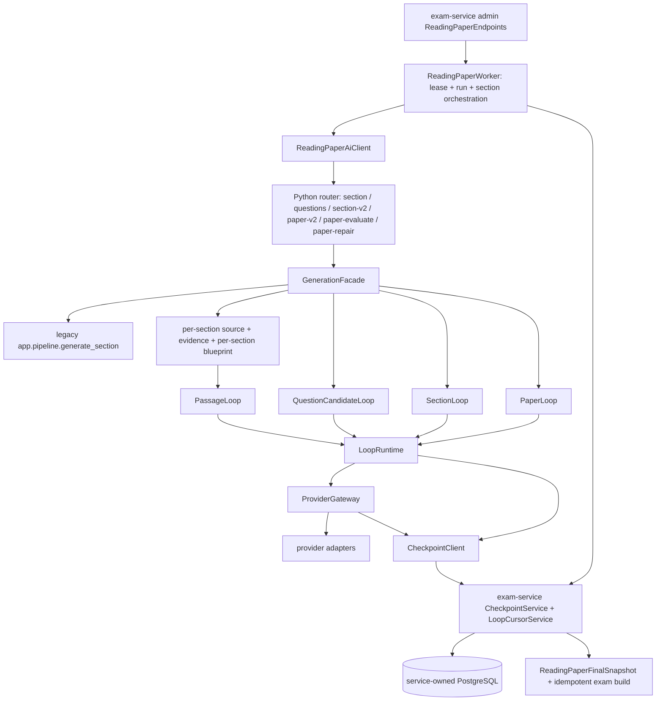
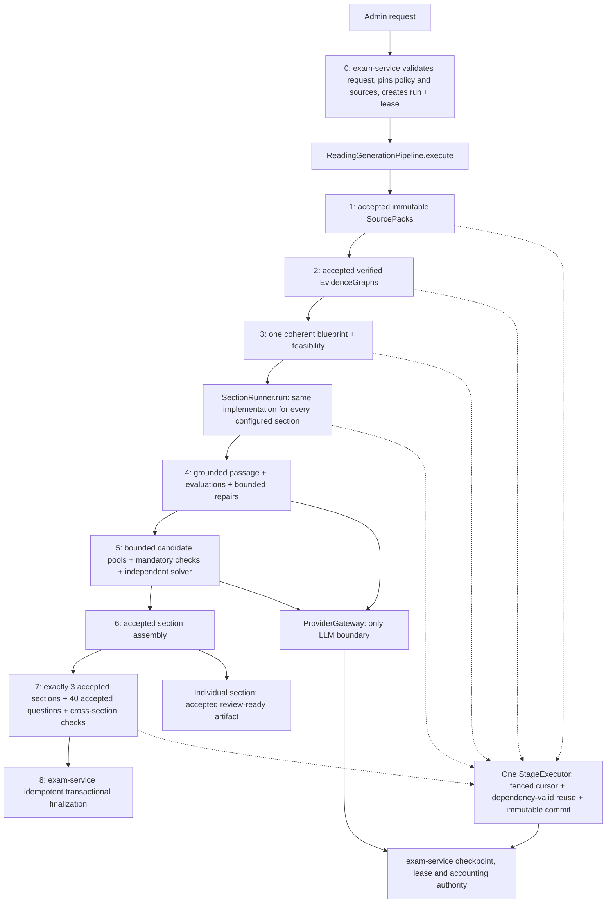

# Unified Reading generation rebuild

## Audit: pre-cutover execution graph

Observed authorities: `app/contracts/policies.py` fixed section allocations; `app/blueprint/policies.py`; `app/config.py`; `app/loop/policy.py`; loop-specific limits; `deploy/envs/loop-caps.env`; .NET `ReadingPaperCapsProfile`; worker-specific allocation/timeout decisions. Existing runtime contains benchmark-name/unlimited detection. These are not acceptable alternative execution modes for the replacement Reading pipeline.

Reusable primitives: immutable `ArtifactEnvelope` content+parent hashes; verified source ingestion/chunking; evidence extraction and validators; typed question contracts; existing deterministic/semantic checks; ProviderGateway physical transport and operation reconciliation; .NET transactional leases, cursor CAS, immutable accepted heads, final snapshot closure validation and idempotent database finalization. Research/grammar tooling is separate application functionality and must not be accidentally removed.

## Resulting ownership and graph (implementation contract)

Sequential and parallel execution change scheduling only. Agent workers execute bounded scopes through the same contracts; cursor CAS prevents conflicting same-stage writers. No stage accepts without successful required evaluations. UNKNOWN_OUTCOME provider operations halt dispatch until reconciled. Reservation liabilities are distinct from actual consumption; only physical provider attempts contribute token consumption.

## Preserved passages

- Section 2 source run `run_70d6a3b92ecf4f5ab61ac42cef20dd4c`: original report text SHA-256 `82888b94430f171753944aa2e3fdbc113154fe08a9dce3c948de659570b470c4`, 799 whitespace-delimited words. Existing `artifacts/continuation/art_passage_s2_v2.json` changes exactly `106:16:6.7` to `106:16:1` and no other passage text. Envelope integrity verified; content hash `63d5991ce36d7dba3b956f69fa49ed1401d8cbef18d1f09ac43e537030194e39`. Canonical regex word counting differs (854 original, 853 corrected) because punctuation/numerical tokenization; do not mistake that for regenerated prose.
- Section 3 source run `run_3345e89254e140e48f51c1a2e1e3ac11`: 748 canonical words, text SHA-256 `62d0e5c4fe055db7ca271b9c65d3a7275fd50b0ce2542d5d7e003aa4eea51fd3`, envelope content hash `e8fe102c8034f1ee672f1a177de3e99a578415527aaf77eb39cb9ecfc12904ad` verified.
- Existing source runs/artifact files are not modified. Import must authenticate exact source version/hash and accepted provenance; destination envelope hashes are recomputed after binding destination dependencies. History/accounting remains attached to original source run; import must not fabricate provider calls or charge it again.

## Working tree protection

Started on `autonomous-generation` at `3d929c6`. Pre-existing user changes: four modified generation/checkpoint files; deleted `.omp` resources; untracked backup/report/monitoring files. No blanket staging, reset or database cleanup. All implementation commits are selective; pre-existing `.omp` deletions and unrelated artifacts remain untouched.

## Verification plan

Deterministic mock provider only, through real ProviderGateway and actual pipeline. Cover S1/S2/S3 standalone, 40-question paper sequential/parallel, persisted resume without redispatch of accepted work, selective invalidation, crash recovery, lease expiration, same-scope CAS conflicts, different-scope concurrency, unknown provider outcomes, token isolation and finalization. PostgreSQL checks require a freshly created disposable container/database and fixture-specific connection guards; never run the existing full exam suite against hardcoded targets. No live MiniMax dispatch until mock E2E passes and user approves.

RED evidence: `python3 -m pytest tests/test_reading_policy.py -q` fails on missing `app.reading_policy`, establishing the absent unified contract before implementation.
